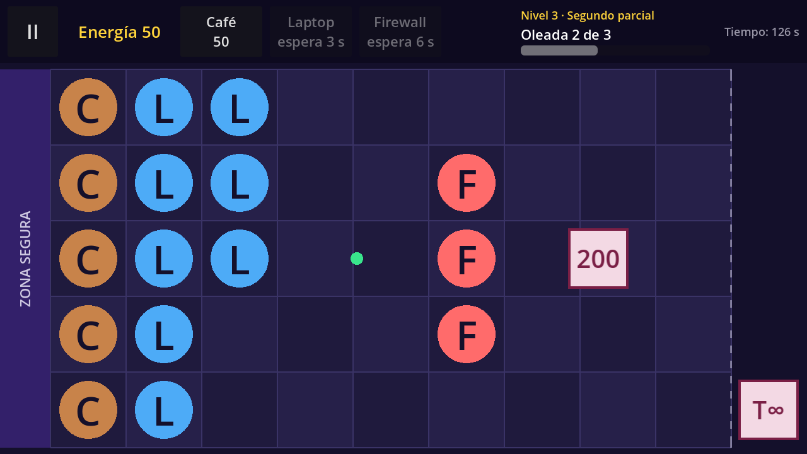

# Defensa ESCOM

A lane defense game for Android (and PC) with school humor from ESCOM (IPN), built with **Godot Engine 4.x** and **GDScript**.
The player places defenders (Café, Laptop, Firewall) on a 5×9 board to stop cartoon "teacher archetypes" before they reach the safe zone.

Course project for *Desarrollo de Aplicaciones Móviles Nativas* (group 7CV4, ESCOM-IPN).
Team: Cruz Villa Miguel Angel, Hernández Alonso Diego Raymundo, Martinez Martinez Carlos Daniel, Reyes Olascoaga Julio Cesar.

## Current version: v0.4 (Block 4: Data-driven levels and world flow)

What works now:

- **World 1 with levels 1 to 4**, described only as data (`LevelData` / `WorldData` Custom Resources) and played one after another without closing the app: *Inicio de semestre*, *Primer parcial*, *Segundo parcial* and *Tercer parcial*. Each level has its own starting energy, available defenders and waves.
- **Waves** read by `WaveManager`: each wave starts with a calm time, its enemies appear at the second, lane and type set in the level file, and the next wave starts only when the previous one has been cleared. The top bar shows the level name, **"Oleada X de Y"** and a bar with the progress of the current wave.
- **Victory panel** when every wave is defeated: *Siguiente nivel* and *Volver al inicio*. After the last level it shows **"¡Mundo 1 superado!"**.
- `ProgressRepository` (Autoload) remembers the current level while the app is open: *Jugar* continues from it, and *Reintentar* / *Reiniciar nivel* repeat it.
- Home screen with a **Play** button that opens the current level.
- A 5×9 board with a safe zone on the left. A tap or click is converted to a (lane, column) cell; the same code works with mouse on PC and touch on mobile.
- **Defender cards** in the top bar, created from the defenders of the level (Café 50, Laptop 100, Firewall 75): tap to select, tap again to cancel. Without enough energy a card is dimmed and shows "faltan X". After placing a defender its card recharges for a few seconds ("espera N s").
- **Placing defenders:** select a card, then tap a free cell. The defender appears there (shown as a letter: C, L, F), the cell is registered as occupied and its cost is subtracted.
- **Energy:** the level sets the starting energy (50 to 100). Each Café produces a "+25" energy orb every 10 s; tap it to collect it. Orbs nobody taps disappear after 8 s.
- **Enemies:** three archetypes from one single enemy scene: the basic *tarea infinita* (T∞), the fast *examen sorpresa* (!) and the tough *200 diapositivas* (200). They walk along their lane, stop at the first defender and bite it until it dies.
- **Combat:** the Laptop shoots only when an enemy is in its lane; hits are a simple distance check per lane. The Firewall holds enemies back thanks to its high health.
- If an enemy reaches the safe zone, the **Defeat panel** appears with *Reintentar* and *Volver al inicio*.
- **Notices** for invalid moves, without spending energy, and an **empty-board hint** at the start of the level.
- Pause menu (Resume, Restart level, Exit to home) using `get_tree().paused`; everything freezes while paused. The game pauses automatically when the app goes to the background, and the Android back button opens/closes the pause menu.

## Requirements

- Godot Engine 4.4 or newer (standard build, not .NET). Tested on Godot 4.7.
- For Android builds: Android export templates, OpenJDK 17 and the Android SDK configured in *Editor Settings → Export → Android*.

## How to run

1. Open Godot, choose **Import**, and select `project.godot`.
2. Press **F5** (Run Project). The game starts on the home screen.

## Project settings

| Setting | Value |
|---|---|
| Renderer | Compatibility (best support on low-end phones) |
| Base resolution | 1280×720, landscape |
| Stretch | `canvas_items`, aspect `keep` |
| Touch | *Emulate Mouse From Touch* enabled |
| Back button | `quit_on_go_back = false` (handled by the game) |

## Architecture

- **Nodes and scenes:** every screen and every game entity is a reusable scene.
- **Data separated from the engine:** each defender is a `DefenderType` Custom Resource (`data/defenders/*.tres`) with its name, cost, health, cooldown, image and the **behavior scene** it uses. Café, Laptop and Firewall are three files of the same type, not three different scripts. Each enemy is an `EnemyType` resource (`data/enemies/*.tres`) read by the single `enemy.tscn` scene. Each level is a `LevelData` resource (`data/worlds/levels/*.tres`) whose waves are `WaveData` lists of `SpawnEvent`s (second, lane, enemy type), and `world_1.tres` (`WorldData`) holds the ordered list of levels.
- **Progress:** the `ProgressRepository` Autoload is the only piece that knows which level is being played (in memory for now; saved to `user://` in Block 5). `Game` asks it for the current `LevelData` when the scene starts, and *Siguiente nivel* reloads the scene after it moves forward.
- **Behaviors by inheritance:** `Defender` (health, damage, death) is the base script; `GeneratorDefender`, `ShooterDefender` and `BlockerDefender` inherit from it.
- **Cell-based logic:** game logic works in board cells (lane, column, with decimals like column 6.4). Only `Board.cell_to_pixel()` / `Board.pixel_to_cell()` convert to and from screen pixels. `Board` also knows which cells are occupied. Enemy speed is in cells per second, and hits are distance checks in columns.
- **Signals:** nodes communicate through signals (`Board.cell_tapped`, `Hud.card_pressed`, `GeneratorDefender.orb_produced`, `EnergyOrb.collected`, `ShooterDefender.shot_fired`, `Enemy.reached_safe_zone`, `Defender.died`, `WaveManager.spawn_requested`, `WaveManager.all_waves_cleared`...). The `Game` node owns the energy and the phase of the match (playing, victory, defeat), applies the rules and connects everything.

### Adding a level (no scripts)

1. In the FileSystem dock, right-click `data/worlds/levels/` → *New Resource…* → `LevelData`.
2. In the Inspector, fill in `display_name` and `start_energy`, and drag the defenders from `data/defenders/` into `defenders`.
3. In `waves`, add a *New WaveData* with its `start_delay`, and inside `events` add one *New SpawnEvent* per enemy (`time`, `lane`, `enemy_type` from `data/enemies/`).
4. Add the new file to `levels` in `data/worlds/world_1.tres`, in the position where it should be played.

### Adding a defender with an existing behavior

1. In the FileSystem dock, right-click `data/defenders/` → *New Resource…* → `DefenderType`.
2. Fill in the fields in the Inspector and set `behavior_scene` to one of the scenes in `scenes/entities/`.
3. Add the new resource to the `defenders` list of the levels where it should be available. Its card appears automatically.

## Folder structure

```
res://
├── scenes/
│   ├── ui/          main_menu, hud, pause_menu, defender_card, notice, defeat_panel,
│   │                victory_panel (.tscn), ui_theme.tres
│   ├── game/        game.tscn, board.tscn
│   └── entities/    generator_defender, shooter_defender, blocker_defender, energy_orb,
│                    enemy, projectile (.tscn)
├── scripts/
│   ├── engine/      game.gd, board.gd, wave_manager.gd
│   ├── ui/          main_menu.gd, hud.gd, pause_menu.gd, defender_card.gd, notice.gd,
│   │                defeat_panel.gd, victory_panel.gd
│   ├── entities/    defender.gd, generator_defender.gd, shooter_defender.gd,
│   │                blocker_defender.gd, energy_orb.gd, enemy.gd, projectile.gd
│   ├── data/        defender_type.gd, enemy_type.gd, spawn_event.gd, wave_data.gd,
│   │                level_data.gd, world_data.gd
│   └── save/        progress_repository.gd (Autoload)
├── data/
│   ├── defenders/   cafe.tres, laptop.tres, firewall.tres
│   ├── enemies/     tarea_infinita.tres, examen_sorpresa.tres, diapositivas.tres
│   └── worlds/      world_1.tres, levels/level_1.tres … level_4.tres
├── art/             (Block 6)
└── docs/            technical notes and screenshots per block
```

## Screenshots



## Roadmap

| Block | Version | Content | Status |
|---|---|---|---|
| 1 | v0.1 | Foundations, 5×9 board, input, pause | ✅ Done |
| 2 | v0.2 | Defenders and energy economy | ✅ Done |
| 3 | v0.3 | Enemies and combat | ✅ Done |
| 4 | v0.4 | Data-driven levels and world flow | ✅ Done |
| 5 | v0.5 | Save system and error states | Pending |
| 6 | v1.0 | Final boss, art and polish | Pending |
