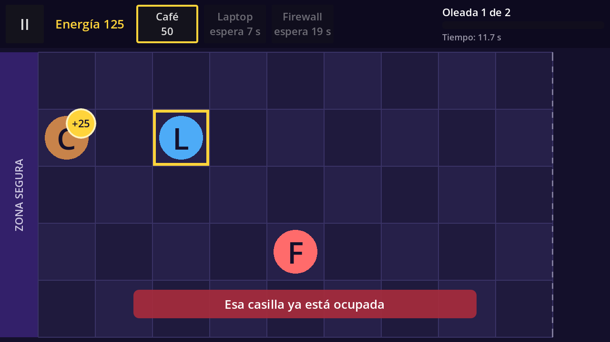

# Defensa ESCOM

A lane defense game for Android (and PC) with school humor from ESCOM (IPN), built with **Godot Engine 4.x** and **GDScript**.
The player places defenders (Café, Laptop, Firewall) on a 5×9 board to stop cartoon "teacher archetypes" before they reach the safe zone.

Course project for *Desarrollo de Aplicaciones Móviles Nativas* (group 7CV4, ESCOM-IPN).
Team: Cruz Villa Miguel Angel, Hernández Alonso Diego Raymundo, Martinez Martinez Carlos Daniel, Reyes Olascoaga Julio Cesar.

## Current version: v0.2 (Block 2: Defenders and energy economy)

What works now:

- Home screen with a **Play** button that opens the game scene.
- A 5×9 board with a safe zone on the left. A tap or click is converted to a (lane, column) cell; the same code works with mouse on PC and touch on mobile.
- **Defender cards** in the top bar (Café 50, Laptop 100, Firewall 75): tap to select, tap again to cancel. Without enough energy a card is dimmed and shows "faltan X". After placing a defender its card recharges for a few seconds ("espera N s").
- **Placing defenders:** select a card, then tap a free cell. The defender appears there (shown as a letter: C, L, F), the cell is registered as occupied and its cost is subtracted.
- **Energy:** the game starts with 50. Each Café produces a "+25" energy orb every 10 s; tap it to collect it. Orbs nobody taps disappear after 8 s.
- **Notices** for invalid moves, without spending energy: occupied cell, not enough energy, card still recharging, no card selected.
- **Empty-board hint** at the start of the level.
- Laptop and Firewall can already be placed, but they shoot and block from Block 3 on (there are no enemies yet).
- Pause menu (Resume, Restart level, Exit to home) using `get_tree().paused`; energy orbs, cooldowns and play time freeze while paused. The game pauses automatically when the app goes to the background, and the Android back button opens/closes the pause menu.

## Requirements

- Godot Engine 4.4 or newer (standard build, not .NET). Tested on Godot 4.7.
- For Android builds: Android export templates, OpenJDK 17 and the Android SDK configured in *Editor Settings → Export → Android*.

## How to run

1. Open Godot, choose **Import**, and select `project.godot`.
2. Press **F5** (Run Project). The game starts on the home screen.

## Project settings

| Setting | Value |
|---|---|
| Renderer | Compatibility (best support on low-end phones) |
| Base resolution | 1280×720, landscape |
| Stretch | `canvas_items`, aspect `keep` |
| Touch | *Emulate Mouse From Touch* enabled |
| Back button | `quit_on_go_back = false` (handled by the game) |

## Architecture

- **Nodes and scenes:** every screen and every game entity is a reusable scene.
- **Data separated from the engine:** each defender is a `DefenderType` Custom Resource (`data/defenders/*.tres`) with its name, cost, health, cooldown, image and the **behavior scene** it uses. Café, Laptop and Firewall are three files of the same type, not three different scripts. `EnemyType`, `LevelData` and `WorldData` come in Blocks 3 and 4.
- **Behaviors by inheritance:** `Defender` (health, damage, death) is the base script; `GeneratorDefender`, `ShooterDefender` and `BlockerDefender` inherit from it.
- **Cell-based logic:** game logic works in board cells (lane, column, with decimals like column 6.4). Only `Board.cell_to_pixel()` / `Board.pixel_to_cell()` convert to and from screen pixels. `Board` also knows which cells are occupied.
- **Signals:** nodes communicate through signals (`Board.cell_tapped`, `Hud.card_pressed`, `GeneratorDefender.orb_produced`, `EnergyOrb.collected`, `Defender.died`...). The `Game` node owns the energy, applies the rules and connects everything.

### Adding a defender with an existing behavior

1. In the FileSystem dock, right-click `data/defenders/` → *New Resource…* → `DefenderType`.
2. Fill in the fields in the Inspector and set `behavior_scene` to one of the scenes in `scenes/entities/`.
3. In `hud.tscn`, add an instance of `defender_card.tscn` inside `Cards` and assign the new resource to its `defender_type` (from Block 4 on, the cards come from the level data).

## Folder structure

```
res://
├── scenes/
│   ├── ui/          main_menu, hud, pause_menu, defender_card, notice (.tscn), ui_theme.tres
│   ├── game/        game.tscn, board.tscn
│   └── entities/    generator_defender, shooter_defender, blocker_defender, energy_orb (.tscn)
├── scripts/
│   ├── engine/      game.gd, board.gd
│   ├── ui/          main_menu.gd, hud.gd, pause_menu.gd, defender_card.gd, notice.gd
│   ├── entities/    defender.gd, generator_defender.gd, shooter_defender.gd,
│   │                blocker_defender.gd, energy_orb.gd
│   ├── data/        defender_type.gd
│   └── save/        (Block 4-5)
├── data/
│   ├── defenders/   cafe.tres, laptop.tres, firewall.tres
│   ├── enemies/     (Block 3)
│   └── worlds/      (Block 4)
├── art/             (Block 6)
└── docs/            technical notes and screenshots per block
```

## Screenshots



## Roadmap

| Block | Version | Content | Status |
|---|---|---|---|
| 1 | v0.1 | Foundations, 5×9 board, input, pause | ✅ Done |
| 2 | v0.2 | Defenders and energy economy | ✅ Done |
| 3 | v0.3 | Enemies and combat | Pending |
| 4 | v0.4 | Data-driven levels and world flow | Pending |
| 5 | v0.5 | Save system and error states | Pending |
| 6 | v1.0 | Final boss, art and polish | Pending |
