# Defensa ESCOM

A lane defense game for Android (and PC) with school humor from ESCOM (IPN), built with **Godot Engine 4.x** and **GDScript**.
The player places defenders (Café, Laptop, Firewall, USB, Calculadora científica, Router lento, Ctrl+Z) on a 5×9 board to stop cartoon "teacher archetypes" before they reach the school, and faces *El examen final* at the end of World 1 and *La Profesora del Proyecto Final* at the end of World 2.

Course project for *Desarrollo de Aplicaciones Móviles Nativas* (group 7CV4, ESCOM-IPN).
Team: Cruz Villa Miguel Angel, Hernández Alonso Diego Raymundo, Martinez Martinez Carlos Daniel, Reyes Olascoaga Julio Cesar.

## Current version: v1.6 (Block 12: World 1 with 6 levels and World 2)

Version 2.0 grows the game into a career of **8 semesters** (worlds) with 6 to 8 levels each, the Director as narrator, cut-out animation, IPN locations and a World 2. Block 12 makes the game **12 levels long** and proves that the content grows with data (see `docs/tech-note-v1.6.md`):

- **World 1 with 6 levels:** *Primer día* (the guided tutorial) is level 1 and the five 1.0 levels are levels 2–6. This was already done in v1.1 (with the save migration of the 1.0: old level N is now level N + 1); v1.6 keeps it and checks it again.
- **World 2, *Segundo semestre* (Biblioteca Central), fully playable:** *Inscripciones*, *La biblioteca a las 7 a. m.*, *Equipo de cuatro*, *Llegando tarde*, *Semana de entregas* and *El proyecto final*, with the Director's conversations of `docs/dialogues-world-2.md`. Every level, card, enemy and conversation is a `.tres` file.
- **4 new cards:** **USB** (cheap wall), **Calculadora científica** (shoots twice as fast, weaker shots), **Router lento** (its shots slow the enemy to half speed for 3 s, "lag") and **Ctrl+Z** (after 0.5 s it erases the enemies in a 3 × 3 area and disappears). Calculadora and Router are only `.tres` files of `ShooterDefender`; Ctrl+Z uses the new `InstantDefender`.
- **3 new enemies with abilities read from `EnemyType`:** **La Bibliografía** (a pile of books, `armor_health`, takes the damage first and falls), **El Proyecto en Equipo** (`split_into` / `split_count`: when it dies it splits into 2 *Tareas infinitas*, using the boss's summon signal) and **El Retardo** (`jumps_first_defender`: it jumps over the first defender it meets with a Tween).
- **Boss of World 2, *La Profesora del Proyecto Final*:** calls Proyectos en Equipo; at 50 % health she gets furious, speeds up (`phase2_speed_multiplier`) and calls Bibliografías (`phase2_summon_type`).
- **World 3 opens after World 2 and says *Próximamente*** on the career map (no padlock); worlds 4–8 stay locked.
- **Expediente:** 7 cards and 8 enemies, with descriptions and the new abilities in words.
- **Balance** checked with the fast and the slow bot of the 1.0 on the 12 levels (results in the tech note).
- **The art of the 8 new characters is placeholder** (drawn by `tools/art_src/make_world2_placeholders.py` in the style of the 1.0 and cut with the same pipeline) until the real art batches arrive.

Block 11 (v1.5) IPN locations and audio, still in place (see `docs/tech-note-v1.5.md`):

- **IPN locations:** World 1 is the plaza of **ESCOM** (the concrete block with its portal and flagpoles on the left, the cobblestone explanada as the 5 lanes, the guinda gate where the enemies come in). World 2 is the plaza of the **Biblioteca Central** (red scalloped roof, grooved pillars and staircase, terracotta plaza with cream stone strips, blue gate and four-globe lamps; playable in Block 12). Each background is assembled pixel-exact from separate art pieces by `tools/art_src/compose_backgrounds.py`.
- **Time of day:** `LevelData.time_of_day` tints the game world with a `CanvasModulate` (Scenery): morning in levels 1–2, afternoon in 3–5, night for the boss, when the lights of the scenery turn on (ESCOM's facade glows blue-violet, as the real one).
- **Living scenery:** `WorldData.scenery` adds up to 6 animated decorations and a foreground: pigeons that peck and fly across the screen, a cloud shadow, falling leaves, flying homework sheets and night lights.
- **Illustrated career map:** a grass field with a curved dirt road (`Curve2D`) and a thumbnail of the place of each semester (`WorldData.map_icon`).
- **Original music and effects**, made by the team with code (`tools/audio_src/make_audio.py`, chiptune with a soft bass): menu, World 1, World 2, boss, victory and defeat, with a crossfade between songs; place, collect, shoot, hit, bite, die, Extraordinario, button and the Director's "bip" voice. The volumes are in *Ajustes*.
- **Vibration** when a defender is lost, an Extraordinario runs or the boss arrives (if it is on in *Ajustes*).
- **One Theme for the whole UI** (`scenes/ui/ui_theme.tres`): the free font **Nunito** and guinda/gold buttons with a pressed state.

Block 10 (v1.4) cut-out animation and progressive damage, still in place:

- **Cut-out puppets:** each character has a scene in `scenes/visuals/` (a `CharacterVisual`: one `Sprite2D` per piece hanging from its pivot — hip, shoulder, laptop hinge — and an `AnimationPlayer` with fixed names: enemies `idle`/`walk`/`attack`/`hit`/`die`, defenders `idle`/`action`/`hit`/`die`). `DefenderType.visual_scene` / `EnemyType.visual_scene` choose it; a type without one keeps the fixed image of the 1.0.
- **Defenders:** the Café sways with steam and hops when it releases an orb; the Laptop has code running on its screen and recoils with a screen flash when it shoots; the Firewall's bricks breathe and it compresses when bitten. When they die, their pieces fall apart spinning.
- **Enemies:** walk with alternating legs and a bobbing body (`anim.speed_scale = speed / walk_base_speed`), lean in when they bite, fall backwards dropping paper bits. The 1.0 white hit flash is kept. Armored enemies (`armor_health`, from Block 12) drop their armor piece.
- **Damage in 3 stages:** above 66 % health intact, 66–33 % damaged, below 33 % critical; each stage changes the frame of every piece (strips of 3 frames), drops pieces and shakes harder, and the critical stage smokes. A bitten Firewall goes through the 3 stages and then falls apart (P09).
- **Effects:** projectile trail and impact bits; orbs that pop out with a bounce and fly to the energy counter before adding; the boss enters with a camera shake and changes phase at 50 % health (red, cracked, bigger, banner). All particle caps are in `FxLimits`; a 30-enemy benchmark is in the hidden debug panel.
- **Cutting pipeline:** `tools/cut_parts.py` cuts a character drawn in "vista desarmada" (pieces on green or magenta, 40 px apart, 3 sheets: intact, damaged, critical) into one 3-frame strip per piece in `art/characters/<character>/`. **The art of this version is placeholder** (cut from the 1.0 images, damage drawn by a script) until the real art batches arrive.
- **v1.3 fixes:** the tutorial no longer gets stuck when the only Café is erased, and its arrow is hidden under the pause menu.

Block 9 (v1.3) the Director, tutorial and Expediente, still in place:

- **A story with school humor:** every semester, the homework nobody delivered wakes up in the **Archivo Muerto** and marches to the classrooms. Her Mosso guides the player through World 1, a small mystery that ends with *El Examen Final* and a clue that leads to World 2.
- **The Director, Her Mosso:** a dialogue box (`DialogueBox`, a `CanvasLayer` that pauses the game while it talks) with his portrait in 6 expressions, typewriter text (tap to complete, tap to continue) and a *Saltar* button. He welcomes the player to the semester (`WorldData.intro_dialogue`), talks before the first wave (`LevelData.intro_dialogue`) and after the last one (`outro_dialogue`), and congratulates the player on *Semestre aprobado*. Each conversation is a `DialogueData` file in `data/dialogues/` and is shown **only once** (`[seen] dialogues`).
- **Presentations:** a line with `show_card` shows the big card under **"¡Nueva carta!"**; with `show_enemy`, the enemy under **"Nuevo en tu expediente"**. The Firewall is presented at the start of *Primer parcial* (it is the `reward_card` of *Inicio de semestre*).
- **Guided tutorial** in *Primer día* (`LevelData.is_tutorial`): an animated arrow and a speech bubble lead the player through choosing the Café, placing it, collecting an orb and placing a Laptop in the lane of the tasks. The waves start when the steps are done; replaying the level skips it.
- **Expediente** (Inicio → *Expediente*): tabs *Cartas* and *Enemigos*, built from the levels of `campaign.tres`. What the player has not met yet is a black silhouette (*???*); a tap shows the file with the picture, description and stats in words. Known cards and enemies are saved in `[seen] cards` / `enemies`.
- **World 2 scripts** for Block 12 in `docs/dialogues-world-2.md`.

Block 8 (v1.2) career map, levels and grades, still in place:

- **New flow:** Inicio (*Jugar*/*Continuar*, *Expediente*, *Ajustes*, *Créditos*) → **Mapa de la carrera** → **Selección de nivel** → game → Victory → *Siguiente nivel* or *Selección de nivel*. Pause and Defeat exit to the level select. The Android back button goes back one screen everywhere and asks "¿Salir del juego?" on Inicio.
- **Career map:** the 8 semesters in a horizontal scroll joined by a path, built in code from `data/campaign.tres`: locked (padlock, *Próximamente* for unavailable worlds), available (pulses) or passed (shows the average). A world opens when the last level of the previous one is won.
- **Level select:** a 4 × 2 grid with the levels of the world (number, name, best grade or padlock). Tapping something locked says why.
- **Extraordinarios** (levels 2–6 of World 1, `LevelData.use_extraordinarios`): one per lane. The first enemy that reaches the school in a lane makes it run along the lane removing every enemy; the second one is a defeat.
- **Grade 6–10:** 10 minus one point per Extraordinario used. Shown with a stamp on Victory, saved only if better, shown on the level button; **Semestre aprobado** shows the average of the world (the progress is no longer reset after the last level).
- **Dar de baja:** eraser button in the top bar; tap a defender to remove it (no energy back).
- **Top bar for up to 6 cards** (compact top row; the left side stays free for the Extraordinarios).
- **Ajustes:** music and effects sliders (buses `Music` / `SFX`), vibration, *Borrar progreso* with confirmation, *Créditos*. Saved in `user://progress.cfg`.
- **Save format v3:** 1.0 and v1.1 saves are migrated; a player who finished World 1 in the 1.0 sees it as passed, and the levels won in the 1.0 get grade 6 (the 1.0 had no grades).

Block 7 (v1.1) foundations, still in place:

- **Campaign data:** `data/campaign.tres` (`CampaignData`) lists the 8 worlds in order. World 1 is **Primer semestre** (ESCOM) with **6 levels**: the new short level **Primer día** (future tutorial) and the five 1.0 levels. Worlds 2–8 already exist as `WorldData` files marked "Próximamente" (`available = false`).
- **Extended resources** with defaults that reproduce the 1.0: `WorldData`, `LevelData`, `DefenderType` and `EnemyType` gained the fields the next blocks need, and `DialogueData` / `DialogueLine` were added for the Director.
- **GameSession** Autoload: remembers the chosen world and level; Game, the loading screen and the home screen ask it what to play.
- **Save format** (`user://progress.cfg`, v2 in Block 7, v3 now): unlocked level, "Continuar" level, best grade per level, dialogues seen and settings. Older saves are **migrated automatically** and the progress is kept.
- **SceneTransition** Autoload: every screen change fades to black and back.
- **AudioManager** Autoload with the `Music` and `SFX` buses (sounds arrive in Block 11).
- **Android:** the back button pauses in a level and asks **"¿Salir del juego?"** on the home screen; minimizing pauses and saves; the screen stays on while playing; the top bar respects the notch.

Everything from v1.0 still works:

- **Final art** for every defender, enemy, the boss, the energy orb, the projectile, the game board background, the home screen, the logo and the app icon. Each image lives in its `DefenderType` / `EnemyType` resource; a resource without an image is drawn as a letter placeholder.
- **Final boss *El examen final*:** one more `EnemyType` file using the same enemy scene, drawn bigger, with 3000 health; every 10 s it summons two *Examen sorpresa* in the lanes above and below it. A **boss health bar** appears while it is alive. Defeating it completes the semester (**"¡Primer semestre aprobado!"** screen since v1.2).
- **Wave warnings** ("¡Se acerca una oleada!"), **visual feedback** (hit flash, shake, sway, floating orbs, sparks), **loading screen**, **save error notice** with *Reintentar* / *Ahora no*, and the **hidden debug option** (tap the logo 5 times, debug builds only).
- **Waves**, **defender cards** (Café 50, Laptop 100, Firewall 75), **energy orbs**, **three enemy archetypes**, **Victory**, **Defeat** and **Pause** panels, as in v1.0.

## Requirements

- Godot Engine 4.4 or newer (standard build, not .NET). Tested on Godot 4.7.
- For Android builds: Android export templates, OpenJDK 17 and the Android SDK configured in *Editor Settings → Export → Android*.

## How to run

1. Open Godot, choose **Import**, and select `project.godot`.
2. Press **F5** (Run Project). The game starts on the home screen.

## Project settings

| Setting | Value |
|---|---|
| Renderer | Compatibility (best support on low-end phones) |
| Base resolution | 1280×720, landscape |
| Stretch | `canvas_items`, aspect `keep` |
| Touch | *Emulate Mouse From Touch* enabled |
| Back button | `quit_on_go_back = false` (handled by the game) |
| Version | `application/config/version = "1.6"` (shown on the home screen). Android preset (not in the repo): version/name `1.6`, version/code `7`, permission *Vibrate* |
| Screen | `keep_screen_on = false`; the game screen keeps it on while playing |
| Audio buses | `default_bus_layout.tres`: `Music` and `SFX` |
| Autoloads | `GameSession`, `ProgressRepository`, `AudioManager`, `SceneTransition` (in this order) |
| Icon | `art/icon/icon.png` |

## Architecture

- **Nodes and scenes:** every screen and every game entity is a reusable scene.
- **Data separated from the engine:** each defender is a `DefenderType` Custom Resource (`data/defenders/*.tres`) with its name, cost, health, cooldown, image and the **behavior scene** it uses. Each enemy is an `EnemyType` resource (`data/enemies/*.tres`) read by the single `enemy.tscn` scene; the boss is one more `EnemyType` with `is_boss`, a bigger `sprite_size` and a summon ability. Each level is a `LevelData` resource (`data/worlds/world_N/levels/*.tres`, with a unique `id` such as `w1_l3`) whose waves are `WaveData` lists of `SpawnEvent`s. Each world is a `WorldData` (`data/worlds/world_N/world_N.tres`) with its ordered levels, and `data/campaign.tres` (`CampaignData`) holds the 8 worlds in order.
- **Session and progress:** the `GameSession` Autoload knows which world and level are being played, which worlds and levels are open and how a level is graded. The `ProgressRepository` Autoload is the only one that reads and writes in `user://` (save format v3, migration from 1.0 and v1.1).
- **Screens built from data:** the career map creates one `SemesterButton` per `WorldData` of the campaign and the level select one `LevelButton` per `LevelData` of the world, so new worlds and levels appear without touching scripts.
- **Screens and sound:** the `SceneTransition` Autoload makes every scene change (fade with a Tween). The `AudioManager` Autoload owns two music players (crossfade) and the effect players on the `Music` and `SFX` buses; every button clicks through `SceneTree.node_added`.
- **Scenery as data:** a world points to its background, music, map thumbnail and decorations scene (`WorldData`); a level only chooses its `time_of_day`. `Scenery` (in `game.tscn`) applies them; decorations are small reusable scripts (`Pigeon`, drifter, sway) driven by Tweens.
- **Behaviors by inheritance:** `Defender` (health, damage, shake, death) is the base script; `GeneratorDefender`, `ShooterDefender`, `BlockerDefender` and `InstantDefender` (Block 12) inherit from it. Every number of a behavior (fire interval, damage, slow-down, area) comes from the `DefenderType`, so a new card with an existing behavior is only a `.tres` file.
- **Cell-based logic:** game logic works in board cells (lane, column, with decimals like column 6.4). Only `Board.cell_to_pixel()` / `Board.pixel_to_cell()` convert to and from screen pixels. Enemy speed is in cells per second, and hits are distance checks in columns.
- **Signals:** nodes communicate through signals (`Board.cell_tapped`, `Hud.card_pressed`, `GeneratorDefender.orb_produced`, `EnergyOrb.collected`, `ShooterDefender.shot_fired`, `Enemy.reached_safe_zone`, `Enemy.damaged`, `Enemy.summon_requested`, `Defender.died`, `WaveManager.spawn_requested`, `WaveManager.wave_warning`, `WaveManager.all_waves_cleared`...). The `Game` node owns the energy and the phase of the match, applies the rules and creates every enemy, including the boss's summons.
- **Story as data:** a conversation is a `DialogueData` with `DialogueLine`s (speaker, expression, text, optional card or enemy to present). Worlds and levels point to their conversations; `DialogueBox.play_once()` shows each one once. The tutorial is a list of steps in `tutorial.gd` that waits for Game signals (`card_selected`, `defender_placed`, `orb_collected`).
- **Effects:** animations are Tweens created by each node (`create_tween()`) or the `AnimationPlayer` of a puppet, so they stop with the pause. Sparks, paper bits and falling pieces are one-shot `CPUParticles2D` (`SparkBurst`) added to the `Effects` node of the game scene, capped by `FxLimits`. A dead enemy or defender is freed at once; only its puppet moves to `Effects` to play the death.
- **Puppets:** `CharacterVisual` (`scripts/entities/character_visual.gd`) is the base of every `scenes/visuals/*_visual.tscn`. Enemy and Defender instance `type.visual_scene` inside their `Visual` node and only call `play()`, `play_once()`, `set_damage_stage()` and `die()`.

### Adding a level (no scripts)

1. In the FileSystem dock, right-click `data/worlds/world_N/levels/` → *New Resource…* → `LevelData`.
2. In the Inspector, fill in a unique `id` (for example `w1_l7`), `display_name` and `start_energy`, drag the defenders from `data/defenders/` into `defenders` (6 at most: the limit of the card bar) and turn on `use_extraordinarios` if the lanes should have them.
3. In `waves`, add a *New WaveData* with its `start_delay` (and `warning_text` if it needs a special warning), and inside `events` add one *New SpawnEvent* per enemy (`time`, `lane`, `enemy_type` from `data/enemies/`).
4. Add the new file to `levels` in `data/worlds/world_N/world_N.tres`, in the position where it should be played. It appears in the level select of that world.

### Adding a world (no scripts)

1. Create `data/worlds/world_N/world_N.tres` (*New Resource…* → `WorldData`) with a unique `id` (`world_N`), `display_name`, `semester`, `location_name` and `available = true`. In *Look and sound*, set its `background` (2560 × 1440), `music`, `scenery` (a scene like `scenes/scenery/escom_scenery.tscn`) and, in *Career map*, its `map_icon`.
2. Create its levels as above and add them to its `levels`.
3. Add the world to `worlds` in `data/campaign.tres`, in its position (worlds 2–8 are already there as "Próximamente").

### Adding a defender with an existing behavior

1. In the FileSystem dock, right-click `data/defenders/` → *New Resource…* → `DefenderType`.
2. Fill in the fields in the Inspector, set `behavior_scene` to one of the scenes in `scenes/entities/` and, optionally, a `texture`.
3. Add the new resource to the `defenders` list of the levels where it should be available. Its card appears automatically.

Examples: `data/defenders/usb.tres` (*USB*, a cheap wall: `BlockerDefender`), `calculadora.tres` (`ShooterDefender` with `fire_interval` 0.75 and `projectile_damage` 12) and `router.tres` (`ShooterDefender` with `slow_factor` 0.5 and `slow_time` 3) were made this way without writing any script. The top bar fits up to 6 cards (with 4 or more they switch to a compact size).

### Adding a conversation of the Director (no scripts)

1. Right-click `data/dialogues/` → *New Resource…* → `DialogueData`. Give it a unique `id` (for example `w1_l4_outro`).
2. In `lines`, add one *New DialogueLine* per line: `expression`, `text` and, if the line presents something, `show_card` (a `DefenderType`) or `show_enemy` (an `EnemyType`). `speaker` is "Her Mosso" by default.
3. Drag the file to `intro_dialogue` / `outro_dialogue` of a `LevelData` or a `WorldData`.

### Adding an enemy or a boss

Create an `EnemyType` in `data/enemies/` with its health, speed, damage and texture. Its abilities are fields of the group *Abilities*: `armor_health` (spent before the health), `split_into` + `split_count` (enemies that appear where it dies), `jumps_first_defender`. For a boss, enable `is_boss` (health bar), raise `sprite_size` and choose a `summon_type` and `summon_interval`; for a phase 2 at 50 % health, set `phase2_speed_multiplier`, `phase2_summon_type` and `phase2_text`. Then use it in the `SpawnEvent`s of a level.

### Animating a character (cut-out puppet)

1. Put its three "vista desarmada" sheets (`intacto.png`, `danado.png`, `critico.png`, pieces on green `#00FF00` or magenta `#FF00FF`, 40 px apart) and a `parts.txt` with the piece names in `tools/art_src/<character>/`.
2. `pip install pillow`, then `python tools/cut_parts.py tools/art_src/<character> --scale 0.25` → `art/characters/<character>/<piece>.png` (3 frames each).
3. Duplicate a scene of `scenes/visuals/` with a similar body, replace the textures of its pieces, move each piece to its pivot and set `design_width`. Keep the animation names.
4. Drag the scene to `visual_scene` of the `DefenderType` / `EnemyType`. Without it, the type keeps its fixed image.

## Folder structure

```
res://
├── art/
│   ├── defenders/   cafe, laptop, firewall; usb, calculadora, router, ctrl_z (placeholder) (.png)
│   ├── enemies/     tarea_infinita, examen_sorpresa, diapositivas, examen_final;
│   │                bibliografia, proyecto_equipo, retardo, profesora (placeholder) (.png)
│   ├── items/       energy_orb, projectile (.png)
│   ├── fx/          spark.png, puff.png, chip.png
│   ├── characters/  part strips of the puppets, 3 frames each (placeholder in v1.4):
│   │                cafe/, laptop/, firewall/, tarea_infinita/, examen_sorpresa/,
│   │                diapositivas/, examen_final/, usb/, calculadora/, router/, ctrl_z/,
│   │                bibliografia/, proyecto_equipo/, retardo/, profesora/
│   ├── backgrounds/ escom_bg.jpg (World 1), biblioteca_bg.jpg (World 2), game_bg.jpg (1.0), menu_bg.jpg
│   ├── scenery/     pigeon_stand, pigeon_fly, leaf, paper, cloud_shadow, glow, window_light,
│   │                foreground_branch (.png, placeholder)
│   ├── map/         map_ground.png and place_1 … place_8.png (thumbnails, placeholder)
│   ├── fonts/       Nunito-Bold.ttf + OFL.txt (SIL Open Font License)
│   ├── icon/        icon.png
│   ├── director/    the Director in 6 expressions: normal, feliz, serio, sorprendido,
│   │                preocupado, orgulloso (.png)
│   └── ui/          logo.png; placeholders of v1.2: semester_locked/available/passed, padlock,
│                    grade_stamp, extraordinario, eraser (.png)
├── scenes/
│   ├── ui/          main_menu, career_map, level_select, world_complete, settings, credits,
│   │                expediente, dialogue_box, tutorial_pointer,
│   │                loading_screen, hud, pause_menu, defender_card, notice,
│   │                defeat_panel, victory_panel, save_error_panel (.tscn), ui_theme.tres
│   ├── game/        game.tscn, board.tscn, extraordinario.tscn, tutorial.tscn
│   ├── entities/    generator_defender, shooter_defender, blocker_defender, instant_defender, energy_orb,
│   │                enemy, projectile (.tscn)
│   ├── visuals/     the cut-out puppets: cafe_visual, laptop_visual, firewall_visual,
│   │                tarea_infinita_visual, examen_sorpresa_visual, diapositivas_visual,
│   │                examen_final_visual, usb_visual, calculadora_visual, router_visual,
│   │                ctrl_z_visual, bibliografia_visual, proyecto_equipo_visual,
│   │                retardo_visual, profesora_visual (.tscn)
│   ├── scenery/     escom_scenery.tscn, biblioteca_scenery.tscn (decorations of each world)
│   ├── debug/       benchmark.tscn (30 enemies)
│   └── fx/          spark_burst.tscn
├── scripts/
│   ├── engine/      game.gd, board.gd, wave_manager.gd, extraordinario.gd, tutorial.gd, scenery.gd
│   ├── scenery/     pigeon.gd, drifter.gd, sway.gd (decorations)
│   ├── ui/          main_menu.gd, career_map.gd, semester_button.gd, level_select.gd,
│   │                expediente.gd, dialogue_box.gd, tutorial_pointer.gd,
│   │                level_button.gd, world_complete.gd, settings.gd, credits.gd,
│   │                loading_screen.gd, hud.gd, pause_menu.gd, defender_card.gd,
│   │                notice.gd, defeat_panel.gd, victory_panel.gd, save_error_panel.gd
│   ├── entities/    defender.gd, generator_defender.gd, shooter_defender.gd,
│   │                blocker_defender.gd, instant_defender.gd, energy_orb.gd, enemy.gd, projectile.gd,
│   │                character_visual.gd
│   ├── visuals/     code_screen.gd
│   ├── debug/       benchmark.gd
│   ├── fx/          spark_burst.gd, fx_limits.gd
│   ├── autoload/    game_session.gd, audio_manager.gd, scene_transition.gd
│   ├── data/        defender_type.gd, enemy_type.gd, spawn_event.gd, wave_data.gd,
│   │                level_data.gd, world_data.gd, campaign_data.gd,
│   │                dialogue_data.gd, dialogue_line.gd
│   └── save/        progress_repository.gd (Autoload)
├── data/
│   ├── defenders/   cafe, laptop, firewall, usb, calculadora, router, ctrl_z (.tres)
│   ├── enemies/     tarea_infinita, examen_sorpresa, diapositivas, examen_final,
│   │                bibliografia, proyecto_equipo, retardo, profesora (.tres)
│   ├── campaign.tres  the 8 worlds in order
│   ├── dialogues/   conversations of the Director: w1_intro … w1_outro, w2_intro … w2_outro (.tres)
│   └── worlds/      world_1/ and world_2/ (world_N.tres, levels/wN_l1.tres … wN_l6.tres), world_3/ … world_8/
├── audio/
│   ├── music/       menu, world_1, world_2, boss, victory, defeat (.ogg)
│   └── sfx/         place, collect, shoot, hit, bite, die, extraordinario, button, director_bip (.wav)
├── default_bus_layout.tres  audio buses Music and SFX
├── tools/           cut_parts.py (cutting pipeline), make_placeholder_sheets.py,
│                    art_src/ (source sheets, make_world2_placeholders.py, escom/ and biblioteca/ background pieces,
│                    compose_backgrounds.py, make_scenery_placeholders.py),
│                    audio_src/make_audio.py (.gdignore: not imported by Godot)
└── docs/            technical notes and screenshots per block (.gdignore: not imported by Godot)
```

## Screenshots


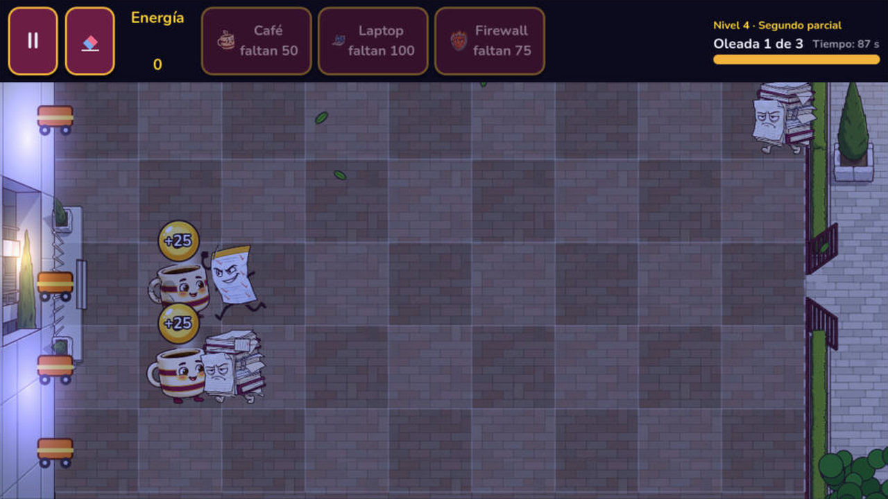
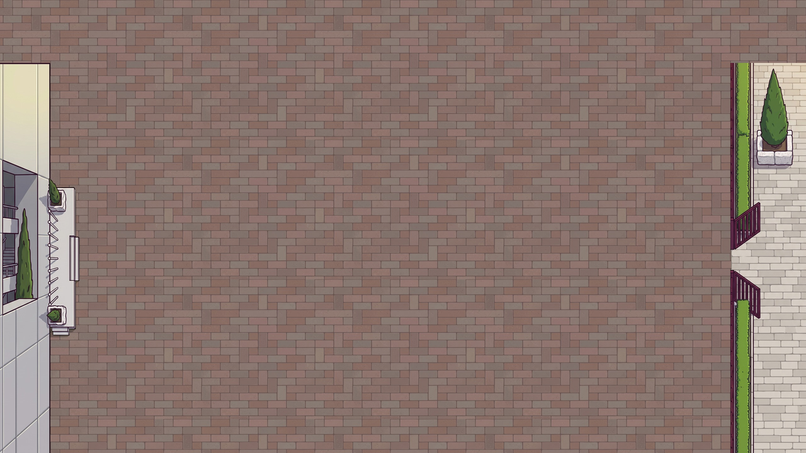
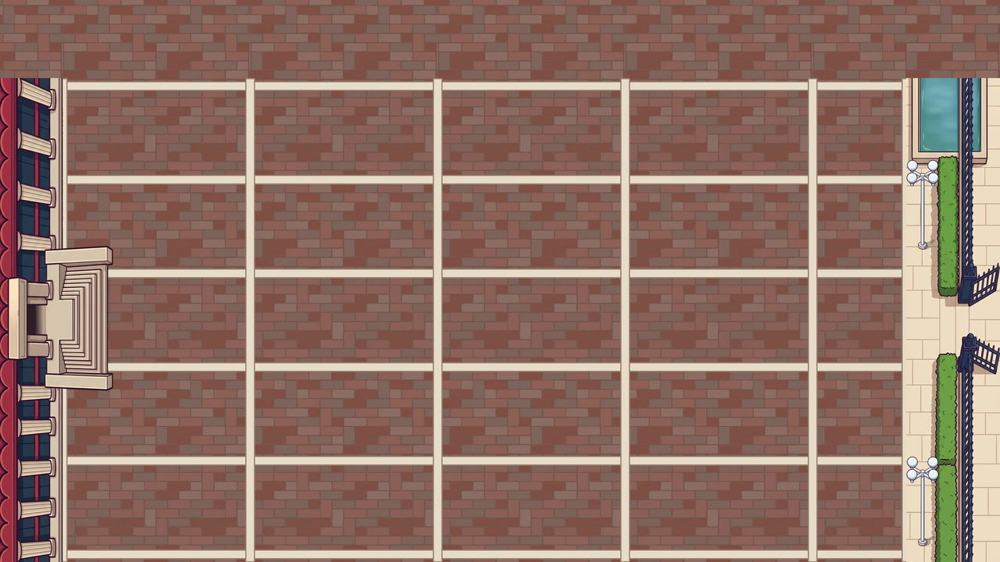
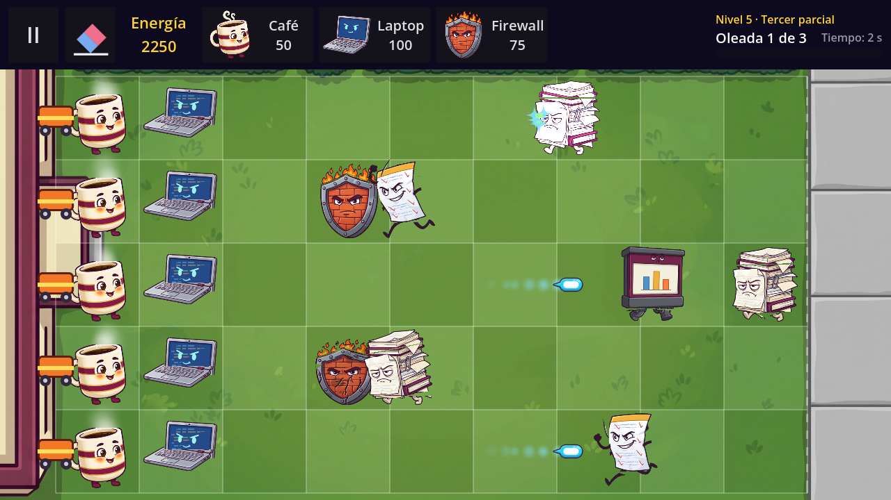
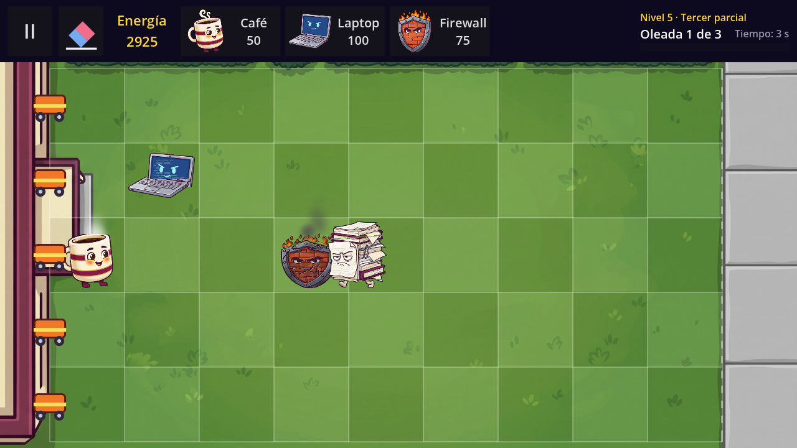
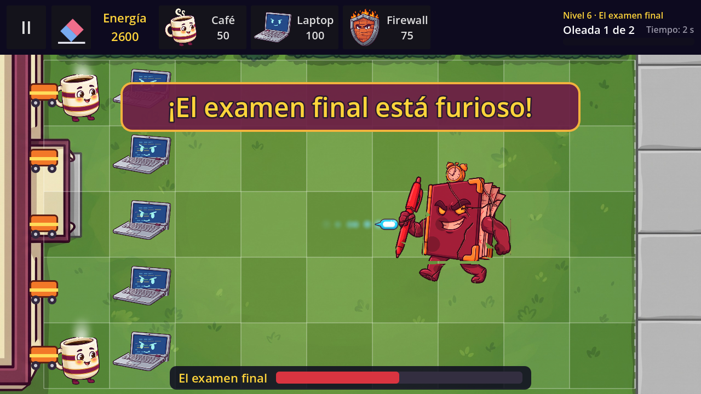


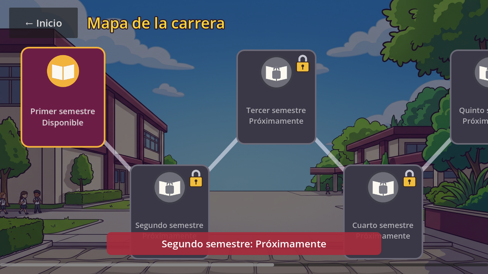
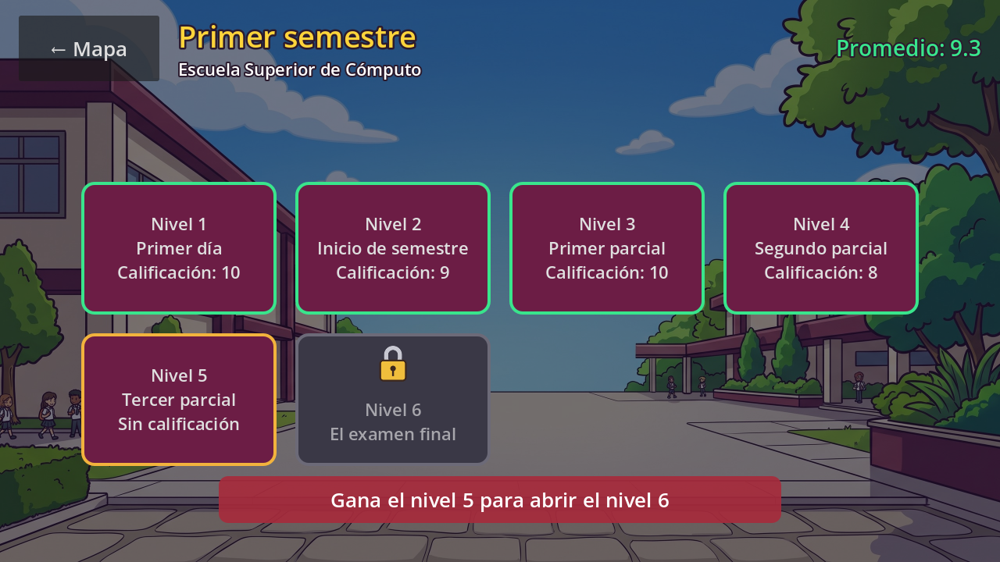
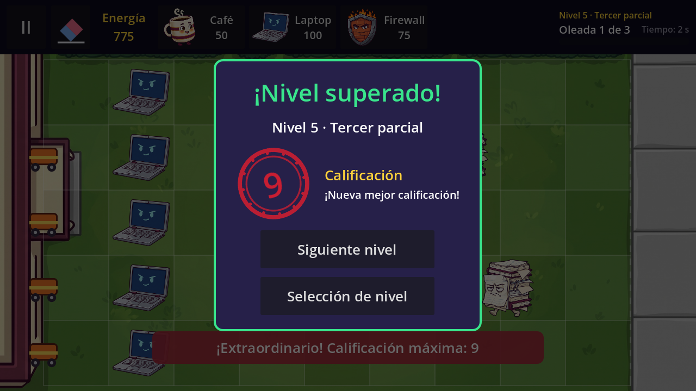
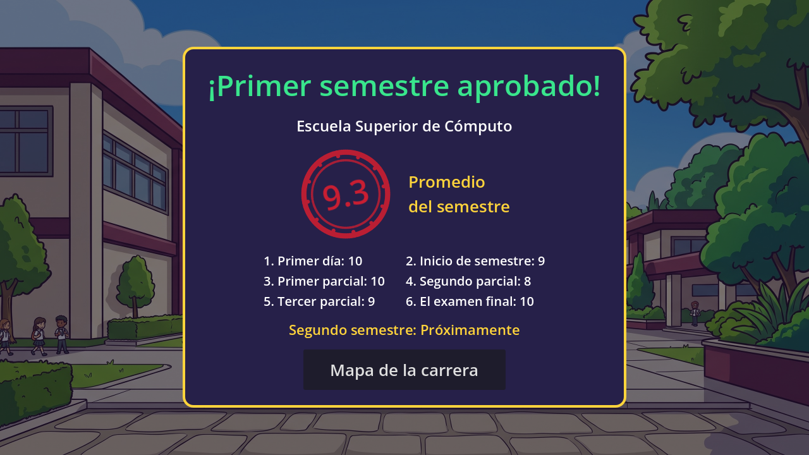
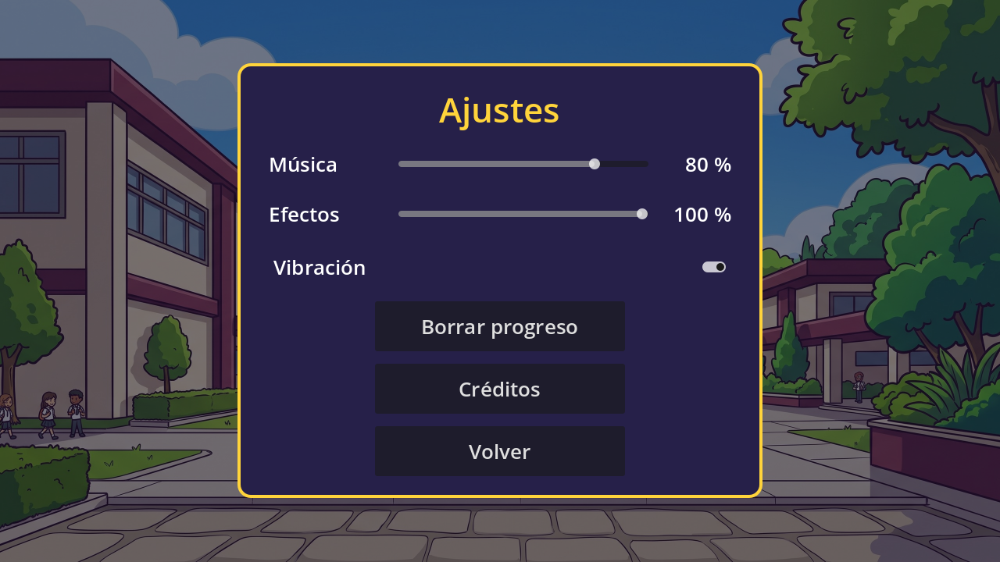

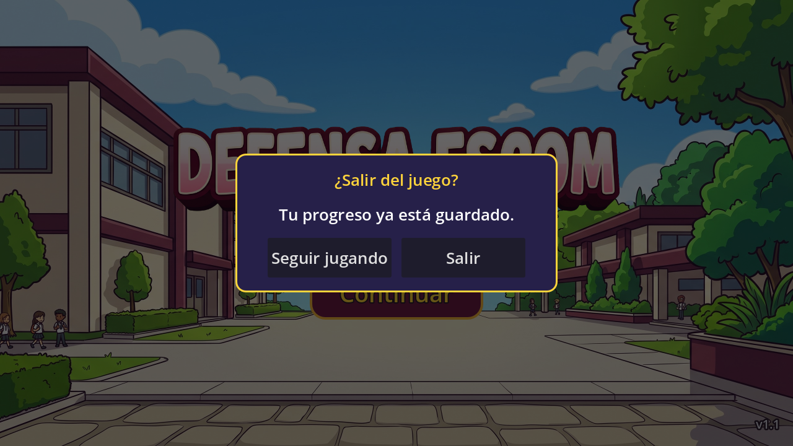


## Roadmap

| Block | Version | Content | Status |
|---|---|---|---|
| 1 | v0.1 | Foundations, 5×9 board, input, pause | ✅ Done |
| 2 | v0.2 | Defenders and energy economy | ✅ Done |
| 3 | v0.3 | Enemies and combat | ✅ Done |
| 4 | v0.4 | Data-driven levels and world flow | ✅ Done |
| 5 | v0.5 | Save system and error states | ✅ Done |
| 5 | v0.5.1 | Review fixes for Block 5 | ✅ Done |
| 6 | v1.0 | Final boss, art and polish | ✅ Done |
| 7 | v1.1 | Foundations 2.0: campaign data, save v2, transitions, audio buses, Android behavior | ✅ Done |
| 8 | v1.2 | Career map, level select, grades, Extraordinarios, settings | ✅ Done (placeholder art) |
| 9 | v1.3 | The Director: dialogues, tutorial, Expediente | ✅ Done |
| 10 | v1.4 | Cut-out animation and 3-stage damage | ✅ Done (placeholder art; 50 fps test on a phone pending) |
| 11 | v1.5 | IPN locations and audio | ✅ Done (backgrounds final; decorations and map thumbnails placeholder) |
| 12 | v1.6 | World 1 with 6 levels and World 2 | ✅ Done (placeholder art for the 8 new characters) |
| 13 | v2.0 | Final polish and delivery | Planned |
