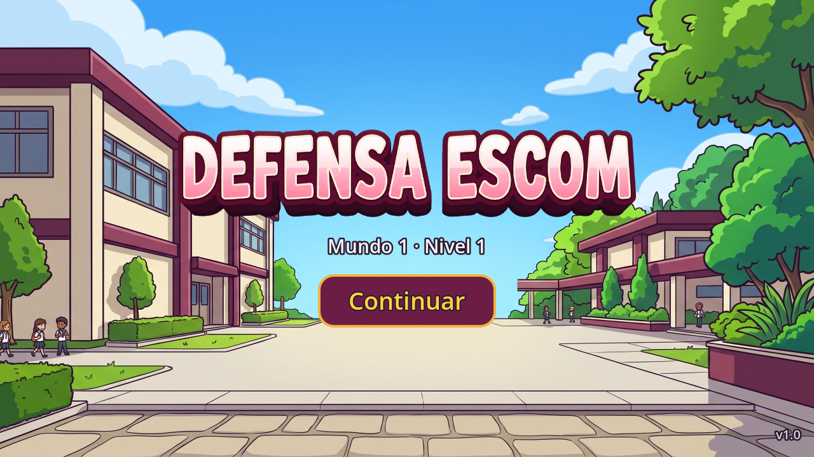
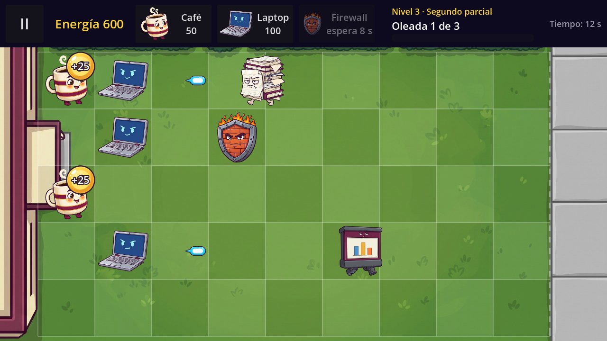
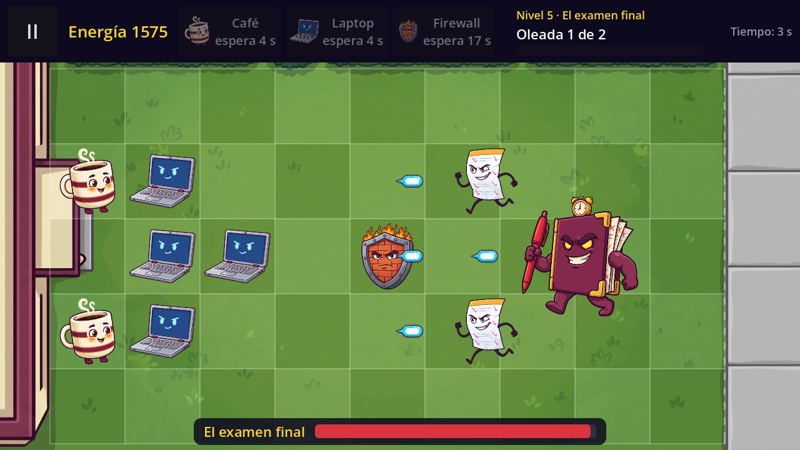

# Defensa ESCOM

A lane defense game for Android (and PC) with school humor from ESCOM (IPN), built with **Godot Engine 4.x** and **GDScript**.
The player places defenders (Café, Laptop, Firewall) on a 5×9 board to stop cartoon "teacher archetypes" before they reach the school, and faces the final boss *El examen final* at the end of World 1.

Course project for *Desarrollo de Aplicaciones Móviles Nativas* (group 7CV4, ESCOM-IPN).
Team: Cruz Villa Miguel Angel, Hernández Alonso Diego Raymundo, Martinez Martinez Carlos Daniel, Reyes Olascoaga Julio Cesar.

## Current version: v1.0 (Block 6: Final boss, art and polish)

World 1 is complete: five levels from *Inicio de semestre* to *El examen final*, with the final art, wave warnings, visual feedback and a first balance pass (see `docs/tech-note-v1.0.md`).

What works now:

- **Final art** for every defender, enemy, the boss, the energy orb, the projectile, the game board background, the home screen, the logo and the app icon. Each image lives in its `DefenderType` / `EnemyType` resource; a resource without an image is drawn as a letter placeholder.
- **World 1 with five levels**, described only as data (`LevelData` / `WorldData` Custom Resources) and played one after another: *Inicio de semestre*, *Primer parcial*, *Segundo parcial*, *Tercer parcial* and **El examen final**.
- **Final boss *El examen final*:** one more `EnemyType` file using the same enemy scene, drawn bigger, with 3000 health and one special ability defined in its resource: every 10 s it summons two *Examen sorpresa* in the lanes above and below it, at its own column. A **boss health bar** (`ProgressBar`) appears at the bottom of the screen while it is alive. Defeating it (and its summons) shows **"¡Mundo 1 superado!"**.
- **Wave warnings:** two seconds before each wave a big banner says **"¡Se acerca una oleada!"**; before the boss it says **"¡Llegó El examen final!"**. The text is a field of each wave (`WaveData.warning_text`).
- **Visual feedback with Tween and particles:** enemies flash white for 0.1 s when hit, defenders shake while they are bitten, enemies sway while they walk (and stand still while they bite), energy orbs float, projectile hits make small blue sparks and defeated enemies burst into gold sparks.
- **The progress is saved** in `user://progress.cfg` (`ConfigFile`) every time a level is won, and survives closing the app. The home screen shows it (**"Mundo 1 · Nivel 3"**) and its button changes from *Jugar* to **Continuar**.
- **Loading screen** every time a level is entered; invalid level data shows an error with *Volver al inicio* instead of crashing.
- **Save error notice** "No se pudo guardar tu progreso" with *Reintentar* and *Ahora no*. **Missing or damaged save file:** the game starts from level 1 and says so.
- **Hidden debug option** (debug builds only): tap the logo on the home screen 5 times to open a panel that deletes the progress or simulates a save failure.
- **Waves** read by `WaveManager`: a calm time, then each enemy at the second, lane and type set in the level file; the next wave starts only when the previous one has been cleared. The top bar shows the level name, **"Oleada X de Y"** and the progress of the current wave.
- **Defender cards** with the defender image (Café 50, Laptop 100, Firewall 75): tap to select, tap again to cancel; dimmed with "faltan X" without enough energy, and "espera N s" while recharging.
- **Energy:** each level sets the starting energy (50 to 200). Each Café produces a "+25" orb every 10 s; tap it to collect it. Orbs nobody taps disappear after 8 s.
- **Enemies:** three archetypes from one single enemy scene (*tarea infinita*, *examen sorpresa*, *200 diapositivas*) plus the boss. They walk along their lane, stop at the first defender and bite it until it dies. The Laptop shoots only when an enemy is in its lane; hits are a simple distance check per lane.
- **Victory panel** (*Siguiente nivel*, *Volver al inicio*) and **Defeat panel** (*Reintentar*, *Volver al inicio*) when an enemy reaches the school.
- **Pause menu** (Resume, Restart level, Exit to home) using `get_tree().paused`; everything freezes while paused, including Tweens and particles. The game pauses automatically when the app goes to the background, and the Android back button opens/closes the pause menu (on the Victory and Defeat panels it returns to the home screen).

## Requirements

- Godot Engine 4.4 or newer (standard build, not .NET). Tested on Godot 4.7.
- For Android builds: Android export templates, OpenJDK 17 and the Android SDK configured in *Editor Settings → Export → Android*.

## How to run

1. Open Godot, choose **Import**, and select `project.godot`.
2. Press **F5** (Run Project). The game starts on the home screen.

## Project settings

| Setting | Value |
|---|---|
| Renderer | Compatibility (best support on low-end phones) |
| Base resolution | 1280×720, landscape |
| Stretch | `canvas_items`, aspect `keep` |
| Touch | *Emulate Mouse From Touch* enabled |
| Back button | `quit_on_go_back = false` (handled by the game) |
| Version | `application/config/version = "1.0"` (shown on the home screen) |
| Icon | `art/icon/icon.png` |

## Architecture

- **Nodes and scenes:** every screen and every game entity is a reusable scene.
- **Data separated from the engine:** each defender is a `DefenderType` Custom Resource (`data/defenders/*.tres`) with its name, cost, health, cooldown, image and the **behavior scene** it uses. Each enemy is an `EnemyType` resource (`data/enemies/*.tres`) read by the single `enemy.tscn` scene; the boss is one more `EnemyType` with `is_boss`, a bigger `sprite_size` and a summon ability (`summon_type`, `summon_interval`). Each level is a `LevelData` resource (`data/worlds/levels/*.tres`) whose waves are `WaveData` lists of `SpawnEvent`s (second, lane, enemy type) with their own warning text, and `world_1.tres` (`WorldData`) holds the ordered list of levels.
- **Progress:** the `ProgressRepository` Autoload is the only piece that knows which level is being played and the only one that reads and writes in `user://`.
- **Behaviors by inheritance:** `Defender` (health, damage, shake, death) is the base script; `GeneratorDefender`, `ShooterDefender` and `BlockerDefender` inherit from it.
- **Cell-based logic:** game logic works in board cells (lane, column, with decimals like column 6.4). Only `Board.cell_to_pixel()` / `Board.pixel_to_cell()` convert to and from screen pixels. Enemy speed is in cells per second, and hits are distance checks in columns.
- **Signals:** nodes communicate through signals (`Board.cell_tapped`, `Hud.card_pressed`, `GeneratorDefender.orb_produced`, `EnergyOrb.collected`, `ShooterDefender.shot_fired`, `Enemy.reached_safe_zone`, `Enemy.damaged`, `Enemy.summon_requested`, `Defender.died`, `WaveManager.spawn_requested`, `WaveManager.wave_warning`, `WaveManager.all_waves_cleared`...). The `Game` node owns the energy and the phase of the match, applies the rules and creates every enemy, including the boss's summons.
- **Effects:** animations are Tweens created by each node (`create_tween()`), so they stop with the pause and disappear with their node. Sparks are one-shot `CPUParticles2D` (`SparkBurst`) added to the `Effects` node of the game scene.

### Adding a level (no scripts)

1. In the FileSystem dock, right-click `data/worlds/levels/` → *New Resource…* → `LevelData`.
2. In the Inspector, fill in `display_name` and `start_energy`, and drag the defenders from `data/defenders/` into `defenders`.
3. In `waves`, add a *New WaveData* with its `start_delay` (and `warning_text` if it needs a special warning), and inside `events` add one *New SpawnEvent* per enemy (`time`, `lane`, `enemy_type` from `data/enemies/`).
4. Add the new file to `levels` in `data/worlds/world_1.tres`, in the position where it should be played.

### Adding a defender with an existing behavior

1. In the FileSystem dock, right-click `data/defenders/` → *New Resource…* → `DefenderType`.
2. Fill in the fields in the Inspector, set `behavior_scene` to one of the scenes in `scenes/entities/` and, optionally, a `texture`.
3. Add the new resource to the `defenders` list of the levels where it should be available. Its card appears automatically.

Example: `data/defenders/usb.tres` (*USB*, a cheap wall: `BlockerDefender`, cost 25, 600 health) was made this way without writing any script. No level uses it in v1.0. The top bar fits three cards; a level with four needs narrower cards in `defender_card.tscn`.

### Adding an enemy or a boss

Create an `EnemyType` in `data/enemies/` with its health, speed, damage and texture. For a boss, enable `is_boss` (health bar), raise `sprite_size` and choose a `summon_type` and `summon_interval`. Then use it in the `SpawnEvent`s of a level.

## Folder structure

```
res://
├── art/
│   ├── defenders/   cafe, laptop, firewall (.png)
│   ├── enemies/     tarea_infinita, examen_sorpresa, diapositivas, examen_final (.png)
│   ├── items/       energy_orb, projectile (.png)
│   ├── fx/          spark.png
│   ├── backgrounds/ game_bg.jpg, menu_bg.jpg
│   ├── icon/        icon.png
│   └── ui/          logo.png
├── scenes/
│   ├── ui/          main_menu, loading_screen, hud, pause_menu, defender_card, notice,
│   │                defeat_panel, victory_panel, save_error_panel (.tscn), ui_theme.tres
│   ├── game/        game.tscn, board.tscn
│   ├── entities/    generator_defender, shooter_defender, blocker_defender, energy_orb,
│   │                enemy, projectile (.tscn)
│   └── fx/          spark_burst.tscn
├── scripts/
│   ├── engine/      game.gd, board.gd, wave_manager.gd
│   ├── ui/          main_menu.gd, loading_screen.gd, hud.gd, pause_menu.gd, defender_card.gd,
│   │                notice.gd, defeat_panel.gd, victory_panel.gd, save_error_panel.gd
│   ├── entities/    defender.gd, generator_defender.gd, shooter_defender.gd,
│   │                blocker_defender.gd, energy_orb.gd, enemy.gd, projectile.gd
│   ├── fx/          spark_burst.gd
│   ├── data/        defender_type.gd, enemy_type.gd, spawn_event.gd, wave_data.gd,
│   │                level_data.gd, world_data.gd
│   └── save/        progress_repository.gd (Autoload)
├── data/
│   ├── defenders/   cafe.tres, laptop.tres, firewall.tres, usb.tres (test defender)
│   ├── enemies/     tarea_infinita.tres, examen_sorpresa.tres, diapositivas.tres, examen_final.tres
│   └── worlds/      world_1.tres, levels/level_1.tres … level_5.tres
└── docs/            technical notes and screenshots per block (.gdignore: not imported by Godot)
```

## Screenshots





## Roadmap

| Block | Version | Content | Status |
|---|---|---|---|
| 1 | v0.1 | Foundations, 5×9 board, input, pause | ✅ Done |
| 2 | v0.2 | Defenders and energy economy | ✅ Done |
| 3 | v0.3 | Enemies and combat | ✅ Done |
| 4 | v0.4 | Data-driven levels and world flow | ✅ Done |
| 5 | v0.5 | Save system and error states | ✅ Done |
| 5 | v0.5.1 | Review fixes for Block 5 | ✅ Done |
| 6 | v1.0 | Final boss, art and polish | ✅ Done (tests with students and signed release APK pending) |
