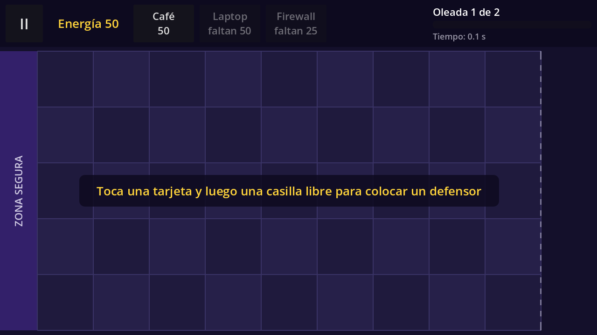
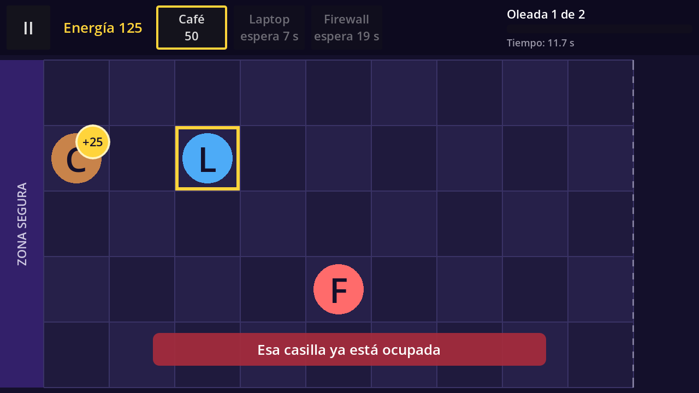

# Technical Note — v0.2 (Block 2: Defenders and Energy Economy)

## Goal

Make the player's main task work from start to end: with an empty board and enough energy, tapping a defender card and then a free cell places that defender in the cell and subtracts its cost from the energy.




## Data: `DefenderType` (Custom Resource)

`scripts/data/defender_type.gd` describes **what** a defender is. **How** it behaves is the scene stored in `behavior_scene`.

| Field | Meaning |
|---|---|
| `display_name` | Name on the card. Its first letter is drawn on the board until the art exists. |
| `cost` | Energy needed to place it. |
| `health` | Health points (used by enemies in Block 3). |
| `cooldown` | Seconds the card stays locked after placing this defender. |
| `texture` | Final image (Block 6). Empty for now, so the letter is shown. |
| `color` | Color of the placeholder circle behind the letter. |
| `behavior_scene` | Scene with the behavior script (generator, shooter or blocker). |
| `energy_per_orb`, `orb_interval` | *Generator* group: energy per orb and seconds between orbs. |

Resource files (initial values, to be balanced in Block 6):

| File | Name | Cost | Health | Cooldown | Behavior scene | Generator |
|---|---|---|---|---|---|---|
| `data/defenders/cafe.tres` | Café (C) | 50 | 300 | 7.5 s | `generator_defender.tscn` | +25 every 10 s |
| `data/defenders/laptop.tres` | Laptop (L) | 100 | 300 | 7.5 s | `shooter_defender.tscn` | — |
| `data/defenders/firewall.tres` | Firewall (F) | 75 | 1500 | 20 s | `blocker_defender.tscn` | — |

Start energy is 50 (`Game.START_ENERGY`; it moves to `LevelData.start_energy` in Block 4).

## Node hierarchy

### `scenes/game/game.tscn` (modified)

```
Game (Node2D)                            game.gd
├── Board (instance of board.tscn)       position (80, 110)
├── Defenders (Node2D)                   NEW: placed defenders are added here
├── Orbs (Node2D)                        NEW: energy orbs (after Defenders, so they are drawn on top)
└── UI (CanvasLayer)
    ├── HUD (instance of hud.tscn)
    ├── Hint (Label)                     NEW: empty-board hint, visible only while no defender is on the board
    ├── Notice (instance of notice.tscn) NEW: short warnings
    └── PauseMenu (instance of pause_menu.tscn, hidden)
```

### `scenes/ui/hud.tscn` (modified)

```
HUD (PanelContainer)                     hud.gd
└── Row (HBoxContainer)
    ├── %PauseButton (Button)            "II"
    ├── %EnergyLabel (Label)             "Energía N" (now updated by code)
    ├── %Cards (HBoxContainer)           NEW: holds the defender cards
    │   ├── CafeCard     (instance of defender_card.tscn, defender_type = cafe.tres)
    │   ├── LaptopCard   (instance of defender_card.tscn, defender_type = laptop.tres)
    │   └── FirewallCard (instance of defender_card.tscn, defender_type = firewall.tres)
    ├── Spacer (Control, expand)
    └── WaveBox (VBoxContainer)          unchanged (wave data arrives in Block 4)
```

### `scenes/ui/defender_card.tscn` (new)

```
DefenderCard (Button, 130×80)            defender_card.gd   @export defender_type
└── SelectedFrame (Panel, full rect, yellow border, mouse_filter = Ignore, hidden)
```

### `scenes/ui/notice.tscn` (new)

```
Notice (Label, bottom center, red background)   notice.gd
└── HideTimer (Timer, one shot)
```

### `scenes/entities/` (new)

```
GeneratorDefender (Node2D)   generator_defender.gd
├── Sprite (Sprite2D)        empty until Block 6
├── Letter (Label)           "C"
└── OrbTimer (Timer)

ShooterDefender (Node2D)     shooter_defender.gd     (same Sprite + Letter, no Timer)
BlockerDefender (Node2D)     blocker_defender.gd     (same Sprite + Letter, no Timer)

EnergyOrb (Button, 64×64, round yellow style)   energy_orb.gd
└── LifeTimer (Timer, one shot)
```

## Scripts

| Script | Class | Status | Responsibility |
|---|---|---|---|
| `scripts/data/defender_type.gd` | `DefenderType` | new | Defender data (see table above). |
| `scripts/entities/defender.gd` | `Defender` | new | Base of every defender: `setup(type, lane, column)`, health, `take_damage()`, signal `died`. Shows the image, or the first letter over a colored circle drawn in `_draw()`. |
| `scripts/entities/generator_defender.gd` | `GeneratorDefender` | new | Café. `OrbTimer` fires every `orb_interval` s and creates an `EnergyOrb` at the top-right corner of its cell (in cell units), then emits `orb_produced(orb)`. |
| `scripts/entities/shooter_defender.gd` | `ShooterDefender` | new | Laptop. Empty for now; shooting arrives in Block 3. |
| `scripts/entities/blocker_defender.gd` | `BlockerDefender` | new | Firewall. Empty for now; its high health comes from the resource; blocking arrives in Block 3. |
| `scripts/entities/energy_orb.gd` | `EnergyOrb` | new | Button showing "+25". On tap it emits `collected(amount)` and frees itself. If nobody taps it in 8 s (`LIFETIME`), `LifeTimer` frees it. |
| `scripts/ui/defender_card.gd` | `DefenderCard` | new | Shows the card state only: ready ("Café / 50"), dimmed with "faltan X", or dimmed with "espera N s" while recharging. Counts the cooldown down in `_process()`. |
| `scripts/ui/notice.gd` | `Notice` | new | `show_message(text)` shows a warning for 2 s. |
| `scripts/ui/hud.gd` | `Hud` | modified | Emits `card_pressed(card)`. `set_energy()` updates the label and every card. Keeps `selected_card` with `select_card()` / `clear_selection()`. |
| `scripts/engine/board.gd` | `Board` | modified | `occupied_cells` (Dictionary `Vector2i(column, lane)` → `Defender`), `is_occupied()`, `is_empty()`, `occupy_cell()`, `free_cell()`, `clear_highlight()`. |
| `scripts/engine/game.gd` | — | modified | Owns `energy`. Validates card taps and cell taps, places defenders, connects orbs and deaths, updates the hint. |

## How it works

**Selecting a card** (`Game._on_card_pressed`):

1. Tapping the selected card again cancels the selection.
2. If the card is recharging → notice "Café se está recargando".
3. If energy is not enough → notice "Energía insuficiente: faltan X".
4. Otherwise the card is selected (yellow frame).

**Tapping a cell** (`Game._on_board_cell_tapped`), all checks happen *before* spending energy:

1. No card selected → notice "Primero toca una tarjeta de defensor".
2. Cell occupied → notice "Esa casilla ya está ocupada" (the card stays selected, so the player can tap another cell).
3. Not enough energy → notice (safety check).
4. `behavior_scene` missing in the resource → notice "Datos inválidos" and `push_error()`.
5. Valid: `place_defender()` → `behavior_scene.instantiate()`, `setup()`, add to `Defenders`, position with `Board.cell_to_pixel()`, `Board.occupy_cell()`, subtract the cost. Then the card starts its cooldown and the selection is cleared.

**Energy loop:** `GeneratorDefender` → `orb_produced(orb)` → `Game` adds the orb to `Orbs`, places it with `Board.cell_to_pixel()` and connects `orb.collected` to `Game.add_energy()` → `Hud.set_energy()` refreshes the label and the cards.

## Key decisions

- **Data vs. behavior:** the three defenders are three `.tres` files of the same `DefenderType`. A new defender with an existing behavior only needs a new `.tres` file (and a card that points to it).
- **The orb is a `Button`:** the UI receives input before `_unhandled_input()`, so tapping an orb never reaches the Board and never places a defender by accident.
- **Game decides, HUD shows:** the rules (energy, cooldown, occupied cell) live in `Game`; the HUD and the cards only display state and report taps through signals.
- **Laptop and Firewall are placeable but passive** in v0.2; their behaviors are added in Block 3 without changing the resources.
- **Cards are placed in `hud.tscn` by hand** with their `defender_type` set in the Inspector. In Block 4 they will be generated from `LevelData.defenders`.
- **Pause:** `Timer` nodes and `_process()` stop with `get_tree().paused`, so orb production, orb lifetime, card cooldowns and notices freeze during pause without extra code.
- **The hint** is shown whenever `Board.is_empty()` is true (level start, or after every defender dies in Block 3).

## Project settings changed

`application/config/version` = `0.2` (and the version label on the home screen).

## Verification

Automated run on **Godot 4.7 stable** (Compatibility renderer, 1280×720, fixed 60 fps): 44 gameplay checks plus 3 touch checks, all passed:

- Start: energy 50, hint visible, Café card ready, Laptop "faltan 50", Firewall "faltan 25".
- Tap on a cell without a card → notice, nothing placed.
- Tap on the Laptop card with 50 energy → "Energía insuficiente: faltan 50", not selected.
- Café card: tap selects, second tap cancels.
- **Acceptance criterion:** Café selected + free cell (lane 2, column 1) → defender "C" at the cell center, cell registered in Board, energy 50 → 0, hint hidden, card shows "espera 8 s".
- First orb after exactly 10 s; tapping it adds 25 energy, removes it, and the tap does not reach the board.
- An orb nobody taps disappears after 8 s.
- Pause freezes the orb timer and play time; board taps are ignored while paused.
- Occupied cell → "Esa casilla ya está ocupada" and no energy spent.
- Laptop and Firewall are placed as `ShooterDefender` / `BlockerDefender`; Firewall health 1500 and 20 s cooldown come from its resource.
- A defender with health 0 frees its cell; the hint comes back when the board is empty.
- Restart reloads the level with energy 50 and an empty board.
- Real touch events (`InputEventScreenTouch`) on a 2400×1080 window: select card, place Café, collect orb.

Pending manual check: Android export and APK install on a physical phone.
