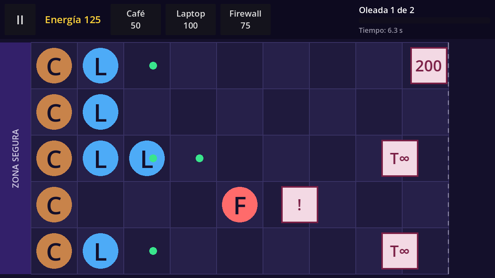
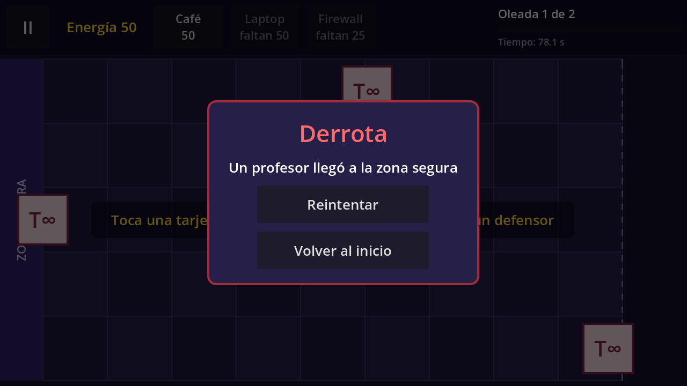

# Technical Note — v0.3 (Block 3: Enemies and Combat)

## Goal

Get the minimum complete game: one wave that can be won or lost. Enemies walk along their lane, stop at the first defender and bite it, the Laptop shoots at enemies in its lane, the Firewall holds them back, and an enemy reaching the safe zone means defeat.




## Data: `EnemyType` (Custom Resource)

`scripts/data/enemy_type.gd` describes **what** an enemy is. There is a **single** enemy scene (`scenes/entities/enemy.tscn`) that reads every stat from the `EnemyType` it receives.

| Field | Meaning |
|---|---|
| `display_name` | Archetype name. |
| `label_text` | Short text drawn on the board until the art exists. |
| `health` | Health points. Laptop projectiles take it away. |
| `speed` | Walking speed in **cells per second**. |
| `damage_per_second` | Damage to the defender it is biting. |
| `texture` | Final image (Block 6). Empty for now, so `label_text` is shown. |
| `color` | Color of the placeholder box. |

Resource files (initial values, to be balanced in Block 6):

| File | Archetype | Text | Health | Speed (cells/s) | Damage/s |
|---|---|---|---|---|---|
| `data/enemies/tarea_infinita.tres` | Basic | T∞ | 200 | 0.25 | 25 |
| `data/enemies/examen_sorpresa.tres` | Fast | ! | 100 | 0.6 | 25 |
| `data/enemies/diapositivas.tres` | Tough | 200 | 600 | 0.15 | 25 |

`DefenderType` gets a new **Shooter** group: `fire_interval` (1.5 s) and `projectile_damage` (20), set in `laptop.tres`.

## Node hierarchy

### `scenes/game/game.tscn` (modified)

```
Game (Node2D)                            game.gd
├── Board (instance of board.tscn)
├── Defenders (Node2D)
├── Enemies (Node2D)                     NEW: spawned enemies
├── Projectiles (Node2D)                 NEW: Laptop shots (drawn above enemies)
├── Orbs (Node2D)
└── UI (CanvasLayer)
    ├── HUD
    ├── Hint
    ├── Notice
    ├── WaveBanner (Label, hidden)       NEW: "¡Oleada superada!"
    ├── PauseMenu (hidden)
    └── DefeatPanel (instance, hidden)   NEW
```

### `scenes/entities/enemy.tscn` (new)

```
Enemy (Node2D)          enemy.gd   (draws the placeholder box in _draw())
├── Sprite (Sprite2D)   empty until Block 6
└── Text (Label)        "T∞", "!" or "200" from the EnemyType
```

### `scenes/entities/projectile.tscn` (new)

```
Projectile (Node2D)     projectile.gd   (draws a small green circle)
```

### `scenes/entities/shooter_defender.tscn` (modified)

```
ShooterDefender (Node2D)   shooter_defender.gd
├── Sprite, Letter
└── FireTimer (Timer)      NEW
```

### `scenes/ui/defeat_panel.tscn` (new)

```
DefeatPanel (Control, full rect, process_mode = When Paused)   defeat_panel.gd
├── Dim (ColorRect)
└── Center > Panel > Content (VBoxContainer)
    ├── Title "Derrota"
    ├── Message "Un profesor llegó a la zona segura"
    ├── %RetryButton "Reintentar"
    └── %HomeButton "Volver al inicio"
```

## Scripts

| Script | Class | Status | Responsibility |
|---|---|---|---|
| `scripts/data/enemy_type.gd` | `EnemyType` | new | Enemy data (table above). |
| `scripts/entities/enemy.gd` | `Enemy` | new | The one enemy for every archetype. Walks left in cells per second, bites the defender in front (`damage_per_second × delta`), `take_damage()`, signals `died` and `reached_safe_zone`. Joins the `enemies` group. |
| `scripts/entities/projectile.gd` | `Projectile` | new | Flies right at 5 cells/s. Hits the first enemy in the same lane closer than `HIT_DISTANCE` (0.3 columns), then frees itself; also frees itself past column 9.5. |
| `scripts/entities/shooter_defender.gd` | `ShooterDefender` | modified | `FireTimer` every `fire_interval` s; shoots only if an enemy is in its lane and to its right. Emits `shot_fired(projectile)`. |
| `scripts/entities/blocker_defender.gd` | `BlockerDefender` | comment only | No extra code: every defender blocks the enemy biting it; the Firewall lasts longer because of its 1500 health. |
| `scripts/entities/defender.gd` | `Defender` | comment only | `take_damage()` is now called by enemies. |
| `scripts/data/defender_type.gd` | `DefenderType` | modified | New *Shooter* group: `fire_interval`, `projectile_damage`. |
| `scripts/engine/board.gd` | `Board` | modified | New `get_defender(lane, column)`: the defender in a cell, or `null`. |
| `scripts/ui/defeat_panel.gd` | `DefeatPanel` | new | Emits `retry_requested` and `home_requested`. |
| `scripts/engine/game.gd` | — | modified | `Phase` (PLAYING, VICTORY, DEFEAT), `TEST_WAVE`, `spawn_enemy()`, projectile wiring, victory check, defeat. |

## How it works

**Enemy movement and bite** (`Enemy._process`), all in cells:

1. Look for a defender in front: the cell `ceili(column - BITE_DISTANCE)` in the same lane (`BITE_DISTANCE` = 0.7), asked to `Board.get_defender()`.
2. If there is one, bite it: `defender.take_damage(damage_per_second * delta)`. Otherwise walk: `column -= speed * delta`.
3. If `column <= -0.5` (left edge of the grid), emit `reached_safe_zone` and stop.
4. Only at the end, convert to pixels: `global_position = board.cell_to_pixel(lane, column)`.

When the defender dies, it emits `died`, `Game` frees its cell, and on the next frame the enemy finds no defender and walks again.

**Shooting** (`ShooterDefender`): every 1.5 s, if any node of the `enemies` group has the same lane and `column >= own column`, a `Projectile` is created at `column + 0.3` and sent to `Game` through `shot_fired`; `Game` gives it the `Board` and adds it to `Projectiles`.

**Hit detection** (`Projectile._process`): a simple calculation per lane, as the plan asks, with no physics engine: `enemy.lane == lane and absf(enemy.column - column) < 0.3`. At 5 cells/s and 60 fps the projectile moves 0.08 columns per frame, so it cannot jump over an enemy.

**Test wave** (`Game.TEST_WAVE`): a list of `[second, lane, EnemyType]` entries. `_spawn_due_enemies()` spawns every entry whose second has passed, using `elapsed_time`, so the wave also freezes during pause. In Block 4 this list becomes `SpawnEvent` / `WaveData` resources read by `WaveManager`.

| Second | 40 | 60 | 75 | 90 | 100 | 110 | 120 | 130 | 140 |
|---|---|---|---|---|---|---|---|---|---|
| Lane | 2 | 0 | 4 | 1 | 3 | 2 | 0 | 4 | 2 |
| Enemy | Basic | Basic | Basic | Fast | Basic | Tough | Fast | Tough | Basic |

**End of the match:**

- **Defeat:** an enemy emits `reached_safe_zone` → `phase = DEFEAT`, `get_tree().paused = true`, the `DefeatPanel` is shown. *Reintentar* reloads the scene; *Volver al inicio* goes to the home screen (both unpause first). The Android back button is ignored while the defeat panel is shown.
- **Victory:** every `TEST_WAVE` entry has spawned and `Enemies` has no children → `phase = VICTORY` and the "¡Oleada superada!" banner appears. The full Victory panel (Next level / Home) arrives in Block 4.

## Key decisions

- **One enemy scene, three resources:** the difference between basic, fast and tough comes only from the `.tres` values, so it is visible at a glance (speed and how many hits they take).
- **No physics, only cell math:** collisions are distance checks in columns within the same lane, which is easy to explain and behaves the same on any screen.
- **The `enemies` group** lets Laptops and projectiles find enemies without `Game` passing lists around.
- **Blocking needs no special code:** an enemy always stops at the defender in front of it; the Firewall's role comes from its data (1500 health, 75 cost).
- **Pause and defeat** reuse the v0.1 mechanism: `get_tree().paused` plus a panel in *When Paused* mode.

## Verification

Automated run on **Godot 4.7.2 stable** (Compatibility renderer, 1280×720), all checks passed:

- An enemy appears at column 9.0 and is drawn exactly at `Board.cell_to_pixel()`.
- The basic enemy walks 0.25 cells/s (1 cell in 4 s).
- It stops 0.7 columns from a Café and bites it; the Café (300 health) dies after ~12 s, its cell is freed and the enemy walks again.
- The Laptop does not shoot with an empty lane, ignores enemies in other lanes, and shoots at enemies in its lane; each hit takes exactly 20 health.
- An enemy killed by projectiles is removed.
- A fast enemy is stopped by a Firewall at column 6.7 (Firewall at column 6).
- With no defenders the first enemy reaches the safe zone: phase DEFEAT, game paused, defeat panel shown; the back button does not close it; *Reintentar* reloads the level unpaused.
- **Full playthrough with real energy only** (a scripted player collecting orbs, building Cafés first and placing Laptops in threatened lanes): the test wave is won at ~153 s with the "¡Oleada superada!" banner.

Pending manual check: Android export and APK install on a physical phone.
