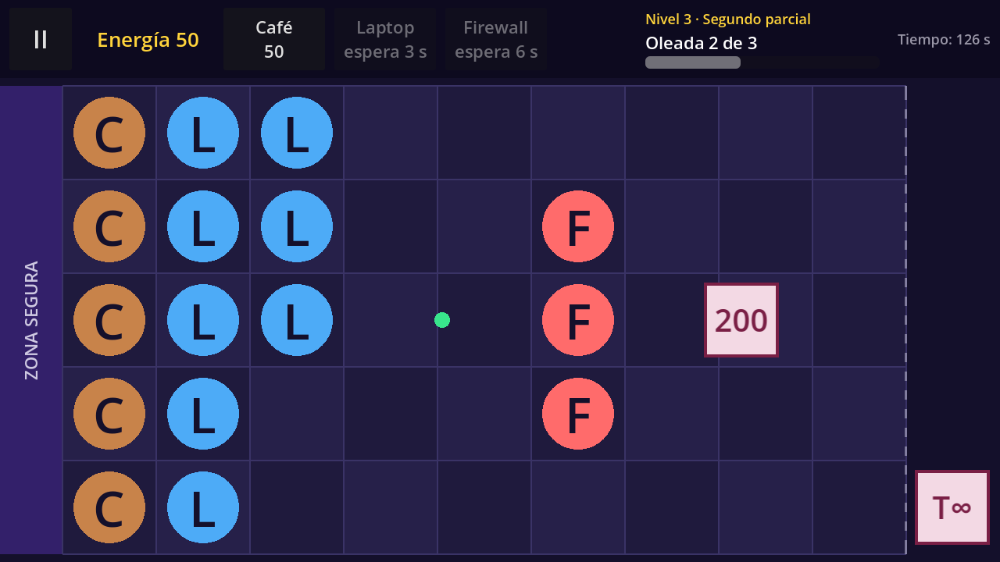
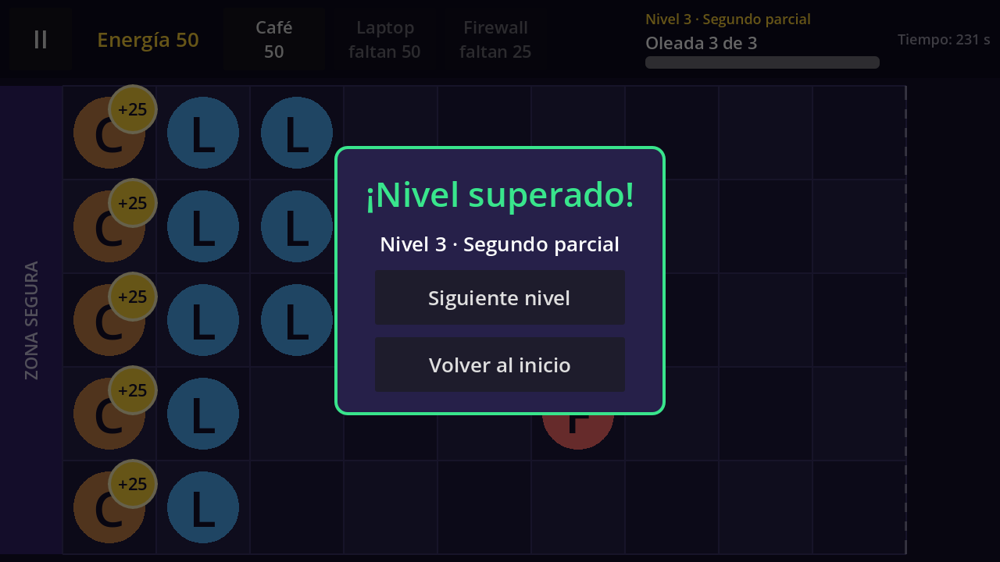

# Technical Note — v0.4 (Block 4: Data-Driven Levels and World Flow)

## Goal

Turn the one-wave prototype into a world with progression. Levels 1 to 4 are now described only as data (Custom Resources), a `WaveManager` reads their waves, a `ProgressRepository` Autoload remembers the current level, and a Victory panel chains the levels without closing the app.




## Data: four new Custom Resources

| Script | Class | Fields | Meaning |
|---|---|---|---|
| `scripts/data/spawn_event.gd` | `SpawnEvent` | `time`, `lane` (0–4), `enemy_type` | One enemy: **when** (seconds after its wave's calm), **where** and **what**. |
| `scripts/data/wave_data.gd` | `WaveData` | `start_delay`, `events` | One wave: seconds of calm, then a list of `SpawnEvent`s. |
| `scripts/data/level_data.gd` | `LevelData` | `display_name`, `start_energy`, `defenders`, `waves` | One level: name, starting energy, available defenders (one card each) and its waves. |
| `scripts/data/world_data.gd` | `WorldData` | `display_name`, `levels` | One world: its name and its ordered list of levels. |

`SpawnEvent` and `WaveData` live **inside** each level file as sub-resources, exactly as the Inspector stores them when you create them with *New SpawnEvent* / *New WaveData*. Only levels and worlds are separate files.

### Resource files

```
data/worlds/
├── world_1.tres            WorldData "Mundo 1": [level_1, level_2, level_3, level_4]
└── levels/
    ├── level_1.tres        LevelData
    ├── level_2.tres
    ├── level_3.tres
    └── level_4.tres
```

Levels of World 1 (section 5.3 of the work plan; values are a first proposal to balance in Block 6):

| Level | Name | Start energy | Defenders | Enemies | Waves | Enemies per wave |
|---|---|---|---|---|---|---|
| 1 | Inicio de semestre | 50 | Café, Laptop | Basic | 2 | 3 + 5 |
| 2 | Primer parcial | 75 | Café, Laptop, Firewall | Basic, fast | 2 | 4 + 6 |
| 3 | Segundo parcial | 75 | Café, Laptop, Firewall | Basic, fast, tough | 3 | 4 + 5 + 7 |
| 4 | Tercer parcial | 100 | Café, Laptop, Firewall | All three, more of them | 3 | 6 + 8 + 10 |

Calm before each wave (`start_delay`): 40 s, 35 s, 35 s and 30 s for the first wave of levels 1–4 (time to place Cafés); 15 s for every later wave.

## Node hierarchy

### `scenes/game/game.tscn` (modified)

```
Game (Node2D)                            game.gd
├── Board (instance of board.tscn)
├── Defenders (Node2D)
├── Enemies (Node2D)
├── Projectiles (Node2D)
├── Orbs (Node2D)
├── WaveManager (Node)                   NEW: wave_manager.gd
└── UI (CanvasLayer)
    ├── HUD
    ├── Hint
    ├── Notice
    ├── PauseMenu (hidden)
    ├── DefeatPanel (hidden)
    └── VictoryPanel (instance, hidden)  NEW (replaces the old WaveBanner label)
```

### `scenes/ui/hud.tscn` (modified)

```
HUD (PanelContainer)                     hud.gd
└── Row (HBoxContainer)
    ├── %PauseButton "II"
    ├── %EnergyLabel
    ├── %Cards (HBoxContainer)           now EMPTY in the editor: cards are created in code
    ├── Spacer
    ├── WaveBox (VBoxContainer)
    │   ├── %LevelLabel                  NEW: "Nivel 1 · Inicio de semestre"
    │   ├── %WaveLabel                   "Oleada 1 de 2"
    │   └── %WaveBar (ProgressBar)       enemies of the current wave that have appeared
    └── %TimeLabel                       moved out of WaveBox: "Tiempo: 12 s"
```

### `scenes/ui/victory_panel.tscn` (new)

```
VictoryPanel (Control, full rect, process_mode = When Paused)   victory_panel.gd
├── Dim (ColorRect)
└── Center > Panel > Content (VBoxContainer)
    ├── %Title       "¡Nivel superado!" or "¡Mundo 1 superado!"
    ├── %Message     "Nivel 1 · Inicio de semestre"
    ├── %NextButton  "Siguiente nivel" (hidden after the last level)
    └── %HomeButton  "Volver al inicio"
```

### Autoload

`project.godot` → *Project Settings → Globals → Autoload*: `ProgressRepository` = `res://scripts/save/progress_repository.gd`.

## Scripts

| Script | Class | Status | Responsibility |
|---|---|---|---|
| `scripts/data/spawn_event.gd` | `SpawnEvent` | new | Data of one enemy appearance. |
| `scripts/data/wave_data.gd` | `WaveData` | new | Data of one wave. |
| `scripts/data/level_data.gd` | `LevelData` | new | Data of one level. |
| `scripts/data/world_data.gd` | `WorldData` | new | Data of one world. |
| `scripts/engine/wave_manager.gd` | `WaveManager` | new | Reads the level's waves and emits `spawn_requested`, `wave_started`, `wave_progress` and `all_waves_cleared`. |
| `scripts/save/progress_repository.gd` | Autoload `ProgressRepository` | new | Keeps the current level index **in memory**; `get_current_level()`, `has_next_level()`, `complete_level()`. |
| `scripts/ui/victory_panel.gd` | `VictoryPanel` | new | `show_level_cleared()`, `show_world_cleared()`; emits `next_requested` and `home_requested`. |
| `scripts/engine/game.gd` | — | modified | Reads the `LevelData` from `ProgressRepository`; start energy, cards and waves come from it. `TEST_WAVE`, `START_ENERGY`, `_spawn_due_enemies()` and `_check_victory()` were removed. New `_on_all_waves_cleared()` and `_on_next_level_requested()`. |
| `scripts/ui/hud.gd` | `Hud` | modified | `create_cards()`, `set_level_name()`, `set_wave()`, `set_wave_progress()`. |
| `scripts/ui/defender_card.gd` | `DefenderCard` | comment only | `defender_type` is now assigned by `Hud`, not in the Inspector. |

## How it works

**Start of a level** (`Game._ready`):

1. `level = ProgressRepository.get_current_level()` → the `LevelData` at `current_level_index` in `world_1.tres`.
2. `energy = level.start_energy`, `hud.set_level_name(...)` and `hud.create_cards(level.defenders)`: one `defender_card.tscn` instance per defender, with its `defender_type` set **before** `add_child()` so the card's `_ready()` already has its data.
3. `Game` connects the `WaveManager` signals and calls `wave_manager.start(level.waves)`.

**Waves** (`WaveManager._process`), all with `delta`, so they freeze during pause:

1. When a wave begins, `wave_time = 0`, its events are copied and **sorted by time** (the order in the Inspector does not matter), and `wave_started(number, count)` updates "Oleada X de Y".
2. `wave_time += delta`. Each event fires when `wave_time >= start_delay + event.time`: `WaveManager` emits `spawn_requested(enemy_type, lane)` and `Game.spawn_enemy()` creates the enemy (the same function as in v0.3). `wave_progress(spawned, total)` fills the bar.
3. When every event has fired **and** the `enemies` group is empty, the next wave starts. After the last wave, `all_waves_cleared` is emitted.

**Victory** (`Game._on_all_waves_cleared`): `phase = VICTORY`, the tree is paused, and before showing the panel `Game` asks `ProgressRepository` whether there is a next level and calls `complete_level()`, which moves the index forward (or back to 0 after the last level). Then:

- More levels → "¡Nivel superado!" with *Siguiente nivel* and *Volver al inicio*. *Siguiente nivel* only unpauses and reloads the scene with `reload_current_scene()`; the new scene reads the next level.
- Last level → "¡Mundo 1 superado!", *Siguiente nivel* hidden, only *Volver al inicio*.

**Retry and home:** *Reintentar* (Defeat) and *Reiniciar nivel* (Pause) reload the scene without touching `ProgressRepository`, so they repeat the same level. *Jugar* on the home screen opens the level stored in memory. The Android back button only opens or closes the pause menu while the phase is `PLAYING`.

## Adding a level without touching scripts

1. In the FileSystem dock, right-click `data/worlds/levels/` → *New Resource…* → `LevelData`, and save it (for example `level_test.tres`).
2. In the Inspector: write `display_name` and `start_energy`; in `defenders`, add elements and drag `.tres` files from `data/defenders/`.
3. In `waves`, add an element → *New WaveData*; set `start_delay`; in its `events`, add elements → *New SpawnEvent* and fill `time`, `lane` and `enemy_type` (drag a file from `data/enemies/`).
4. Open `data/worlds/world_1.tres` and add the new level to `levels` (drag it, or reorder the list to play it first).
5. Press F5. The level is played in its position, with its own cards and waves.

## Key decisions

- **Waves start "per wave, with calm":** each `SpawnEvent` counts seconds from the start of its wave, and a wave waits until the previous one is fully cleared. Waves never overlap, and changing one wave does not shift the timing of the others.
- **`WaveManager` does not create enemies:** it only emits `spawn_requested`; `Game` keeps owning every entity, as in v0.3.
- **The progress advances on victory**, not when *Siguiente nivel* is tapped, so *Volver al inicio* → *Jugar* also continues with the next level. After the last level the index returns to 0. In Block 5 the same `ProgressRepository` will save this to `user://progress.cfg`.
- **The end of the world is data-driven:** "no next level" is decided by the size of `world_1.tres → levels`. When `level_5.tres` (the boss) is added in Block 6, level 4 will show *Siguiente nivel* without changing any script.
- **Wave bar = progress of the current wave:** `max_value` is the number of events of the wave and `value` the ones that have appeared; it starts empty in each wave.
- **Victory panel replaces the "¡Oleada superada!" banner**, with the same *When Paused* pattern as the Pause and Defeat panels.

## Verification

Automated run on **Godot 4.7.2 stable** (Compatibility renderer, 1280×720, `--fixed-fps 60`), 69 checks, all passed:

- *Jugar* opens level 1: start energy 50, only the Café and Laptop cards, "Nivel 1 · Inicio de semestre", "Oleada 1 de 2", empty bar.
- No enemy before second 40; the first one appears at 40 s in lane 2, the second at 65 s, the third at 85 s; the bar goes 1/3 → 3/3.
- Wave 2 does **not** start while an enemy of wave 1 is alive; it starts on the frame after the last one dies, with an empty bar and its own 15 s calm.
- Pause freezes `wave_time`.
- Victory: phase `VICTORY`, game paused, panel visible with the right texts, progress moved to level 2, back button ignored; *Siguiente nivel* loads level 2 unpaused, with 75 energy and 3 cards.
- A Café placed from a generated card costs 50 (real click on the card and the cell).
- Defeat → *Reintentar* keeps level 2; *Reiniciar nivel* keeps it; *Salir al inicio* → *Jugar* continues at level 2.
- Levels 3 and 4 load with 3 waves; level 4 has 24 enemies and 100 energy.
- After level 4: "¡Mundo 1 superado!", no *Siguiente nivel*, progress back to level 1, *Volver al inicio* → *Jugar* opens level 1.
- **Level added only as data:** a fifth `LevelData` appended to the world turns level 4 into a normal "¡Nivel superado!" with *Siguiente nivel*, and the new level loads with its own energy, cards and waves. Events written out of order spawn sorted by time, and an event with no `enemy_type` is skipped with an error message instead of a crash.
- **Full playthrough with real energy only** (a scripted player collecting orbs and placing Cafés, Laptops and Firewalls): levels 1 → 4 chained in one session, won at about 176 s, 174 s, 271 s and 254 s, ending with "¡Mundo 1 superado!". Level 1 takes under 5 minutes.

Pending manual check: Android export and APK install on a physical phone.
