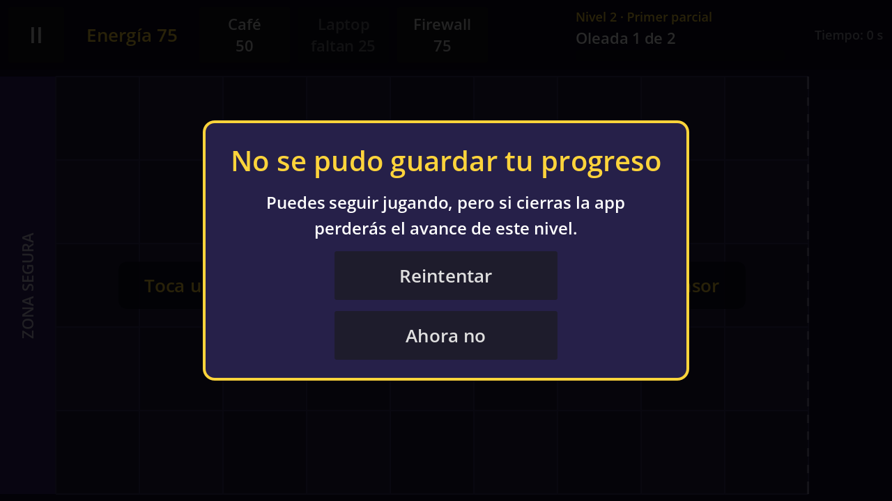

# Technical Note — v0.5 (Block 5: Save, Load and Error States)

## Goal

Make the progress survive closing the app, and show the states outside the happy path: a loading screen when a level is entered, a notice when the progress cannot be saved, and a clean start from level 1 when the save file is missing or damaged.




## Save file

`ProgressRepository` now saves with `ConfigFile` in `user://progress.cfg`. Each world has its own section, named after the world's new `id` field:

```ini
[world_1]

current_level=3
unlocked_level=3
```

| Key | Meaning |
|---|---|
| `current_level` | Level that *Continuar* opens (1-based, like the number the player sees). |
| `unlocked_level` | Highest level reached in the world. It never goes down. |

Both keys are equal while the player moves forward. They differ only after the last level: the world is complete, `current_level` goes back to 1 (as in v0.4) and `unlocked_level` stays at 4. `unlocked_level` is not used by any screen yet; it is the value a level select or a World 2 can read later.

Where `user://` is: `%APPDATA%\Godot\app_userdata\Defensa ESCOM\` on Windows, and the app's private storage on Android (it is deleted when the app is uninstalled or its data is cleared).

## Node hierarchy

### `scenes/ui/main_menu.tscn` (modified)

```
MainMenu (Control)                       main_menu.gd
├── Center > Content (VBoxContainer)
│   ├── %Title "Defensa ESCOM"           now unique and mouse_filter = Stop (hidden debug taps)
│   ├── %Subtitle                        "Mundo 1" or "Mundo 1 · Nivel 3"
│   ├── %PlayButton                      "Jugar" or "Continuar"
│   └── %LoadErrorLabel (hidden)         NEW: "No se pudo leer tu progreso guardado…"
├── VersionLabel "v0.5"
└── %DebugPanel (Control, hidden)        NEW: hidden debug panel
    ├── Dim (ColorRect)
    └── Center > Panel > Content
        ├── Title "Depuración"
        ├── %ResetButton                 "Borrar progreso"
        ├── %FailSaveButton              "Simular falla al guardar: No/Sí"
        └── %CloseDebugButton            "Cerrar"
```

### `scenes/ui/loading_screen.tscn` (new)

```
LoadingScreen (Control, full rect)       loading_screen.gd
└── Center > Content (VBoxContainer)
    ├── %Title       "Cargando…" (or "Algo salió mal")
    ├── %LevelLabel  "Nivel 3 · Segundo parcial" (or the error message)
    ├── %Bar         ProgressBar with the loading progress
    └── %HomeButton  "Volver al inicio" (only in the error state)
```

### `scenes/ui/save_error_panel.tscn` (new)

```
SaveErrorPanel (Control, full rect, process_mode = When Paused)   save_error_panel.gd
├── Dim (ColorRect)
└── Center > Panel > Content (VBoxContainer)
    ├── Title         "No se pudo guardar tu progreso"
    ├── %Message
    ├── %RetryButton  "Reintentar"
    └── %LaterButton  "Ahora no"
```

### `scenes/game/game.tscn` (modified)

```
Game (Node2D)
├── …
└── UI (CanvasLayer)
    ├── HUD, Hint, Notice, PauseMenu, DefeatPanel
    ├── VictoryPanel (hidden)
    └── SaveErrorPanel (instance, hidden)    NEW: last child, so it is drawn on top of VictoryPanel
```

## Scripts

| Script | Class | Status | Responsibility |
|---|---|---|---|
| `scripts/save/progress_repository.gd` | Autoload `ProgressRepository` | modified | `load_progress()` on `_ready()`, `save_progress()` (returns an `Error`), `complete_level()` now saves and returns the save result, `has_progress()`, `reset_progress()`, `load_error`, `simulate_save_error`, `unlocked_level_index`. |
| `scripts/data/world_data.gd` | `WorldData` | modified | New `id` field: the section name in the save file. |
| `scripts/ui/main_menu.gd` | — | modified | Shows the progress and "Jugar"/"Continuar", the load error text, and the hidden debug panel. Opens the loading screen instead of the game. |
| `scripts/ui/loading_screen.gd` | — | new | Validates the level data, loads `game.tscn` in a background thread and changes to it; error state with "Volver al inicio". |
| `scripts/ui/save_error_panel.gd` | `SaveErrorPanel` | new | `show_error()`, `show_retry_failed()`; emits `retry_requested`; "Ahora no" hides it. |
| `scripts/engine/game.gd` | — | modified | On victory, shows `SaveErrorPanel` if `complete_level()` returned an error; `_on_save_retry_requested()`; *Siguiente nivel* goes through the loading screen. |

Data: `data/worlds/world_1.tres` gets `id = "world_1"`. `project.godot`: version `0.5`.

## How it works

**App start.** Godot creates the `ProgressRepository` Autoload before the first scene, and its `_ready()` calls `load_progress()`:

1. `ConfigFile.load()`. `ERR_FILE_NOT_FOUND` is the first launch: level 1, no message.
2. Any other error, a file with no sections, missing keys, values that are not integers, out of `1..levels.size()`, or `current_level > unlocked_level` → the file is rejected: level 1, `load_error` is set and a warning goes to the log. The app never stops. Godot's `ConfigFile` reads some garbage (random words, binary data) without an error and just finds no sections, which is why "no sections" counts as damaged.
3. A file that only has other worlds' sections is valid: this world starts at level 1.
4. Otherwise `current_level_index` and `unlocked_level_index` take the saved values.

**Home screen.** With progress, the subtitle shows "Mundo 1 · Nivel 3" and the button says **Continuar**; without progress, "Mundo 1" and **Jugar**. If the file was rejected, a red line says "No se pudo leer tu progreso guardado. Empiezas desde el nivel 1."

**Entering a level.** *Jugar*/*Continuar* and *Siguiente nivel* open `loading_screen.tscn`:

1. If the current `LevelData` is missing (an empty slot in `world_1.tres`) or has no waves → error state: "Algo salió mal", the reason, and *Volver al inicio*.
2. Otherwise `ResourceLoader.load_threaded_request("res://scenes/game/game.tscn")`, and each frame `load_threaded_get_status()` fills the bar.
3. When it is loaded and at least `MIN_TIME` (0.6 s) has passed, `change_scene_to_packed()` opens the game. The minimum time keeps the screen from just flashing on fast phones.

*Reintentar* (Defeat) and *Reiniciar nivel* (Pause) still use `reload_current_scene()`: they repeat the same level and the scene is already in memory.

**Victory.** `Game._on_all_waves_cleared()` calls `ProgressRepository.complete_level()`, which moves the level forward and calls `save_progress()`. `save_progress()` loads the existing file (to keep other worlds), writes this world's two keys and returns the result of `ConfigFile.save()`. If it is not `OK`, `Game` shows `SaveErrorPanel` on top of the Victory panel:

- **Reintentar** → `Game` calls `save_progress()` again. Success hides the notice; another failure changes the message to "Sigue sin poder guardarse…".
- **Ahora no** → hides the notice. The progress stays in memory, so *Siguiente nivel* and *Continuar* still work until the app is closed.

The progress is saved at the moment of the victory, not when the app closes: Android can kill a background app without warning, so there is no later moment that is guaranteed.

**Hidden debug option.** Only in debug builds (`OS.is_debug_build()`, true in the editor and in a *debug* APK, false in a *release* APK): tap the title "Defensa ESCOM" **5 times in a row** (less than 1 s between taps) to open the *Depuración* panel.

- **Borrar progreso** → `reset_progress()`: level 1 in memory and `progress.cfg` deleted.
- **Simular falla al guardar** → toggles `simulate_save_error`; while it is "Sí", `save_progress()` returns `ERR_FILE_CANT_WRITE` without writing. It is not saved, so it turns off when the app restarts.
- The Android back button closes the panel.

## How to test the visible deliverable

1. Open the debug panel and tap *Borrar progreso*. Home shows "Mundo 1" and *Jugar*.
2. Win levels 1 and 2 (the loading screen appears before each level).
3. On the Victory panel of level 2 tap *Volver al inicio*: Home shows "Mundo 1 · Nivel 3" and *Continuar*.
4. Close the app from *Recents* (swipe it away) and open it again: Home still shows "Mundo 1 · Nivel 3". *Continuar* opens level 3.
5. Open the debug panel, set *Simular falla al guardar: Sí*, tap *Cerrar* and *Continuar*, and win the level: the notice "No se pudo guardar tu progreso" appears over the Victory panel. *Reintentar* fails again and changes the message; *Ahora no* closes the notice and the Victory panel is still usable. Go back to Home and set the option to "No" (or restart the app) to save normally again.

## Key decisions

- **Two keys, not one:** the work plan asks to save the highest unlocked level, and section 4.2 says the repository keeps the level in progress. With linear progression both are the same number until the world is completed, so storing both costs nothing and keeps the v0.4 rule "after the last level, start again at level 1" without losing the record of how far the player got.
- **One section per world, keyed by `WorldData.id`:** a World 2 only needs its own `id`. The id is explicit (not the file name) so renaming a `.tres` does not lose saves.
- **A bad file never stops the app:** every problem falls back to level 1 and the next victory overwrites the file with good data.
- **The save error is a notice, not a blocker:** the player can keep playing with the progress in memory.
- **The debug option is hidden and debug-only**, so it cannot reach players through a release APK, and simulating a failure does not touch the real file.
- **Threaded loading for the game scene:** today the scene loads in a fraction of a second, but the loading screen is ready for Block 6, when the final art will make it heavier.

## Verification

Automated run on **Godot 4.7.2 stable** (Compatibility renderer, 1280×720), in three separate processes with a separate `user://` folder, 63 checks, all passed:

- No file → level 1, no error, Home shows "Mundo 1" and *Jugar*.
- *Jugar* → loading screen with "Nivel 1 · Inicio de semestre", visible at least 0.5 s, then the game with level 1.
- Victory in level 1 writes `current_level=2`, `unlocked_level=2`; no notice. *Siguiente nivel* → loading screen with level 2 (unpaused) → level 2 with 75 energy.
- Simulated failure in level 2: the notice appears above the Victory panel, the file is not changed and the progress moves forward in memory; *Reintentar* while failing shows the second message; *Reintentar* after the failure stops writes `current_level=3`; *Ahora no* hides only the notice.
- *Volver al inicio* → "Mundo 1 · Nivel 3" and *Continuar*.
- **New process (app closed and opened again):** the progress is read from disk, Home shows "Mundo 1 · Nivel 3", *Continuar* opens level 3. Winning levels 3 and 4 shows "¡Mundo 1 superado!" and writes `current_level=1`, `unlocked_level=4`; a later win of level 1 keeps `unlocked_level=4`.
- **Damaged files**, each one → level 1 with `load_error` set and no crash: random text, plain words, unclosed section, truncated file (missing key), empty file, level 9, level 0, a string, a float, `current_level > unlocked_level`. Home shows the red message and *Jugar*, and level 1 is playable. A file with only another world's section loads level 1 without an error, and saving keeps that other section.
- **Debug panel:** 4 taps on the title do nothing, the 5th opens it; *Simular falla al guardar* toggles; *Borrar progreso* deletes the file and Home returns to *Jugar*; *Cerrar* hides it.
- **Invalid level data:** an empty slot added to the world → the loading screen shows the error and *Volver al inicio* returns to Home.
- **Real play:** levels 1 and 2 won by the real waves (Laptops placed on the board, sped-up time), each victory saved to the file.

Pending manual check: Android export, closing the app from *Recents* on a physical phone and opening it again.
