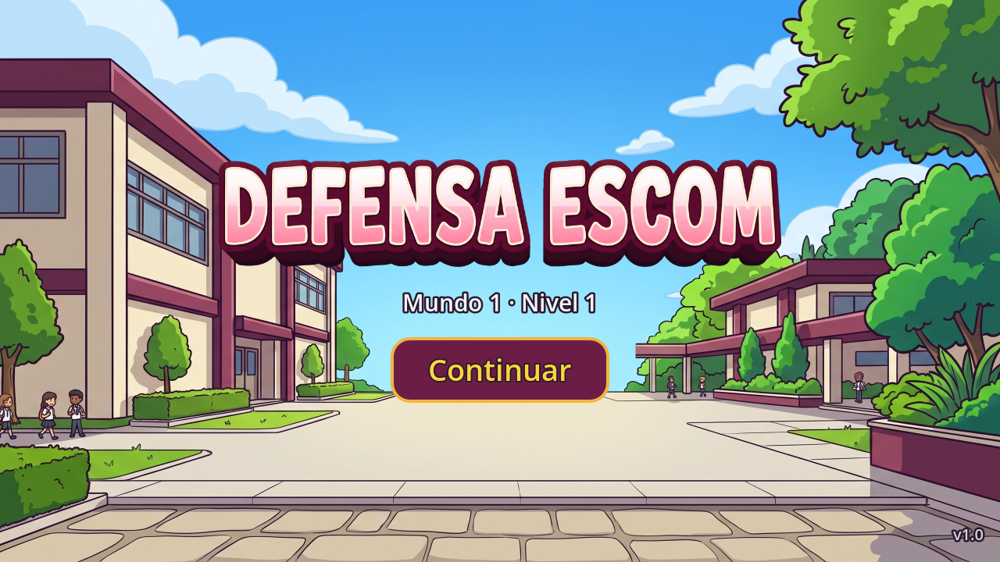
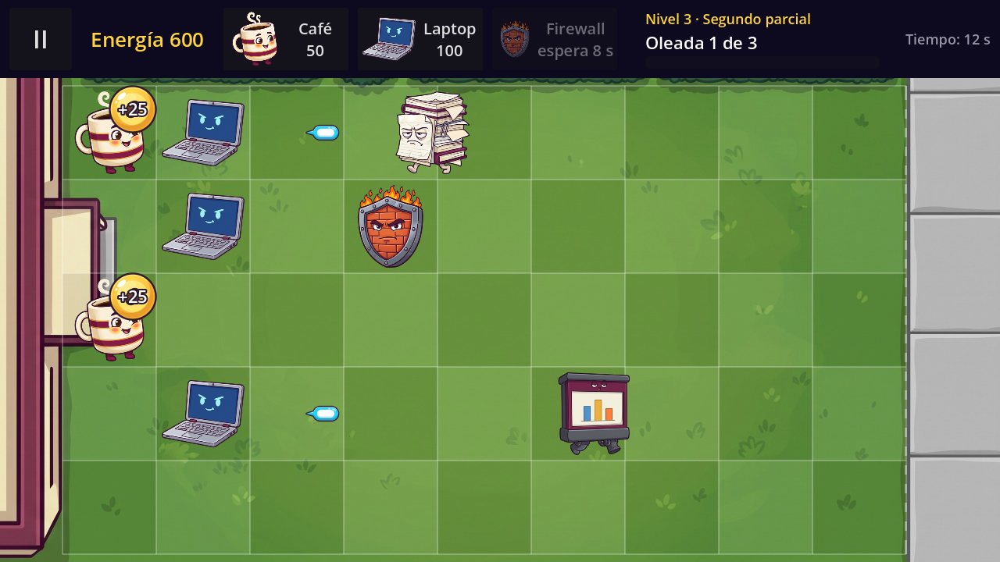
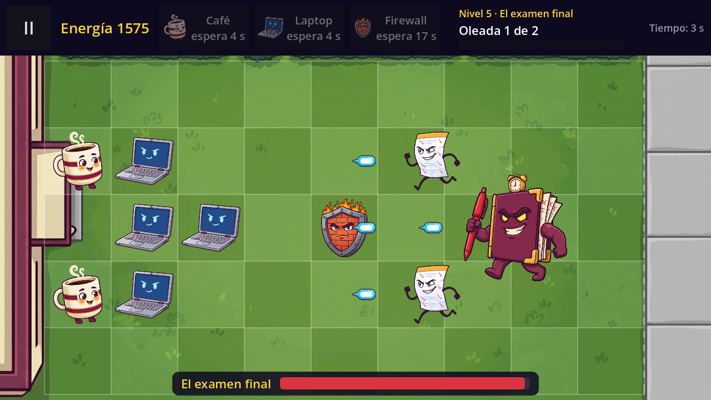
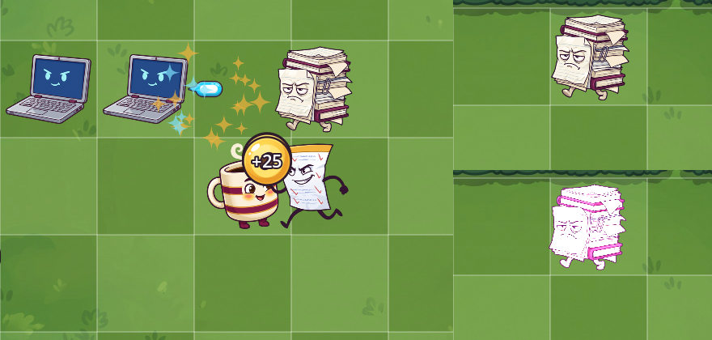

# Technical Note — v1.0 (Block 6: Final Boss, Art and Polish)

## Goal

Close World 1: final art instead of letters, the final boss *El examen final* in a new level 5, wave warnings, quick visual feedback (hit flash, shake, sway, sparks) and a first balance pass. World 1 can now be played from Home to the boss and ends with **"¡Mundo 1 superado!"**.






## Summary of the block

| Step | Commit | Content |
|---|---|---|
| Art | `feat(v1.0): final art for defenders, enemies, board and home screen` | Final images under `art/`, textures in every `DefenderType`/`EnemyType`, game and home backgrounds, logo, app icon, new play button style. |
| Boss | `feat(v1.0): final boss, level 5 and wave warnings` | `examen_final.tres` with its summon ability, boss health bar, `warning_text` per wave and the wave banner, `level_5.tres`. |
| Feedback | `feat(v1.0): hit flash, shake, walking sway, floating orb and sparks` | Tweens and one-shot particles. |
| Balance | `balance(v1.0): bigger final waves, easier starts in levels 4-5, test defender USB` | Level data only, plus the test defender `usb.tres`. |
| Docs | `docs(v1.0): technical note, README and version 1.0` | This note, the README and `application/config/version = "1.0"`. |

## Node hierarchy

### `scenes/game/game.tscn` (modified)

```
Game (Node2D)                            game.gd
├── Background (Sprite2D)                NEW: art/backgrounds/game_bg.jpg, scale 0.5, centered = false
├── Board (board.tscn)                   (80, 110); SafeZoneLabel removed
├── Defenders (Node2D)
├── Enemies (Node2D)
├── Projectiles (Node2D)
├── Orbs (Node2D)
├── Effects (Node2D, group "effects")    NEW: spark bursts live here
├── WaveManager (Node)                   wave_manager.gd
└── UI (CanvasLayer)
    ├── HUD (hud.tscn)
    ├── Hint (Label)
    ├── Notice (notice.tscn)
    ├── WaveBanner (notice.tscn)         NEW: second Notice, big, top center: "¡Se acerca una oleada!"
    ├── BossBar (PanelContainer, hidden) NEW: bottom center, ignores taps
    │   └── Row (HBoxContainer)
    │       ├── %BossName (Label)        "El examen final"
    │       └── %BossHealth (ProgressBar)
    ├── PauseMenu, DefeatPanel, VictoryPanel, SaveErrorPanel
```

### `scenes/fx/spark_burst.tscn` (new)

```
SparkBurst (CPUParticles2D)              spark_burst.gd
    one_shot, explosiveness 1, texture art/fx/spark.png (white, tinted with "color"),
    color_ramp from opaque to transparent, lifetime 0.45 s
```

### Other scenes

| Scene | Change |
|---|---|
| `scenes/ui/main_menu.tscn` | NEW `Background` (TextureRect, `menu_bg.jpg`, keep aspect covered). The `Title` Label is replaced by `%Logo` (TextureRect, `logo.png`, receives the 5 debug taps). Outlined text in `Subtitle`, `LoadErrorLabel` and `VersionLabel`. `PlayButton` maroon with a gold border (three `StyleBoxFlat`: normal, hover, pressed). |
| `scenes/entities/projectile.tscn` | NEW `Sprite` (Sprite2D, `projectile.png`, scale 0.7) instead of a drawn circle. |
| `scenes/entities/energy_orb.tscn` | `StyleBoxTexture` with `energy_orb.png`; white "+25" with an outline. |
| `scenes/ui/defender_card.tscn` | 160×80, font 20, `expand_icon = true`; the card shows the defender image. |
| `scenes/game/board.tscn` | `SafeZoneLabel` removed (the school building in the background marks the safe zone). |

## Data (Custom Resources)

| Resource | New fields / files |
|---|---|
| `EnemyType` | `sprite_size` (110 by default, 200 for the boss), `is_boss`, group *Summon*: `summon_type` and `summon_interval`. |
| `WaveData` | `warning_text` (default "¡Se acerca una oleada!"). |
| `data/enemies/examen_final.tres` | NEW. 3000 health, 0.12 cells/s, 50 damage/s, `sprite_size` 200, `is_boss`, summons `examen_sorpresa.tres` every 10 s. Same `enemy.tscn` as every enemy. |
| `data/worlds/levels/level_5.tres` | NEW. *El examen final*: 200 energy, Café + Laptop + Firewall, wave 1 with 16 enemies, wave 2 with the boss and the warning "¡Llegó El examen final!". |
| `data/worlds/world_1.tres` | Level 5 added to `levels`. |
| `data/defenders/usb.tres` | NEW test defender (see *Scalability test*). |

## The boss ability

The boss does not create enemies itself: it asks for them with a signal, the same way `WaveManager` does, and `Game` creates them with the same `spawn_enemy()`.

```gdscript
# enemy.gd
func _update_summon(delta: float) -> void:
	if enemy_type.summon_type == null:
		return  # normal enemies never summon
	summon_time += delta
	if summon_time < enemy_type.summon_interval:
		return
	summon_time = 0.0
	for summon_lane in [lane - 1, lane + 1]:
		if summon_lane >= 0 and summon_lane < Board.LANES:
			summon_requested.emit(enemy_type.summon_type, summon_lane, column)
```

```gdscript
# game.gd
func spawn_enemy(type: EnemyType, lane: int, column: float = Enemy.SPAWN_COLUMN) -> void:
	var enemy: Enemy = ENEMY_SCENE.instantiate()
	enemy.setup(type, lane, board, column)
	enemy.reached_safe_zone.connect(_on_enemy_reached_safe_zone)
	enemy.summon_requested.connect(spawn_enemy)
	enemies.add_child(enemy)
	if type.is_boss:
		_show_boss_bar(enemy)
```

The summons are in the `"enemies"` group, so the wave (and the level) is won only when the boss and all its summons are defeated. The boss bar listens to the new `Enemy.damaged` signal and hides on `Enemy.died`.

## Wave warning

`WaveManager` emits `wave_warning(text)` once per wave, when `WARNING_TIME` (2 s) are left before the end of the calm (`wave_time >= start_delay - WARNING_TIME`). `Game` connects it to `WaveBanner.show_message()`, which is the same `Notice` script used for invalid moves, so it hides itself after 2 s.

## Visual feedback (Tween and particles)

| Effect | Where | How |
|---|---|---|
| Hit flash (0.1 s) | `Enemy.take_damage()` → `_flash()` | `modulate = Color(3, 3, 3)` (values above 1 make the image almost white), then a Tween back to `Color.WHITE` in `FLASH_TIME`. A new hit restarts it. |
| Shake | `Defender.take_damage()` → `_shake()` | Tween of `position:x` ±4 px in three steps of 0.05 s plus a 0.25 s rest. It does not start a new one while the last one is running, because bites arrive every frame. |
| Walking sway | `Enemy._start_sway()` | Looping Tween (`set_loops()`) of the sprite rotation ±4°. `pause()` while the enemy bites, `play()` when it walks again. |
| Floating orb | `EnergyOrb._start_floating()` | Looping Tween of `position:y` ±6 px with `as_relative()`, so it works even though `Game` places the orb after `add_child()`. |
| Sparks | `SparkBurst.spawn()` | Blue, small burst when a projectile hits; gold burst when an enemy dies (bigger for the boss, scaled by `sprite_size`). Each burst frees itself on `finished`. |

All Tweens are created with `create_tween()`, so they belong to their node: they freeze with the pause menu and disappear with the node. The particles are `CPUParticles2D`, which works on the Compatibility renderer.

## Art

| Folder | Files | Size |
|---|---|---|
| `art/defenders/` | cafe, laptop, firewall (.png) | 256×256 |
| `art/enemies/` | tarea_infinita, examen_sorpresa, diapositivas (256×256), examen_final (512×512) | |
| `art/items/` | energy_orb (128×128), projectile (64×64) | |
| `art/fx/` | spark (64×64, white) | |
| `art/backgrounds/` | game_bg.jpg, menu_bg.jpg | 2560×1440 |
| `art/icon/`, `art/ui/` | icon.png (512×512), logo.png (1200×230) | |

The images are twice the size they are drawn at, so they stay sharp on high-density phones; `Defender` and `Enemy` scale the sprite to `SPRITE_SIZE` / `sprite_size`. The game background is aligned with the board: the school building ends at x = 80 (safe zone), the walkway starts at x = 1160 (enemy entrance) and the hedges end at y = 110 (top bar). The original images are kept outside the repository so they are not exported into the APK. If a resource has no texture, the letter placeholder of v0.2–v0.5 is still drawn.

## Balance (first pass)

Method: a test bot (not part of the repository) played every level with real energy, collecting orbs 1 s after they appear and doing one action every 0.75 s; a slower variant waited 2.5 s for orbs and 1.5 s between actions.

| Level | Change | Result (fast and slow bot) |
|---|---|---|
| 1 Inicio de semestre | none (tutorial) | Win, ~3 min of play |
| 2 Primer parcial | none | Win |
| 3 Segundo parcial | last wave 7 → 15 enemies | Win |
| 4 Tercer parcial | energy 100 → 150, first calm 30 → 40 s, waves 6+8+10 → 6+10+20 | Win; an enemy reaches column ~1.7 |
| 5 El examen final | energy 150 → 200, first calm 30 → 40 s, wave 1 8 → 16, boss 2000 → 3000 health | Win; the boss destroys defenders |

Before the change, the fast bot won every level with 800–1900 unused energy, and the slow bot lost level 4 in its first wave. Making the Café slower (12–20 s per orb) made levels 4–5 impossible in the first minute, so the economy (Café +25 every 10 s) was kept. There is still spare energy at the end of the long levels; the next adjustment will use the results of the tests with students.

## Scalability test: a defender with only a resource

`data/defenders/usb.tres` is a `DefenderType` with `behavior_scene = blocker_defender.tscn`: *USB*, cost 25, 600 health, 10 s cooldown, no texture. No script was written or changed for it. Added to a level's `defenders` list (tested in memory with level 1) it gets its own card, costs 25, blocks an enemy and is destroyed after about 25 s (600 health / 25 damage per second), and it is drawn as the letter "U" because it has no image. No level uses it in v1.0. Note: the top bar fits three cards; a level with four would need narrower cards in `defender_card.tscn`.

## Scripts

| Script | Change |
|---|---|
| `scripts/data/enemy_type.gd` | `sprite_size`, `is_boss`, `summon_type`, `summon_interval`. |
| `scripts/data/wave_data.gd` | `warning_text`. |
| `scripts/engine/wave_manager.gd` | `wave_warning` signal, `WARNING_TIME`, `warned` flag. |
| `scripts/engine/game.gd` | `spawn_enemy()` with an optional column and the summon connection; boss bar (`_show_boss_bar`, `_on_boss_damaged`, `_on_boss_died`); wave banner connection. |
| `scripts/engine/board.gd` | See-through cells and white grid lines; safe-zone strip removed. |
| `scripts/entities/enemy.gd` | `damaged` and `summon_requested` signals, start column, `_update_summon()`, `_flash()`, `_start_sway()`, death sparks, sprite scaled by `sprite_size`. |
| `scripts/entities/defender.gd` | Sprite scaled to `SPRITE_SIZE`; `_shake()`. |
| `scripts/entities/projectile.gd` | Sprite2D instead of a circle; hit sparks. |
| `scripts/entities/energy_orb.gd` | `_start_floating()`. |
| `scripts/ui/defender_card.gd` | `icon = defender_type.texture`. |
| `scripts/ui/main_menu.gd` | Debug taps on `%Logo` instead of `%Title`. |
| `scripts/ui/notice.gd` | Comment only (it is reused by `WaveBanner`). |
| `scripts/fx/spark_burst.gd` | NEW. |

## How to test

1. **Home:** background, logo, maroon *Jugar* button and "v1.0" in the corner. Tap the logo 5 times (debug build): the debug panel opens.
2. **Art:** play level 1. Defenders, enemies, orb and projectile use their images; the cards show the defender image.
3. **Warning:** two seconds before the first enemy of each wave, "¡Se acerca una oleada!" appears at the top.
4. **Feedback:** an enemy hit by a projectile flashes white and sends blue sparks; a defender being bitten shakes; enemies sway while they walk and stand still while they bite; orbs float; a defeated enemy sends gold sparks. Open the pause menu: everything freezes.
5. **Boss:** in the debug panel use *Borrar progreso* and play the five levels, or win levels 1–4. In level 5 the banner says "¡Llegó El examen final!", the boss bar appears at the bottom, every 10 s two Examen sorpresa appear in the lanes above and below the boss, and after the boss and its summons are defeated the Victory panel shows "¡Mundo 1 superado!".

## Verification

Automated runs on **Godot 4.7.2 stable**:

- Real renderer (Compatibility, 1280×720): Home, levels 3 and 5 and the effects captured in the screenshots above; no script errors.
- Level 5 played to the end at 4× speed: warnings at the right time, six summons in lanes 1 and 3 at the boss column, the boss bar from full to empty and hidden, Victory with "¡Mundo 1 superado!".
- Levels 1–4 keep the default warning text without changing their files.
- Tweens measured: the bitten Café moves between x 496 and 504 (cell center 500); a walking enemy turns from −4° to 4°, a biting one stays near 0°; the orb moves 6 px; with the game paused the rotation does not change; the `Effects` node empties by itself.
- Balance runs described above; `usb.tres` test described above.

Pending for the final delivery: tests with 3–5 students who do not know the game (success criterion: level 1 in less than 5 minutes without help) and the signed release APK.
