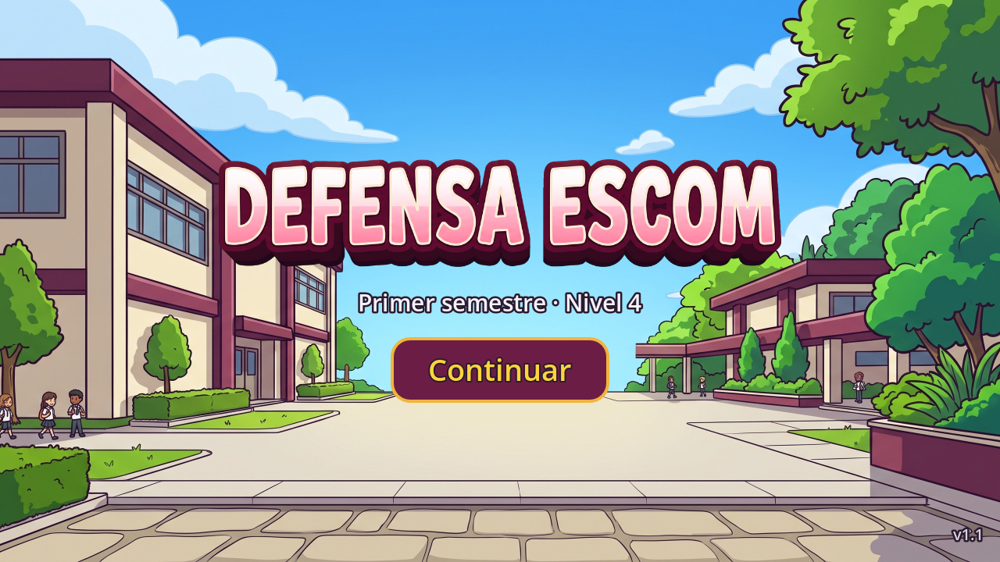
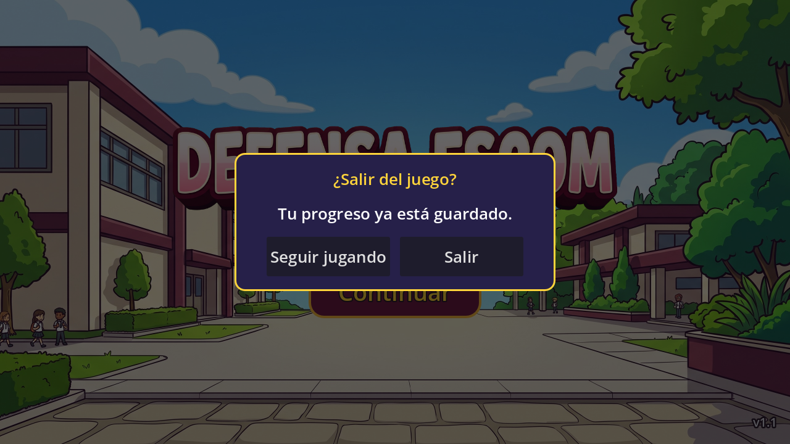

# Technical Note — v1.1 (Block 7: Foundations 2.0)

## Goal

Prepare the game for the 2.0 plan (a career of 8 semesters, 6 to 8 levels each) **without rewriting anything that already works**. Block 7 adds the data, the save format and the small Autoloads that Blocks 8 to 12 build on, plus the Android behavior a store version needs. The cards, enemies, levels, balance and rules of the 1.0 are unchanged.

What the player notices:

- World 1 is now called **"Primer semestre"** and has **6 levels**: the new short level **"Primer día"** (Café + Laptop, one short wave) comes first, and the five 1.0 levels follow in the same order (levels 2 to 6). "Primer día" is the level the Director's tutorial will guide in Block 9.
- Every screen change **fades to black and back** (0.25 s each way).
- On the home screen, the **Android back button asks "¿Salir del juego?"** instead of closing the app.
- The **screen stays on** while a level is being played (menus let the phone sleep).
- The progress saved by the 1.0 is **kept when updating**.




`.gitignore` ignores `*.keystore` and `*.jks`.

## Data resources

Rule: **every new field has a default value that reproduces the 1.0**, so the existing `.tres` files keep working without being edited. Fields marked with a block number are only stored for now; that block uses them.

| Resource | Status | New fields |
|---|---|---|
| `CampaignData` (`scripts/data/campaign_data.gd`) | NEW | `worlds: Array[WorldData]`. One file: `data/campaign.tres`, with the 8 worlds in order. |
| `WorldData` | Extended | `semester`, `location_name`, `available` (false = "Próximamente"), `map_icon` (B8), `background`, `music` (B11), `intro_dialogue`, `outro_dialogue` (B9). |
| `LevelData` | Extended | `id` (`w1_l3`), `background` (optional, overrides the world's), `intro_dialogue`, `outro_dialogue`, `reward_card`, `featured_enemy` (B9), `use_extraordinarios` (B8, default false), `is_tutorial` (B9). |
| `DialogueData` | NEW | `id`, `lines: Array[DialogueLine]` (B9). |
| `DialogueLine` | NEW | `speaker`, `expression` (normal, feliz, serio, sorprendido, preocupado, orgulloso), `text`, `show_card`, `show_enemy` (B9). |
| `DefenderType` | Extended | `description`, `icon`, `visual_scene` (B9/B10); `slow_factor` (default 1.0 = no slow), `slow_time`, `area_radius` (B12). The existing `fire_interval` and `projectile_damage` are reused. |
| `EnemyType` | Extended | `description`, `visual_scene` (B9/B10); `armor_health`, `split_into`, `split_count`, `jumps_first_defender`, `phase2_speed_multiplier` (B12). |

The DialogueData and DialogueLine scripts are created now so that the content front can write `.tres` files in parallel without editing shared scripts.

### New data layout

```
data/
├── campaign.tres                  CampaignData: world_1 … world_8
├── dialogues/                     empty (Block 9)
└── worlds/
    ├── world_1/
    │   ├── world_1.tres           "Primer semestre", Escuela Superior de Cómputo, background game_bg.jpg
    │   └── levels/
    │       ├── w1_l1.tres         NEW "Primer día" (is_tutorial = true)
    │       ├── w1_l2.tres         was level_1.tres "Inicio de semestre"
    │       ├── w1_l3.tres         was level_2.tres "Primer parcial"
    │       ├── w1_l4.tres         was level_3.tres "Segundo parcial"
    │       ├── w1_l5.tres         was level_4.tres "Tercer parcial"
    │       └── w1_l6.tres         was level_5.tres "El examen final"
    └── world_2/ … world_8/        world_N.tres with available = false and an empty levels/ folder
```

The level files were moved with `git mv` (history is kept) and only got their new `id` line. The files had no `uid`, so the paths were updated by hand in `world_1.tres`; nothing else referenced them.

| World | display_name | location_name |
|---|---|---|
| world_1 | Primer semestre | Escuela Superior de Cómputo |
| world_2 | Segundo semestre | Biblioteca Central |
| world_3 | Tercer semestre | Estadio Wilfrido Massieu |
| world_4 | Cuarto semestre | Planetario Luis Enrique Erro |
| world_5 | Quinto semestre | Centro de Lenguas (CENLEX) |
| world_6 | Sexto semestre | Dirección General |
| world_7 | Séptimo semestre | Centro de Investigación en Computación |
| world_8 | Octavo semestre | Auditorio de ESCOM |

## Autoloads

Order in *Project Settings → Autoload* (it matters: each one may use the ones above it in its `_ready()`):

| # | Autoload | Script | Responsibility |
|---|---|---|---|
| 1 | `GameSession` | `scripts/autoload/game_session.gd` | NEW. Preloads `campaign.tres` and remembers the chosen world and level (`world_index`, `level_index`). `current_world()`, `current_level()`, `current_level_number()`, `has_next_level()`, `start_level(world, level)`, `start_next_level()`, `continue_game()`, `complete_current_level(grade)`. It saves nothing. |
| 2 | `ProgressRepository` | `scripts/save/progress_repository.gd` | Rewritten for the save format v2 (below). Still the only piece that reads and writes in `user://`. |
| 3 | `AudioManager` | `scripts/autoload/audio_manager.gd` | NEW. One music player on bus `Music` and 6 effect players on bus `SFX`. `play_music(stream)` (fades out the previous song), `play_sfx(stream)`, `set_music_volume(v)`, `set_sfx_volume(v)`. No sounds yet (Block 11). |
| 4 | `SceneTransition` | `scripts/autoload/scene_transition.gd` | NEW. A `CanvasLayer` (layer 100, process mode Always) with a black `ColorRect`. `change_scene(path)`, `change_scene_to_packed(scene)` and `reload_scene()` fade to black with a Tween, unpause the tree, change the scene and fade back. `is_changing` blocks a second change. |

`default_bus_layout.tres` (NEW, project root) adds the buses `Music` and `SFX`, both sent to `Master`.

### Who asks what

- `Game`, the loading screen and the home screen ask **GameSession** which level to play (before, they asked ProgressRepository).
- When a level is won, `Game` calls `GameSession.complete_current_level(MAX_GRADE)`, which calls `ProgressRepository.complete_level(world, level_index, grade)`. `MAX_GRADE` is 10; from Block 8 each Extraordinario used takes one point away.
- Every `get_tree().change_scene_to_file()` / `change_scene_to_packed()` / `reload_current_scene()` of the game now goes through **SceneTransition**. Game no longer unpauses before leaving: the board stays frozen behind the fade and SceneTransition unpauses right before the change.

## Save format v2

ProgressRepository keeps the whole file in a `ConfigFile` in memory and writes it every time something changes.

```ini
[meta]
version=2

[world_1]
current_level=3        ; level opened by "Continuar"
unlocked_level=4       ; highest level that can be entered
completed=true         ; the last level of the world was won
grade_w1_l1=10         ; best grade per level (LevelData.id)

[seen]
dialogues=["w1_intro"]

[settings]
music_volume=0.8
sfx_volume=1.0
vibration=true
```

| Function | What it does |
|---|---|
| `get_current_level(world)`, `get_unlocked_level(world)`, `is_world_completed(world)` | Read the world's section (defaults: 1, 1, false). |
| `get_grade(world, level_index)` | Best grade, 0 if never won. Key `grade_<LevelData.id>`. |
| `complete_level(world, level_index, grade)` | Moves "Continuar" to the next level (after the last one: `completed = true` and back to level 1, as in the 1.0), unlocks the next level, keeps the grade only if it is better, saves. |
| `has_seen_dialogue(id)`, `mark_dialogue_seen(id)` | For Block 9. |
| `get_setting(key)`, `set_setting(key, value)` | `music_volume`, `sfx_volume`, `vibration`, with `DEFAULT_SETTINGS`. |
| `reset_progress()` | Erases levels, grades and dialogues, keeps the settings (debug panel now; "Borrar progreso" in Block 8). |
| `_notification(NOTIFICATION_APPLICATION_PAUSED)` | Saves when the app goes to the background. |

**Migration from 1.0.** A file without `[meta]` is a 1.0 file. Because "Primer día" now comes first, every old level number moves one place: `current_level` and `unlocked_level` of `[world_1]` get **+1** (old level 3 "Segundo parcial" is now level 4, still "Segundo parcial"). The migrated values are validated first and only then written with `version=2`; a 1.0 file with invalid values is rejected and left untouched.

**Damaged or invalid file:** same behavior as the 1.0. The game starts from zero without crashing and the home screen says *"No se pudo leer tu progreso guardado. Empiezas desde cero."*

## Android behavior

| Situation | Behavior |
|---|---|
| Back button in a level | Opens / closes the pause menu (1.0). On Victory or Defeat: returns to the home screen (1.0). Ignored while a fade is running. |
| Back button on the home screen | NEW: opens **QuitPanel** "¿Salir del juego?" (*Seguir jugando* / *Salir*). A second back closes it. |
| Back button on the loading screen | Only on its error state, like *Volver al inicio* (1.0). |
| App minimized | Game opens the pause menu (only while playing) and ProgressRepository saves. |
| Screen timeout | `display/window/energy_saving/keep_screen_on = false` for the menus; `Game` calls `DisplayServer.screen_set_keep_on(true)` in `_ready()` and `false` in `_exit_tree()`. |
| Notch / round corners | `Game._safe_side_margins()` compares `DisplayServer.get_display_safe_area()` with the 16:9 picture and `Hud.set_side_margins()` pushes the bar content inward. Only on mobile. With stretch aspect `keep`, long phones already show black side bars over the notch, so the margins are usually 0. |

## Node hierarchy

### `scenes/ui/main_menu.tscn` (modified)

```
MainMenu (Control)                       main_menu.gd
├── Background (TextureRect)
├── Center (CenterContainer)
│   └── Content (VBoxContainer)
│       ├── %Logo, %Subtitle ("Primer semestre"), %PlayButton, %LoadErrorLabel
├── VersionLabel (Label)                 "v1.1"
├── %DebugPanel (Control, hidden)
└── %QuitPanel (Control, hidden)         NEW
    ├── Dim (ColorRect)
    └── Center (CenterContainer)
        └── Panel (PanelContainer)       same style as DebugPanel
            └── Content (VBoxContainer)
                ├── Title (Label)        "¿Salir del juego?"
                ├── Message (Label)      "Tu progreso ya está guardado."
                └── Buttons (HBoxContainer)
                    ├── %QuitNoButton    "Seguir jugando"
                    └── %QuitYesButton   "Salir"
```

### Autoload nodes (created by code in their `_ready()`)

```
/root/SceneTransition (CanvasLayer, layer 100, Always)
└── ColorRect (full rect, black, alpha 0 → 1 → 0)

/root/AudioManager (Node, Always)
├── AudioStreamPlayer (bus Music)
└── AudioStreamPlayer × 6 (bus SFX)
```

`game.tscn`, `hud.tscn` and the other scenes are unchanged.

## Files

| File | Change |
|---|---|
| `scripts/autoload/game_session.gd` | NEW Autoload. |
| `scripts/autoload/audio_manager.gd` | NEW Autoload. |
| `scripts/autoload/scene_transition.gd` | NEW Autoload. |
| `scripts/data/campaign_data.gd`, `dialogue_data.gd`, `dialogue_line.gd` | NEW resources. |
| `scripts/data/world_data.gd`, `level_data.gd`, `defender_type.gd`, `enemy_type.gd` | New fields with 1.0 defaults. |
| `scripts/save/progress_repository.gd` | Save format v2, migration from 1.0, grades, dialogues, settings, save on pause. |
| `scripts/engine/game.gd` | Level from GameSession; world/level background; grade on victory; SceneTransition for restart, next and exit; keep screen on; safe area; back ignored during a fade. |
| `scripts/ui/hud.gd` | `set_side_margins(left, right)`. |
| `scripts/ui/loading_screen.gd` | Level from GameSession; changes through SceneTransition. |
| `scripts/ui/main_menu.gd` | Progress of "Primer semestre" through GameSession; "Continuar" calls `GameSession.continue_game()`; QuitPanel on back. |
| `scenes/ui/main_menu.tscn` | QuitPanel; texts "Primer semestre", "v1.1" and "Empiezas desde cero". |
| `data/campaign.tres`, `data/worlds/world_1…8/`, `data/dialogues/` | NEW data layout (above). |
| `default_bus_layout.tres` | NEW buses Music and SFX. |
| `project.godot` | 4 Autoloads in order, `keep_screen_on = false`, version `1.1`. |
| `.gitignore` | `*.jks` (the upload keystore must never be committed). |

## Tests (Godot 4.7.2, headless, with a test Autoload that only exists in a copy of the project)

All passed:

- `campaign.tres` has 8 worlds; world 1 has 6 levels in the right order; worlds 2–8 are unavailable and empty. Buses `Music` and `SFX` exist.
- Fresh install: no progress, home says *Jugar* / *Primer semestre*; *Jugar* fades to the loading screen and then to **Primer día** with the ESCOM background.
- Back on home opens QuitPanel, a second back closes it. Back in a level pauses / resumes. Minimizing pauses and writes the file. *Reiniciar nivel* reloads unpaused.
- Primer día played to the end (two Laptops in lane 2, `Engine.time_scale = 8`): victory, file has `version=2`, `current_level=2`, `unlocked_level=2`, `grade_w1_l1=10`. *Siguiente nivel* opens **Inicio de semestre**; *Salir al inicio* shows *Continuar* / *Primer semestre · Nivel 2*.
- A worse grade does not replace a better one. Winning level 6 sets `completed`, unlocks 6 and returns "Continuar" to level 1.
- Dialogues seen are remembered once. Music volume 0 mutes the bus, 0.5 sets `linear_to_db(0.5)`. `reset_progress()` keeps only the settings.
- Migration: 1.0 file `3/3` → `4/4` (level 4 is still *Segundo parcial*), written as v2 and not migrated twice; finished 1.0 world `1/5` → `2/6`; invalid 1.0 values rejected and the file left untouched.
- Garbage file, out-of-range v2 values and text values are rejected without crashing. The debug "simulate save error" still returns `ERR_FILE_CANT_WRITE`.

## How to add a world (no scripts)

1. Create `data/worlds/world_N/world_N.tres` (*New Resource → WorldData*) with a unique `id` (`world_N`), `display_name`, `semester`, `location_name` and `available = true` when it is playable.
2. Create its levels in `data/worlds/world_N/levels/` (*New Resource → LevelData*) with a unique `id` (`wN_l1`, …) and add them to `levels`.
3. Add the world to `worlds` in `data/campaign.tres` in its position. (Worlds 2–8 are already there.)
