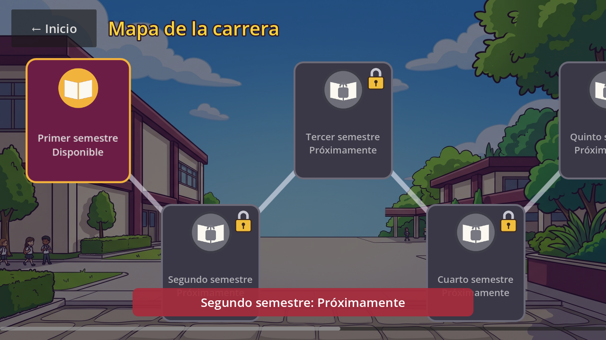
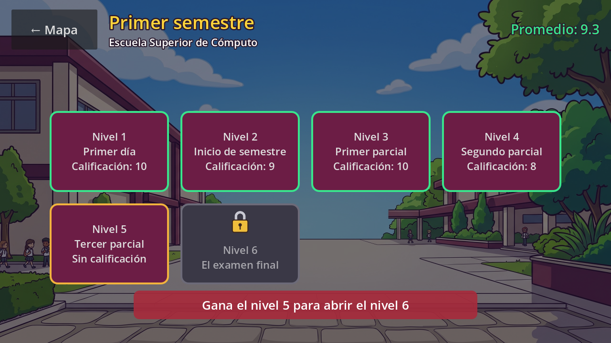
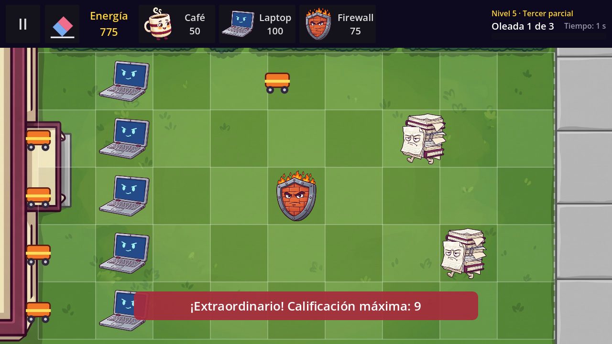
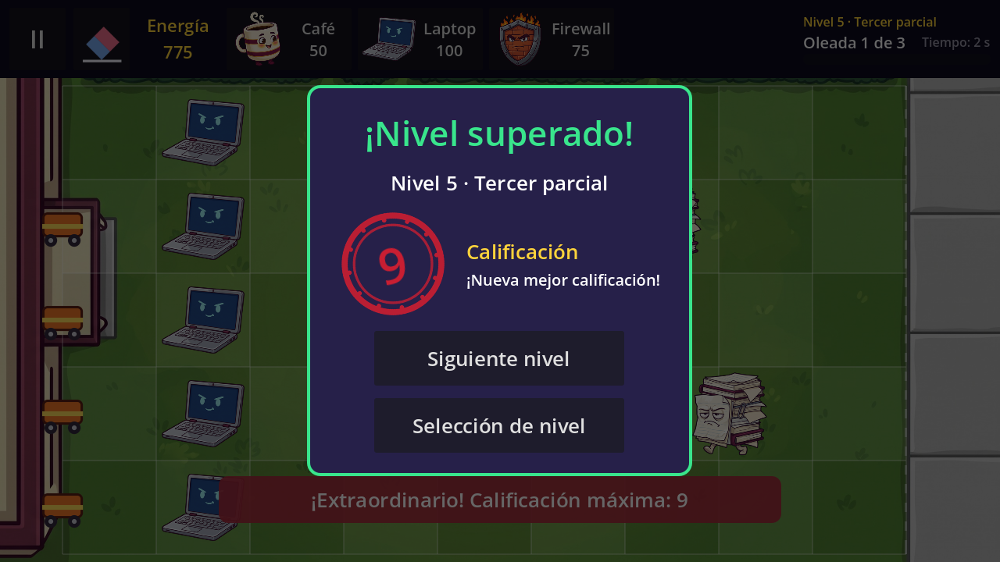
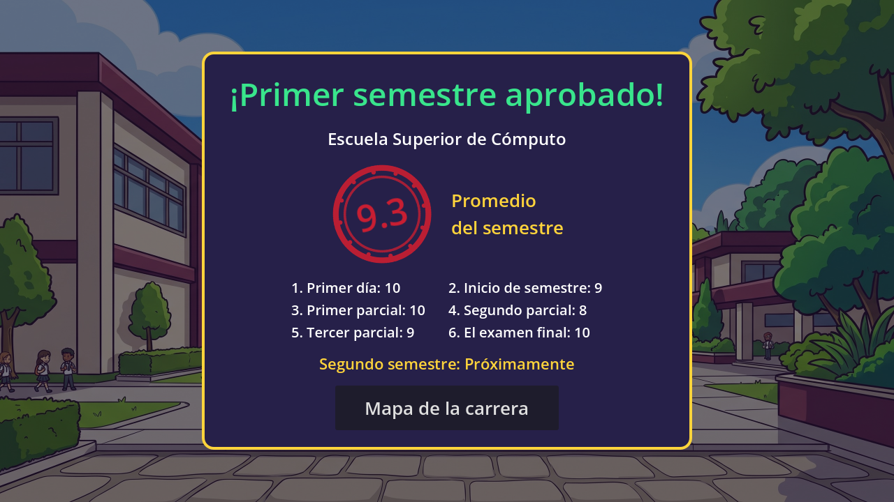
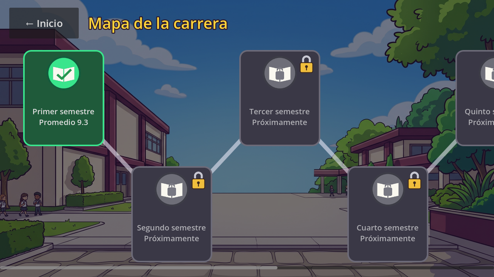
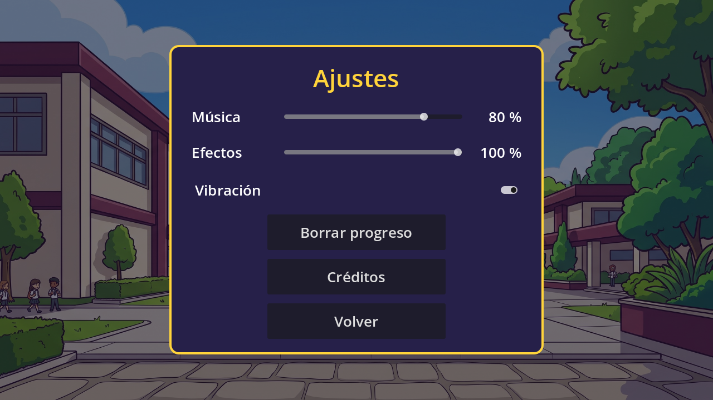
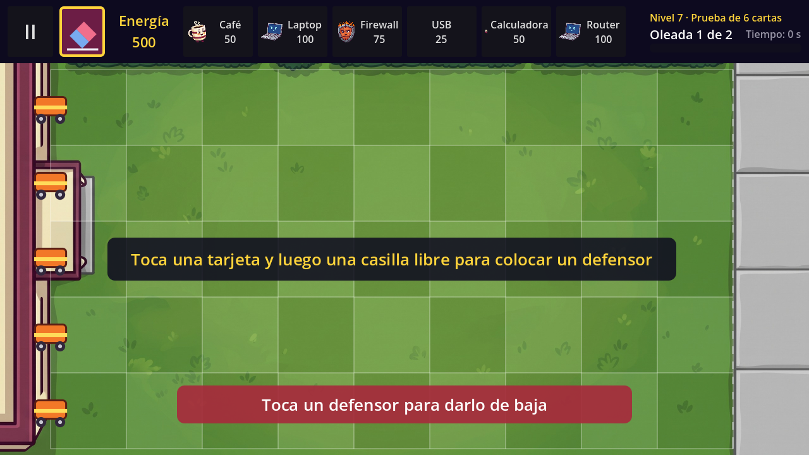

# Technical Note — v1.2 (Block 8: Career map, levels and grades)

## Goal

Let the player choose which semester and which level to play, and make every victory leave a **grade**. Block 8 builds on the Block 7 foundations (`CampaignData`, `GameSession`, save format, `SceneTransition`, `AudioManager`); the cards, enemies, waves and balance of the 1.0 are unchanged.

What the player notices:

- **New flow:** Inicio (*Jugar*/*Continuar*, *Expediente*, *Ajustes*, *Créditos*) → **Mapa de la carrera** → **Selección de nivel** → Juego → Victoria → *Siguiente nivel* or *Selección de nivel*. After the last level of a semester: Victoria → *Continuar* → **Semestre aprobado** → map.
- **Extraordinarios:** in levels 2–6 of World 1 each lane has one. The first enemy that reaches the school in a lane is not a defeat: the Extraordinario runs along the lane and removes every enemy it touches, then disappears. A second enemy in that lane is a defeat.
- **Grade 6 to 10:** 10 minus one point per Extraordinario used, never below 6. The Victory panel shows it with a stamp; the level button and the career map keep the best grade and the average of the semester.
- **Dar de baja:** an eraser button in the top bar removes a defender (no energy back).
- **Top bar for up to 6 cards** (the 1.0 did not fit 4).
- **Ajustes:** music and effects volume, vibration, *Borrar progreso* (with confirmation) and *Créditos*.

| | |
|---|---|
|  |  |
|  |  |
|  |  |
|  |  |

## Screens and Android back button

| Screen | Opens from | Back button / "Volver" goes to |
|---|---|---|
| Inicio (`main_menu.tscn`) | app start | asks **"¿Salir del juego?"** (Block 7) |
| Mapa de la carrera (`career_map.tscn`) NEW | *Jugar* / *Continuar*, Semestre aprobado | Inicio |
| Selección de nivel (`level_select.tscn`) NEW | a semester of the map; Pausa, Derrota, Victoria | Mapa |
| Juego (`game.tscn`) | a level button, *Siguiente nivel* | pause / resume (Block 7). On Victoria or Derrota: Selección de nivel |
| Semestre aprobado (`world_complete.tscn`) NEW | Victoria of the last level → *Continuar* | Mapa |
| Ajustes (`settings.tscn`) NEW | Inicio | closes the confirmation if open, else Inicio |
| Créditos (`credits.tscn`) NEW | Inicio, Ajustes | the screen that opened it |

*Expediente* is Block 9: its button is on Inicio but disabled. The hidden debug panel of the 1.0 (5 taps on the logo) stays on Inicio and still only exists when `OS.is_debug_build()` is true.

## Rules

### Locks

`GameSession` decides, `ProgressRepository` only stores:

- `is_world_unlocked(i)`: the world is `available`, has levels, and it is world 1 or the previous world is `completed` (its last level was won). So **world N+1 opens when the last level of world N is won**.
- `is_level_unlocked(world, level)`: the world is open and `level + 1 <= unlocked_level`.
- `world_lock_reason(i)` / `level_lock_reason(w, l)`: the text shown when a locked button is tapped (*"Segundo semestre: Próximamente"*, *"Aprueba Primer semestre para abrir Segundo semestre"*, *"Gana el nivel 4 para abrir el nivel 5"*). A locked button never changes the screen.

### Extraordinario

`scenes/game/extraordinario.tscn` + `scripts/engine/extraordinario.gd` (`class_name Extraordinario`). Game creates one per lane under the new `Extraordinarios` node when `LevelData.use_extraordinarios` is true. It works in cells like everything else.

| State | Meaning |
|---|---|
| `READY` | waiting at column −0.5 (left edge of the board) |
| `SWEEPING` | a Tween moves `column` from −0.5 to 9.5 in 1.2 s; every frame it removes the enemies of its lane at `column + 0.5` or behind (the boss too) |
| `USED` | hidden; it no longer saves its lane |

`Game._on_enemy_reached_safe_zone(enemy)`: if the lane's Extraordinario is `READY` it is triggered and `extraordinarios_used += 1` (short vibration and a notice with the new maximum grade); if it is already `SWEEPING` the enemy is left to the run (no defeat); otherwise, or if the level does not use them, **defeat** as in the 1.0. The run belongs to the Extraordinario node, so it freezes with the pause.

`use_extraordinarios = true` was set in `w1_l2 … w1_l6` (the plan introduces them in level 2). *Primer día* (`w1_l1`, the tutorial) keeps the 1.0 rule.

### Grade

`GameSession.grade_for(used) = max(10 − used, 6)`. On victory Game reads the saved grade, calls `GameSession.complete_current_level(grade)` (ProgressRepository keeps the grade only if it is better) and calls `VictoryPanel.show_victory(number, name, grade, previous_grade, is_last_level)`. The panel says *"¡Nueva mejor calificación!"* or *"Tu mejor calificación: N"*.

The **average** of a world (`ProgressRepository.get_world_average`) is the mean of the best grades of the levels already won; levels never won do not count.

### "Dar de baja" (eraser)

`Hud` has a toggle button `%EraserButton` (`eraser_toggled(active)` signal, `eraser_active`, `set_eraser_active()`). While it is on, `Game._on_board_cell_tapped` calls `_erase_at()`: a defender is removed with `remove_defender(lane, column)` (frees the Board cell, `queue_free()`, **no refund**) and the eraser turns off; an empty cell only shows *"Toca un defensor para darlo de baja"*. Choosing a card turns the eraser off, and turning the eraser on clears the selected card.

### Card bar (team decision)

The plan left two options: a vertical bar on the left or a compact top row. **v1.2 uses the compact top row**, so the left edge of the board stays free for the Extraordinarios. Up to `Hud.MAX_CARDS = 6` cards; with 1–3 cards they keep the 1.0 size (160 × 80), with 4–6 they use `DefenderCard.COMPACT_SIZE` (110 × 80, font 16, icon 36 px). The bar keeps its 100 px height: the pause button, energy and wave box were narrowed and the time moved next to the wave number. A level with more than 6 defenders shows the first 6 and prints a warning.

To try the vertical bar: move `%Cards` out of `HUD/Row` into a `VBoxContainer` on the left of `game.tscn` and change its type. `Hud.create_cards()` and the cards do not depend on where the box is.

## Save format v3

The keys are the same as v2 (Block 7). Changes:

- `[meta] version=3`.
- Winning the last level of a world sets `completed=true` and **no longer sends `current_level` back to 1**; it stays on the last level.
- Settings read with the wrong type or out of range fall back to the default / are clamped (a text `music_volume` no longer breaks Ajustes).
- A file with a version above 3 is rejected like a damaged file (the game starts from zero, the file is not overwritten until the next save).

### Migration from 1.0 and v1.1 (carry-over from the Block 7 review)

The 1.0 had no grades and never marked a world as finished; the v1.1 migrated those files but did not mark them either. In both versions the levels were played only in order and `current_level` went below `unlocked_level` **only** after the last level was won (it went back to level 1). So `_migrate_legacy()` does, for `world_1` of any file with version 1 (after the +1 move of Block 7) or 2:

| Case | Result |
|---|---|
| `current_level < unlocked_level` (world finished) | `unlocked_level = 6`, `completed = true` → World 1 shows as passed and World 2 will open |
| every won level from 2 (all if finished, else those before `unlocked_level`) without a grade | grade **6** (`LEGACY_GRADE`, the minimum passing grade) |
| *Primer día* (level 1) | no grade: it did not exist in the 1.0, it stays open to be played |
| grades saved by the v1.1 | kept |

Examples: 1.0 `1/5` (finished) → `2/6`, completed, grades `[–, 6, 6, 6, 6, 6]`, average 6.0. 1.0 `3/3` → `4/4`, grades `[–, 6, 6, –, –, –]`. Grade 6 is the safe default for "won, but we do not know how well": winning the level again saves the real grade, which is always 6 or more, so nothing from the 1.0 is lost and nothing is overstated. A v3 file is never migrated again (with the level select, `current_level < unlocked_level` is normal in v1.2).

## Node hierarchy

### `scenes/ui/career_map.tscn` (NEW)

```
CareerMap (Control)                         career_map.gd
├── Background (TextureRect)                menu_bg.jpg
├── Dim (ColorRect)
├── TopBar (HBoxContainer)
│   ├── %BackButton ("← Inicio")
│   └── Title (Label)                       "Mapa de la carrera"
├── %Scroll (ScrollContainer)               horizontal only
│   └── %Track (MarginContainer)            draws the path (draw signal → draw_polyline)
│       └── %Semesters (HBoxContainer)
│           └── Semester1 … Semester8       SemesterButton, created in code from campaign.worlds
│               └── Padlock (TextureRect)   only when locked
└── %Notice (notice.tscn)                   why a semester is locked
```

`SemesterButton` (`scripts/ui/semester_button.gd`) is a `Button` built in code: state `LOCKED` (grey, padlock, *Bloqueado* / *Próximamente*), `AVAILABLE` (pulses with a looping Tween, scale 1 → 1.06) or `PASSED` (green, *Promedio 9.3*). Even buttons are at the top and odd ones at the bottom, so the path zigzags.

### `scenes/ui/level_select.tscn` (NEW)

```
LevelSelect (Control)                       level_select.gd
├── Background, Dim
├── TopBar (HBoxContainer)
│   ├── %BackButton ("← Mapa")
│   ├── Titles (VBoxContainer): %Title (world name), %Subtitle (location)
│   └── %Average (Label)                    "Promedio: 9.3", hidden without grades
├── Center (CenterContainer)
│   └── %Grid (GridContainer, 4 columns)
│       └── Level1 … LevelN                 LevelButton, created in code from world.levels
└── %Notice (notice.tscn)
```

`LevelButton` (`scripts/ui/level_button.gd`): *"Nivel 3 / Primer parcial / Calificación: 10"*, *"Sin calificación"*, or number + name + padlock icon when locked. 6 to 8 levels fill the 4 × 2 grid; a new `LevelData` in `world_N.tres` appears with no script change.

### `scenes/game/extraordinario.tscn` (NEW)

```
Extraordinario (Node2D)                     extraordinario.gd
└── Sprite (Sprite2D)                       art/ui/extraordinario.png, 64 px
```

### `scenes/game/game.tscn` (modified)

```
Game (Node2D)
├── … Background, Board, Defenders, Enemies, Projectiles, Orbs
├── Extraordinarios (Node2D)                NEW: one Extraordinario per lane, created by Game
├── Effects, WaveManager
└── UI (CanvasLayer): HUD, Hint, Notice, WaveBanner, BossBar, PauseMenu, DefeatPanel, VictoryPanel, SaveErrorPanel
```

### `scenes/ui/hud.tscn` (modified)

```
HUD (PanelContainer, 100 px)                hud.gd
└── Row (HBoxContainer)
    ├── %PauseButton (72 × 80)
    ├── %EraserButton (72 × 80, toggle)     NEW, eraser.png
    ├── %EnergyLabel                        "Energía\n50"
    ├── %Cards (HBoxContainer)              up to 6 DefenderCard
    ├── Spacer
    └── WaveBox (VBoxContainer, 240 px)
        ├── %LevelLabel
        ├── WaveRow (HBoxContainer): %WaveLabel, %TimeLabel
        └── %WaveBar
```

### `scenes/ui/victory_panel.tscn` (modified)

```
VictoryPanel (Control, When Paused)
└── Center/Panel/Content (VBoxContainer)
    ├── %Title, %Message
    ├── GradeRow (HBoxContainer)            NEW
    │   ├── %StampBox (Control 140 × 140)
    │   │   └── %Seal (Control)             animated: scale 2.4 → 1, turn, fade in
    │   │       ├── Stamp (TextureRect)     grade_stamp.png
    │   │       └── %GradeLabel             "9"
    │   └── GradeText: GradeCaption ("Calificación"), %BestLabel
    ├── %NextButton                         "Siguiente nivel" / "Continuar"
    └── %HomeButton                         "Selección de nivel"
```

The stamp is animated on `%Seal` and not on `%StampBox` because containers reset the scale and rotation of their direct children.

### `scenes/ui/world_complete.tscn` (NEW)

```
WorldComplete (Control)                     world_complete.gd
├── Background, Dim
└── Center/Panel/Content (VBoxContainer)
    ├── %Title ("¡Primer semestre aprobado!"), %WorldName
    ├── AverageRow: %StampBox/%Seal (Stamp, %AverageLabel "9.3"), Caption
    ├── %Grades (GridContainer, 2 columns)  "1. Primer día: 10" … filled in code
    ├── %NextWorldLabel                     "Se abrió Segundo semestre" / "Segundo semestre: Próximamente"
    └── %MapButton                          "Mapa de la carrera"
```

### `scenes/ui/settings.tscn` (NEW)

```
Settings (Control)                          settings.gd
├── Background, Dim
├── Center/Panel/Content (VBoxContainer)
│   ├── Title ("Ajustes")
│   ├── MusicRow: Caption, %MusicSlider (0–1, step 0.05), %MusicValue ("80 %")
│   ├── SfxRow: Caption, %SfxSlider, %SfxValue
│   ├── %VibrationToggle (CheckButton)
│   ├── %EraseButton, %CreditsButton, %BackButton
├── %ConfirmPanel (hidden): "¿Borrar todo tu progreso?" %ConfirmNoButton / %ConfirmYesButton
└── %Notice                                 "Progreso borrado"
```

The sliders call `AudioManager.set_music_volume()` / `set_sfx_volume()` (bus volume with `linear_to_db`, muted at 0) and the values are saved at once in `[settings]`. *Borrar* calls `ProgressRepository.reset_progress()` (the settings stay).

### `scenes/ui/credits.tscn` (NEW) and `main_menu.tscn` (modified)

`Credits` (Control): Background, Dim, Center/Panel/Content with Title, `%Body` (team, course, engine) and `%BackButton`. `Credits.back_scene` (static) remembers who opened it.

Inicio gets `MoreButtons` (HBoxContainer) under *Jugar*: `%ExpedienteButton` (disabled), `%SettingsButton`, `%CreditsButton`. Version label `v1.2`.

## Files

| File | Change |
|---|---|
| `scripts/autoload/game_session.gd` | Scene paths, `grade_for()`, `MIN_GRADE`, world/level locks and their texts, `latest_world_index()`, `open_map()`, `open_world()`, `open_level_select()`, `open_world_complete()`. |
| `scripts/save/progress_repository.gd` | Version 3, no reset after the last level, `get_world_average()`, `_migrate_legacy()` (1.0/v1.1 finishers completed, grade 6), safe `get_setting()`, unknown versions rejected. |
| `scripts/autoload/audio_manager.gd` | `vibrate()` (only on phones, only if *Vibración* is on). |
| `scripts/engine/game.gd` | Extraordinarios, `extraordinarios_used`, `current_grade()`, `remove_defender()`, eraser, Victory with grade, exits to the level select, *Continuar* to Semestre aprobado. |
| `scripts/engine/extraordinario.gd` | NEW. |
| `scripts/ui/hud.gd`, `defender_card.gd` | Eraser button; compact cards; `MAX_CARDS = 6`. |
| `scripts/ui/victory_panel.gd` | `show_victory()` with the stamp (replaces `show_level_cleared()` / `show_world_cleared()`). |
| `scripts/ui/main_menu.gd` | *Jugar* opens the map; Ajustes and Créditos buttons. |
| `scripts/ui/career_map.gd`, `semester_button.gd`, `level_select.gd`, `level_button.gd`, `world_complete.gd`, `settings.gd`, `credits.gd` | NEW. |
| `scenes/ui/*` | New screens above; Defeat and Pause exit buttons now say *Selección de nivel*. |
| `data/worlds/world_1/levels/w1_l2…w1_l6.tres` | `use_extraordinarios = true`. |
| `art/ui/` | NEW placeholder art (generated shapes, to be replaced by the art batch): `semester_locked/available/passed.png`, `padlock.png`, `grade_stamp.png`, `extraordinario.png`, `eraser.png`. No text inside the images. |
| `project.godot` | `config/version = "1.2"`. |

## Android version

`application/config/version` is `1.2`. The Android export preset (`export_presets.cfg`) is still not in the repository, so the preset on each laptop must use **version/name `1.2`** and **version/code `3`** (one more per release since the 1.0: 1.0 → 1, 1.1 → 2, 1.2 → 3). For the vibration to work on a phone, enable **Permissions → Vibrate** in that preset.

## Tests (Godot 4.7.2, headless, in a copy of the project with its own user folder)

The automated suite of v1.1 was kept and extended: **462 checks, all passed** (the 1.0 / v1.1 checks were adapted only where the flow changed: exits to the level select, no reset after the last level, version 3, Extraordinarios in levels 2–6). Block 8 adds 129 checks, among them:

- Grade rule: 0/1/2 Extraordinarios → 10/9/8, minimum 6; a worse grade does not replace a better one (P06).
- P07: the first enemy in a lane triggers its Extraordinario (no defeat), the run removes every enemy of that lane and none of the others, freezes in pause, and a second enemy in the same lane is a defeat. Levels without Extraordinarios keep the 1.0 defeat.
- P05: tapping a locked level or world does not change the screen and shows why.
- Winning the last level of World 1 opens World 2 (tested with a temporary World 2), shows Semestre aprobado with the average and keeps the progress.
- 1.0 and v1.1 migration (finished and unfinished, grades kept).
- P14: music at 0 in Ajustes is still 0 (bus muted, slider at 0 %) after restarting the game.
- Eraser (real taps), 6-card bar inside the screen, 7 defenders → 6 cards.
- P04: back navigation through every screen.
- P17: a `LevelData` added to the world (in memory and as a `.tres`) appears in the level select and can be played.
- Real waves of the 6 levels of World 1 won with grade 10.
