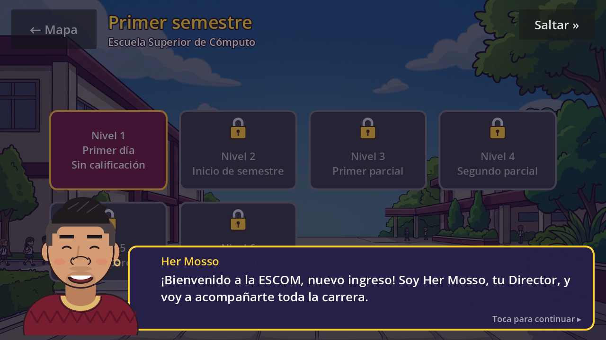
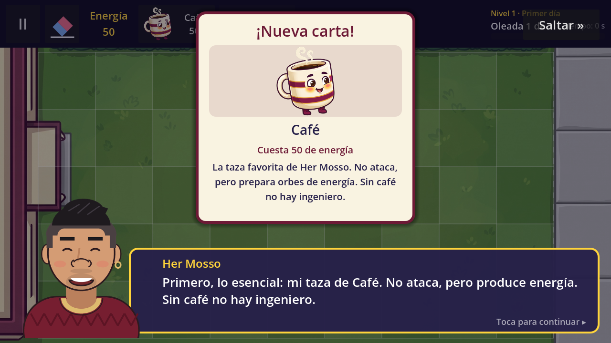
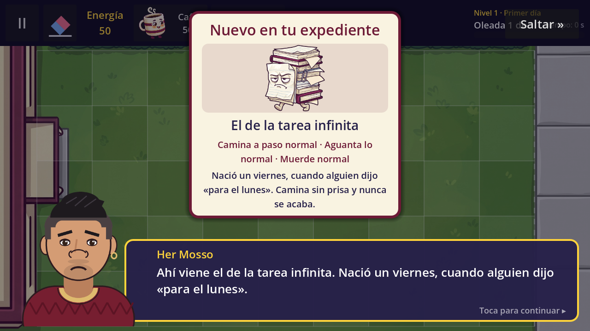
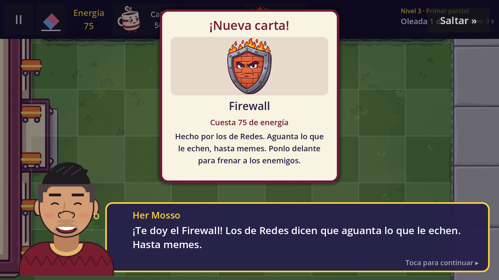
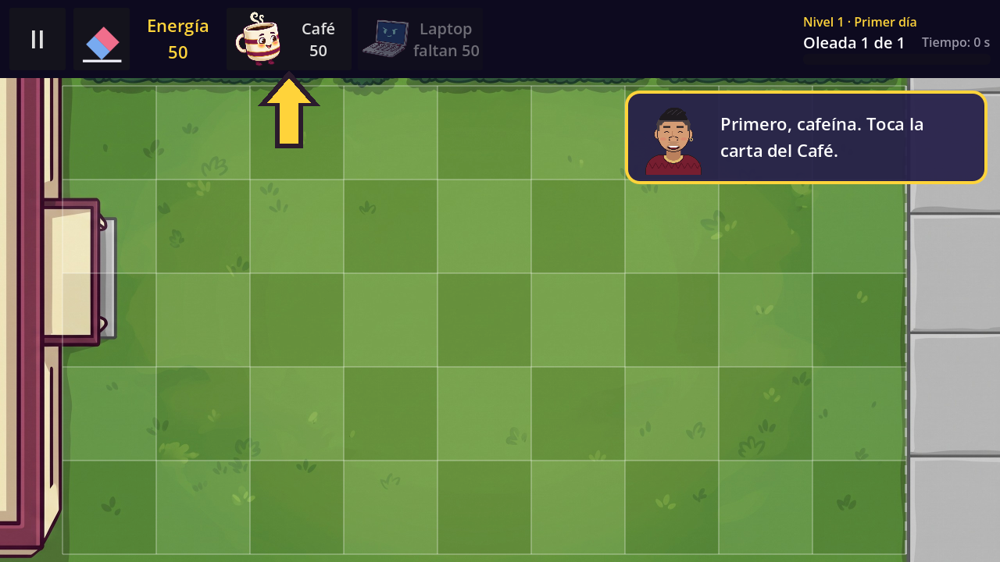
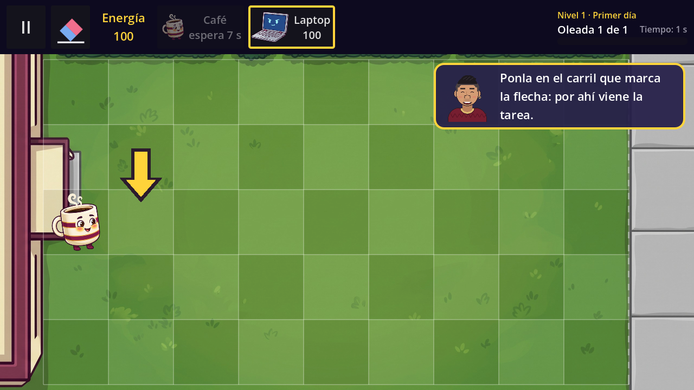
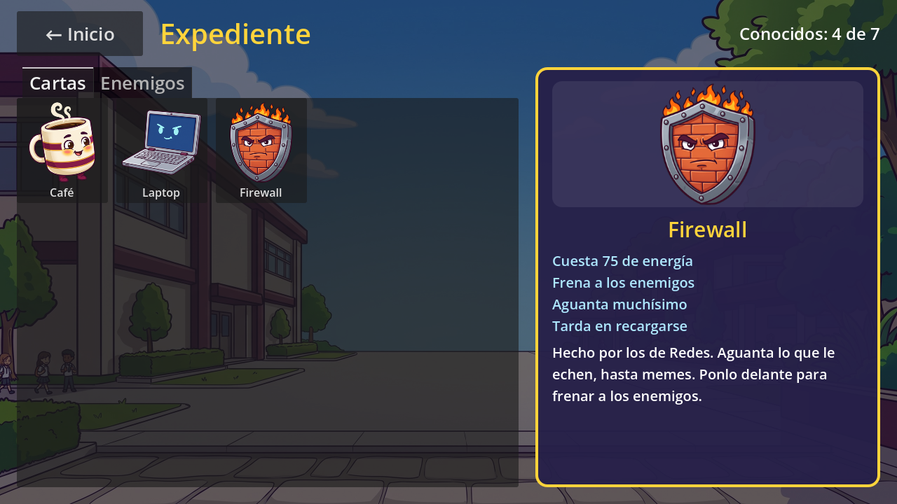
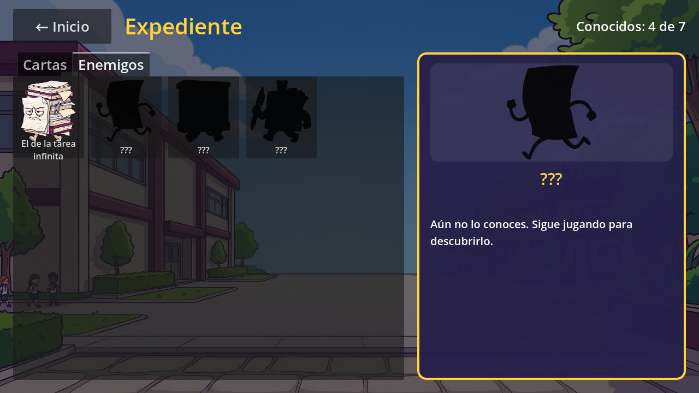
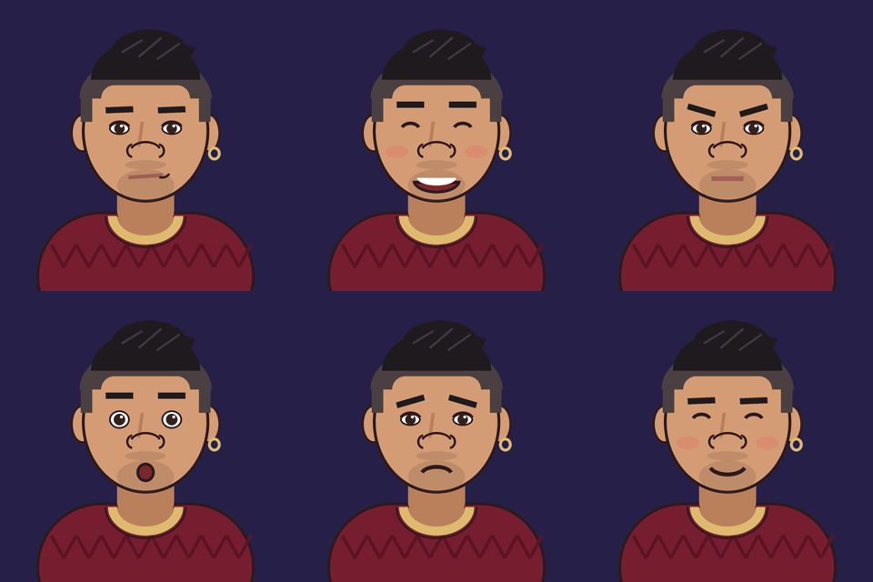

# Technical Note — v1.3 (Block 9: The Director, tutorial and Expediente)

## Goal

Make the game explain itself and let the story go with the player from the first screen. Block 9 builds on the data of Block 7 (`DialogueData`, `DialogueLine`, the `[seen]` section of the save) and the screens of Block 8. Cards, enemies, waves and balance are unchanged.

What the player notices:

- **The Director, Her Mosso**, talks in a dialogue box with his portrait (6 expressions). He welcomes the player to the semester, presents every new card (**"¡Nueva carta!"**) and every new enemy (**"Nuevo en tu expediente"**), announces the boss and congratulates the player when the semester is passed.
- **Guided tutorial** in *Primer día* (World 1, level 1): an animated arrow and a speech bubble lead the player step by step. The waves wait until the steps are done.
- **Expediente** (Inicio → *Expediente*): the catalog of cards and enemies. What has not been met yet is a black silhouette called **???**.
- Conversations and the tutorial are shown **only once**; replaying a level goes straight to the waves (P08).

| | |
|---|---|
|  |  |
|  |  |
|  |  |
|  |  |

## The story

The player is a new student at ESCOM and **Her Mosso**, the Director, is the narrator. In the basement there is the **Archivo Muerto**, where the homework nobody delivered ends up; every semester it wakes up and marches to the classrooms. The player has to reach graduation (8 semesters) without letting any of it in.

World 1 is a small mystery with school humor: on the first day there are too many tasks awake, by the third partial they come out together ("someone is organizing them… someone cumulative"), and the culprit is the boss, **El Examen Final**. When he falls he drops a stamp, *"Biblioteca Central. Préstamo vencido"*: the hook to World 2 (Biblioteca Central). Running jokes: the Café is the Director's favorite mug and the Laptop is his old one ("older than you, but it compiles"); the Firewall was built by the Networks people ("it holds anything, even memes"). Teachers are never real people: the enemies are archetypes (the endless homework, the pop quiz, the 200 slides). The World 2 scripts continue the mystery up to the first hint of **El Sínodo**, the final boss of semester 8.

## When the Director talks

| Moment | Data | Screen that plays it |
|---|---|---|
| First time a world is entered | `WorldData.intro_dialogue` | Selección de nivel (`level_select.gd`) |
| Before the first wave of a level | `LevelData.intro_dialogue` | Game (`_begin_level()`) |
| After the last wave, before Victory | `LevelData.outro_dialogue` (+ `reward_card`) | Game (`_on_all_waves_cleared()`) |
| Semester passed | `WorldData.outro_dialogue` | Semestre aprobado (`world_complete.gd`) |

Every conversation is played with `await dialogue_box.play_once(conversation)`: it does nothing if the resource is empty or its `id` is already in `[seen] dialogues`; otherwise it shows it, waits for the end and saves the `id`.

### World 1 conversations (`data/dialogues/`)

| File | Where | Presents |
|---|---|---|
| `w1_intro.tres` | World 1 intro | — |
| `w1_l1_intro.tres` / `w1_l1_outro.tres` | *Primer día* | Café, Laptop, El de la tarea infinita |
| `w1_l2_intro.tres` / `w1_l2_outro.tres` | *Inicio de semestre* (explains the Extraordinarios; `reward_card` = Firewall) | — |
| `w1_l3_intro.tres` | *Primer parcial* | **Firewall**, El del examen sorpresa |
| `w1_l4_intro.tres` | *Segundo parcial* | El de las 200 diapositivas |
| `w1_l5_intro.tres` | *Tercer parcial* | — |
| `w1_l6_intro.tres` / `w1_l6_outro.tres` | *El examen final* (the outro leaves the clue for World 2) | El examen final (boss) |
| `w1_outro.tres` | Semestre aprobado | — |

There are 11 conversations of 4 or 5 lines each. The World 2 scripts are written in `docs/dialogues-world-2.md`; Block 12 turns them into `.tres` files when the World 2 cards and enemies exist.

`LevelData.featured_enemy` was set in levels 1, 3, 4 and 6. If the player skipped the conversation before meeting that enemy, Game shows the notice *"¡Cuidado! Ahí viene: …"* the first time it enters the board.

## Dialogue box

`scenes/ui/dialogue_box.tscn` + `scripts/ui/dialogue_box.gd` (`class_name DialogueBox`). A `CanvasLayer` (layer 5, above the game UI) with **process mode Always**: while it talks, `get_tree().paused = true`, so the board, the waves and the timers freeze, but the box and its Tweens keep working. When it ends, the pause goes back to what it was before (it stays paused after a victory).

| Action | Result |
|---|---|
| `play(conversation)` | slides the portrait in from the left, starts the "breathing" Tween (scale 1.00 → 1.02) and shows line 0 |
| tap while a line is being written | the line appears complete (`visible_ratio = 1`) |
| tap on a complete line | next line; after the last one, `finish()` |
| *Saltar* or the Android back button | `finish()` at once |
| `finish()` | hides the box, restores the pause and emits `finished` |

- **Typewriter:** a Tween on `RichTextLabel.visible_ratio` from 0 to 1 in `text.length() × 0.03 s`.
- **Portrait:** `art/director/<expression>.png`; the expression comes from `DialogueLine.expression` (normal, feliz, serio, sorprendido, preocupado, orgulloso).
- **Speaker:** `DialogueLine.speaker` now defaults to **"Her Mosso"**; the `.tres` files do not store it, so changing the default changes every line.
- **Presentations:** a line with `show_card` shows the big card (picture, name, *"Cuesta 75 de energía"*, description) under **"¡Nueva carta!"**; with `show_enemy`, the enemy's file under **"Nuevo en tu expediente"** with its stats in words. It pops in with a Tween (scale 0.6 → 1, `TRANS_BACK`) and marks the card or enemy as known.
- **Back button:** Game, Selección de nivel and Semestre aprobado ask `dialogue_box.is_open()` first; if it is open, back works as *Saltar* (the pause menu does not open).

## Tutorial of *Primer día*

`scenes/game/tutorial.tscn` + `scripts/engine/tutorial.gd` (`class_name Tutorial`) and `scenes/ui/tutorial_pointer.tscn` + `scripts/ui/tutorial_pointer.gd` (`class_name TutorialPointer`).

It runs only if `LevelData.is_tutorial` is true and `"tutorial_w1_l1"` is not in `[seen] dialogues`. Game waits for it: `await tutorial.run(self)`, then starts the waves.

`steps` is a plain list of Dictionaries; each step shows its text in the bubble and waits for one Game signal:

| # | Text (bubble) | Waits for | Arrow |
|---|---|---|---|
| 0 | Primero, cafeína. Toca la carta del Café | `card_selected(Café)` | under the Café card, pointing up |
| 1 | Toca una casilla para ponerlo | `defender_placed(Café, any cell)` | first free cell of lane 2 (back to the card if it is put away) |
| 2 | Cuando salga el orbe, tócalo antes de que se enfríe | `orb_collected` | on the orb, when there is one |
| 3 | Te regalo 75 de energía; toca la Laptop | `card_selected(Laptop)` (`gift: 75` → 25 + 75 = 100, the Laptop's cost) | under the Laptop card |
| 4 | Ponla en el carril que marca la flecha | `defender_placed(Laptop, lane 2)` | first free cell of lane 2 |

- **New Game signals:** `card_selected(type)`, `defender_placed(type, lane, column)`, `orb_collected(amount)`. The tutorial only listens; Game keeps the rules.
- **Lane rule:** in step 4, `Game._on_board_cell_tapped()` asks `tutorial.allows_placement(type, lane)`; a Laptop outside lane 2 is refused with *"Ponla en el carril que marca la flecha"* and no energy is spent (the three tasks of *Primer día* walk along lane 2).
- **Arrow:** `_process()` moves `TutorialPointer` every frame to what the current step needs (its tip is the node position). It bobs with a looping Tween and, as the Tutorial node is Pausable, it freezes with the pause.
- While the Director talks or the tutorial runs, the empty-board hint (*"Toca una tarjeta…"*) is hidden. At the end the bubble says *"¡Listo! En unos segundos llega la tarea…"* for 5 s.

## Expediente

`scenes/ui/expediente.tscn` + `scripts/ui/expediente.gd` (`class_name Expediente`). Inicio's *Expediente* button is now enabled.

- **Catalog from data:** `Expediente.all_cards(campaign)` and `all_enemies(campaign)` walk every level of `campaign.tres` (cards of the bar + `reward_card`; enemies of the waves + `summon_type` + `split_into`), without repeats and in the order the player meets them. A card or enemy added to a level appears here without touching scripts (`usb.tres`, which no level uses yet, does not appear).
- **Known or ???:** `ProgressRepository.is_known(kind, type)`. Unknown entries are the picture tinted black (`icon_*_color` overrides) with the name *???*; their file says *"Aún no lo conoces. Sigue jugando para descubrirlo."*
- **When something becomes known** (`ProgressRepository.mark_known()`, saves only if something is new): the cards of the bar when a level starts; an enemy when it enters the board; a card or enemy presented by the Director; the `reward_card` when its level is won.
- **Stats in words** (static, also used by the presentation of enemies):

| Card | Enemy |
|---|---|
| *Cuesta N de energía* | *Jefe del semestre* (boss) |
| behavior read from `behavior_scene`: *Da 25 de energía cada 10 s* / *Dispara cada 1.5 s* / *Frena a los enemigos* | speed: *Muy lento* (< 0.2 cells/s), *Camina a paso normal* (< 0.4), *Rápido* (< 0.5), *Muy rápido* |
| health: *Aguanta poco* (< 500), *bastante* (< 1000), *muchísimo* | health: *Aguanta poco* (< 150), *lo normal* (< 400), *mucho* (< 1000), *muchísimo* |
| cooldown: *Se recarga rápido* (≤ 8 s), *a ritmo normal* (≤ 15 s), *Tarda en recargarse* | *Muerde muy fuerte* (≥ 50/s) or *Muerde normal*; *Llama a: …* if it summons |

The `description` field of the four defenders and the four enemies was filled in (Spanish, shown in the game).

## Save file

Same format and version (3). Block 9 only adds keys to the `[seen]` section, which older versions ignore, so no migration is needed:

```
[seen]
dialogues=["w1_intro", "w1_l1_intro", "tutorial_w1_l1", ...]
cards=["cafe", "laptop", "firewall"]
enemies=["tarea_infinita", "examen_sorpresa"]
```

Cards and enemies are saved by the name of their file (`cafe` for `data/defenders/cafe.tres`). *Borrar progreso* clears them with the rest of the progress (settings are kept).

## Director art

`art/director/normal.png`, `feliz.png`, `serio.png`, `sorprendido.png`, `preocupado.png`, `orgulloso.png` (512 × 512, transparent background, same framing). A cartoon of the school's Director, drawn from his photos, under the name **Her Mosso**. His permission to use his image is required before the game is shared (plan, section 7.4). To replace the art, overwrite the six files with the same names; no scene or script changes.



## Node hierarchy

### `scenes/ui/dialogue_box.tscn` (NEW)

```
DialogueBox (CanvasLayer, layer 5, process mode Always)   dialogue_box.gd
├── Dim (ColorRect)                          full screen; receives the taps (advance)
├── %Presentation (Control, hidden)
│   └── %PresentationCard (PanelContainer)   animated with scale
│       └── Content (VBoxContainer)
│           ├── %PresentationTitle           "¡Nueva carta!" / "Nuevo en tu expediente"
│           ├── ImageBack/%PresentationImage
│           ├── %PresentationName, %PresentationInfo, %PresentationDescription
├── Box (PanelContainer, bottom)
│   └── Content (VBoxContainer)
│       ├── %NameLabel                       "Her Mosso"
│       ├── %TextLabel (RichTextLabel)       typewriter (visible_ratio)
│       └── %ContinueLabel                   "Toca para continuar ▸"
├── %Portrait (TextureRect, 320 × 320)       slides in and breathes
└── %SkipButton                              "Saltar »"
```

### `scenes/game/tutorial.tscn` and `scenes/ui/tutorial_pointer.tscn` (NEW)

```
Tutorial (Node)                              tutorial.gd
├── Layer (CanvasLayer, layer 2)
│   ├── %Bubble (PanelContainer, top right)
│   │   └── Row: Face (TextureRect, feliz.png), %BubbleText (Label)
│   └── %Pointer (TutorialPointer)           tutorial_pointer.tscn
└── HideTimer (Timer)                        hides the last message

TutorialPointer (Node2D)                     tutorial_pointer.gd; position = tip of the arrow
└── Arrow (Node2D)                           bobs with a Tween
    ├── Outline (Polygon2D)
    └── Fill (Polygon2D)
```

### `scenes/ui/expediente.tscn` (NEW)

```
Expediente (Control)                         expediente.gd
├── Background, Dim
├── TopBar (HBoxContainer): %BackButton ("← Inicio"), Title, %Counter ("Conocidos: 4 de 7")
├── Tabs (TabContainer)
│   ├── Cartas (ScrollContainer) / %CardsGrid (GridContainer, 5 columns)
│   └── Enemigos (ScrollContainer) / %EnemiesGrid
│       └── one Button per card or enemy, created in code
└── File (PanelContainer)
    └── Content: ImageBack/%DetailImage, %DetailName, %DetailStats, %DetailDescription
```

### Modified scenes

- `game.tscn`: `Tutorial` and `DialogueBox` instanced as children of `Game` (after `UI`).
- `level_select.tscn`, `world_complete.tscn`: `DialogueBox` instanced as the last child.
- `main_menu.tscn`: `%ExpedienteButton` enabled.

## Files

| File | Change |
|---|---|
| `scripts/ui/dialogue_box.gd`, `scenes/ui/dialogue_box.tscn` | NEW. |
| `scripts/engine/tutorial.gd`, `scenes/game/tutorial.tscn` | NEW. |
| `scripts/ui/tutorial_pointer.gd`, `scenes/ui/tutorial_pointer.tscn` | NEW. |
| `scripts/ui/expediente.gd`, `scenes/ui/expediente.tscn` | NEW. |
| `scripts/engine/game.gd` | Signals `card_selected`, `defender_placed`, `orb_collected`; `_begin_level()` (intro → tutorial → waves); lane rule of the tutorial; outro before Victory; known cards/enemies; featured enemy notice; back button skips the dialogue; wave label set before the first wave. |
| `scripts/save/progress_repository.gd` | `is_known()`, `mark_known()` (`[seen] cards` / `enemies`). |
| `scripts/ui/hud.gd` | `get_card(type)`. |
| `scripts/ui/level_select.gd`, `world_complete.gd` | World intro / outro, back = *Saltar*. |
| `scripts/ui/main_menu.gd`, `scripts/autoload/game_session.gd` | *Expediente* button, `EXPEDIENTE_SCENE`. |
| `scripts/data/dialogue_line.gd` | `speaker` defaults to "Her Mosso". |
| `data/dialogues/*.tres` | NEW: 11 conversations of World 1. |
| `data/worlds/world_1/world_1.tres`, `levels/w1_l1…w1_l6.tres` | Dialogues (outros in levels 1, 2 and 6), `reward_card` (level 2) and `featured_enemy` linked. |
| `data/defenders/*.tres`, `data/enemies/*.tres` | `description`. |
| `art/director/*.png` | NEW: portrait in 6 expressions. |
| `docs/dialogues-world-2.md` | NEW: World 2 scripts for Block 12. |
| `project.godot` | `config/version = "1.3"`. |

## Android version

The preset on each laptop uses **version/name `1.3`** and **version/code `4`**.

## Tests (Godot 4.7.2, headless, in a copy of the project with its own user folder)

126 checks, all passed. Among them:

- World intro: opens the first time, pauses the game, first tap completes the line, second tap goes on, the end unpauses; not shown again (P08).
- *Primer día*: waves wait for the intro and the tutorial; card and enemy presentations; back button = *Saltar* without opening the pause menu; arrow on the Café card; each step advances with its event; orb + gift = 100 energy; Laptop refused outside lane 2 with no energy spent; waves start after the last step; real waves won; the outro appears before the Victory panel, which then shows with the game still paused.
- Replay of *Primer día*: no intro, no tutorial, the waves start at once.
- Level 2: the Firewall becomes known when the level is won; the outro plays. Level 3 starts presenting the Firewall.
- Expediente: 3 cards and 4 enemies in the catalog, unknown ones as *???*, counter, stats in words.
- Inicio: *Expediente* enabled. Semestre aprobado: semester outro, unpaused at the end.
- Every line of the 11 conversations fits in the dialogue box (3 lines of text at most) and every presented card stays above the box; each conversation has 4 to 12 lines.
- `[seen]` survives a reload; *Borrar progreso* clears the Expediente.
