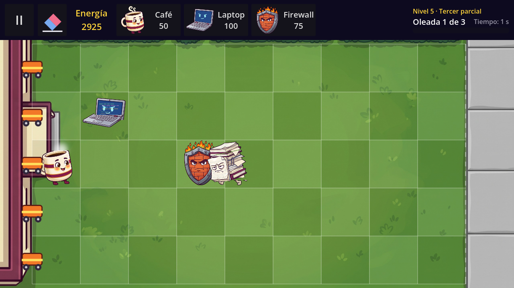
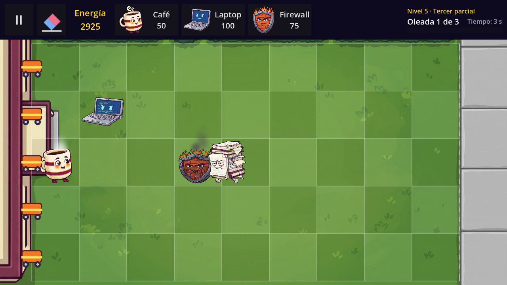
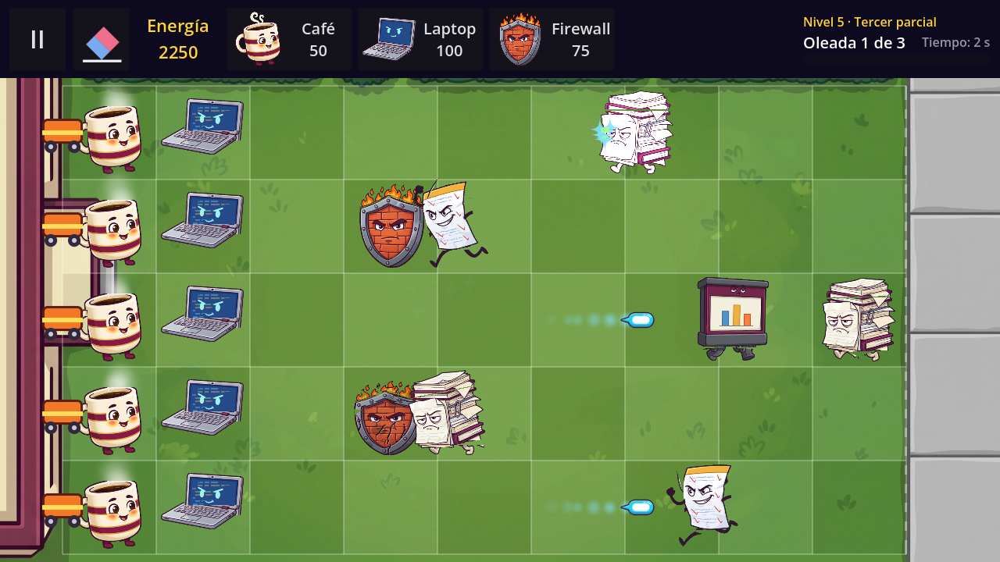
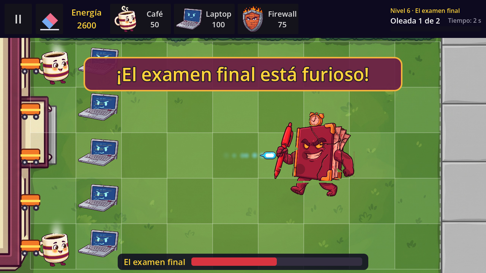
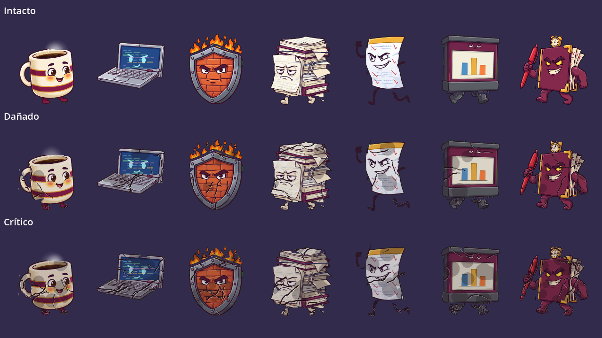

# Technical Note — v1.4 (Block 10: Cut-out animation and progressive damage)

## Goal

Make every character move like in a professional game and show the damage **on the character**, not on a bar. Block 10 builds on the `visual_scene` and `armor_health` / `phase2_speed_multiplier` fields that Block 7 added to `DefenderType` and `EnemyType`. Cards, enemies, waves and balance are unchanged.

What the player notices:

- **All characters move.** The Café sways with steam and hops when it releases an orb; the Laptop has code running on its screen and recoils with a screen flash when it shoots; the Firewall's bricks "breathe" and it compresses when it is bitten. Enemies walk with alternating legs and a bobbing body (faster enemies move their legs faster), lean in when they bite, and fall backwards dropping paper bits when they die. The white hit flash of the 1.0 is kept.
- **Damage in 3 stages (P09):** a defender goes from intact to damaged (below 66 % health) to critical (below 33 %): its pieces show cracks, chipped bits and soot, some pieces fall, it shakes harder, and in the critical stage it smokes. When it dies, it falls apart: the pieces fall spinning and fade.
- **Projectiles** leave a short trail and burst into code bits on impact. **Energy orbs** pop out with a bounce and, when tapped, fly to the energy counter before the energy is added.
- **El examen final** enters with a camera shake. At 50 % health it changes phase: cracked, red and bigger, the banner says *"¡El examen final está furioso!"* and the camera shakes again.
- **Fixes of v1.3** (see below): the tutorial no longer gets stuck if the only Café is erased, and its arrow no longer covers the pause menu.

| | |
|---|---|
|  |  |
|  |  |
|  |  |

> **The art is placeholder.** The real cut-out art (art batches 1–2 of the plan: the "vista desarmada" sheets of the Café, Laptop, Firewall, the three World 1 enemies and the boss) is not in the repository yet. The pieces in `art/characters/` were cut **from the 1.0 images** and their damage (cracks, chipped bits, soot) is **drawn by a script**. They go through the same cutting script the real sheets will use, so replacing them is only running the script again (see *Replacing the placeholder art*).

## The puppet: `CharacterVisual`

`scripts/entities/character_visual.gd` (`class_name CharacterVisual extends Node2D`) is the base of every puppet. Each character has its own scene in `scenes/visuals/`:

| Scene | Pieces (pivot) | Animations |
|---|---|---|
| `cafe_visual.tscn` | Body (bottom), Handle (where it joins the mug), LegL, LegR (hips) + `Steam` (CPUParticles2D) | idle, action, hit, die |
| `laptop_visual.tscn` | Base (bottom), Lid (**hinge**) + `CodeScreen`, `Flash` | idle, action, hit, die |
| `firewall_visual.tscn` | Frame (bottom), Bricks (center), Flames (bottom) | idle, hit, die |
| `tarea_infinita_visual.tscn` | Body (bottom), **Armor** (the pile of homework on top), LegL, LegR (hips) | idle, walk, attack, hit, die |
| `examen_sorpresa_visual.tscn` | Body, ArmL, ArmR (**shoulders**), LegL, LegR (hips) | idle, walk, attack, hit, die |
| `diapositivas_visual.tscn` | Body (bottom), LegL, LegR (wheels) | idle, walk, attack, hit, die |
| `examen_final_visual.tscn` | Body, Clock, ArmPen (shoulder), LegL, LegR | idle, walk, attack, hit, die |

```
CafeVisual (Node2D)                     character_visual.gd  (design_width = 256)
├── Rig (Node2D)                        its origin is at the feet: squash and falls pivot there
│   ├── LegL, LegR (Sprite2D)           hframes = 3, centered = false; position = pivot (hip),
│   ├── Body (Sprite2D)                 offset = top-left corner of the piece relative to its pivot
│   │   ├── Handle (Sprite2D)           show_behind_parent
│   │   └── Steam (CPUParticles2D)
└── AnimationPlayer                     RESET + the animations of the table
```

A piece hangs from its **pivot**: the `Sprite2D` is placed on the pivot (hip, shoulder, laptop hinge) and its `offset` moves the picture so that rotating the node turns the piece around that point. Pieces that must move together are children of another piece (the Café's handle follows the body).

**API**

| Member | What it does |
|---|---|
| `@onready var anim: AnimationPlayer = $AnimationPlayer` | |
| `play(anim_name)` | Plays a loop / state animation if the puppet has it and it is not already the current one (Enemy calls it every frame). |
| `play_once(anim_name)` | One-shot (`hit`, `action`); when it ends it goes back to the last `play()` animation. A one-shot that is already playing is not restarted (bites arrive every frame). |
| `set_damage_stage(stage)` | `frame = stage` on every `Sprite2D` with `hframes == 3` (at any depth). |
| `drop_piece(name)` | One piece falls spinning and fades (the armor). |
| `die(disassemble)` | Plays `die`, then the pieces fall apart spinning (defenders) or the puppet only fades (enemies), and frees itself. |
| `design_width` | Width of the source art (256; the boss 512). Enemy and Defender scale the puppet to `sprite_size` / 110 px. |
| `walk_base_speed` | Speed (cells/s) the walk cycle was animated for. Default 0.25. |

Before changing animation the puppet applies its `RESET` animation (the rest pose of every animated property), so no piece keeps the pose of the previous animation.

**Fixed animation names** (plan, section 4.3): enemies `idle`, `walk`, `attack`, `hit`, `die`; defenders `idle`, `action`, `hit`, `die`. The Firewall has no `action` (a blocker does nothing on its own). A missing animation is simply not played.

## How Enemy and Defender use it

`enemy.tscn` and the three defender scenes got one empty `Visual` (Node2D) child. In `_ready()`:

- If the type has a `visual_scene`, the puppet is instanced inside `Visual`, scaled to the board size, and the 1.0 `Sprite`/letter is hidden.
- If it has none, everything works as in the 1.0 (fixed image with sway, or the letter / box placeholder). `usb.tres` still has neither.

| Event | Enemy | Defender |
|---|---|---|
| Walking | `play("walk")`, `anim.speed_scale = speed / walk_base_speed` (tarea 1.0, sorpresa 2.4, diapositivas 0.6, boss 0.48) | — |
| Biting | `play("attack")`, `speed_scale = 1` | `play_once("hit")` at the pace of the 1.0 shake |
| Café releases an orb / Laptop shoots | — | `play_once("action")` |
| Hit by a projectile | 1.0 white flash + `play_once("hit")` | — |
| Death | gold sparks + paper bits; the puppet moves to `Effects` and falls backwards | the puppet moves to `Effects` and falls apart |

When an entity dies it is freed **at once**, as before (the Board cell, the enemy group and the rules do not wait). Only its puppet survives in the `Effects` node (`Node.reparent()` keeps its place on screen) to play the death, and frees itself. Every animation is an `AnimationPlayer` or a `Tween` of a Pausable node, so everything freezes with the pause.

## Progressive damage

`Defender.stage_for(health_ratio)`: **> 66 % → 0** (intact), **66–33 % → 1** (damaged), **< 33 % → 2** (critical). The thresholds are `STAGE_DAMAGED_RATIO = 0.66` and `STAGE_CRITICAL_RATIO = 0.33`. The stage only goes up. When it goes up:

1. `visual.set_damage_stage(stage)` — the pieces show frame 1 or 2.
2. A burst of falling pieces in the defender's color (`FxLimits.DEBRIS`).
3. A stronger shake (10 px, of the `Visual` node, on top of the 4 px shake of each bite).
4. Critical stage: continuous smoke (`CPUParticles2D` "Smoke", `FxLimits.SMOKE`).

A defender without puppet (fixed 1.0 image) has no stages, exactly like the 1.0.

**Armor** (`EnemyType.armor_health`, used from Block 12): the armor takes the damage first; what is left over goes to the health. When it runs out, `Enemy.armor_broken` is emitted once and the piece called `Armor` of the puppet falls (in El de la tarea infinita, the pile of homework on top). No World 1 enemy has armor yet, so nothing changes in the levels.

## Boss

- **Entry:** `Game.shake_camera(14 px, 0.7 s)`: a Tween on the `offset` of the new `Camera2D` of `game.tscn` (`anchor_mode` top-left, so it changes nothing while it is still).
- **Phase 2 at 50 % health** (`Enemy.PHASE2_HEALTH_RATIO`), once: `Enemy.phase_changed`; the puppet shows its damaged frames, turns red and grows 12 %; the banner says *"¡El examen final está furioso!"* and the camera shakes (10 px, 0.5 s). The speed is multiplied by `EnemyType.phase2_speed_multiplier` (the walk cycle too); El examen final keeps it at **1.0**, so the balance of the 1.0 does not change.

## Projectiles and orbs

- `projectile.tscn` has a `Trail` (`CPUParticles2D`, world coordinates, 6 particles, 0.18 s). On impact: the 1.0 blue sparks + green code bits (`FxLimits.HIT_BITS`).
- `EnergyOrb`: it appears from scale 0, jumps 40 px and lands with a bounce (`TRANS_BOUNCE`), then floats as before. When tapped it is disabled at once (no double collection), its life timer stops, and it flies in 0.4 s to the energy counter (`fly_target`, set by Game from `hud.energy_label`); `collected` is emitted when it arrives, so the energy goes up then, once. An orb without `fly_target` is collected at once (1.0 behavior).

## Performance

All the particle caps are in `scripts/fx/fx_limits.gd` (`FxLimits`):

| Effect | Particles |
|---|---|
| Café steam (continuous) | 5 |
| Critical smoke (continuous, per defender) | 6 |
| Falling pieces at a stage change | 8 |
| Paper bits when an enemy dies | 8 |
| Death sparks (the boss multiplies by its size, up to) | 24 |
| Projectile trail (continuous) | 6 |
| Code bits on impact | 4 |
| One-shot bursts alive at the same time (new ones are skipped) | 40 |

**Benchmark:** `scenes/debug/benchmark.tscn` (`scripts/debug/benchmark.gd`). The real board with **30 animated enemies always on screen** (the three World 1 enemies), 5 Cafés, 5 Laptops shooting and 5 Firewalls being bitten (damage stages, smoke, falling pieces); it waits 2 s and measures 20 s, then shows the average fps and the "1 % low". Open it from the hidden debug panel of Inicio (tap the logo 5 times, debug builds only) → **Prueba de rendimiento (30 enemigos)**, or run the scene in the editor (F6). `-- --benchmark-quit` prints the result and closes.

| Device | Average fps | 1 % low | Goal ≥ 50 |
|---|---|---|---|
| PC (development laptop, ASUS TUF Gaming F16, Windows 11, GL Compatibility, 1280 × 720, vsync on) | 60.0 (vsync cap) | 60.0 | ✅ |
| Same PC, vsync off (headroom) | 819.8 | 432.8 | ✅ |
| Weakest phone of the team | **pending** | | |

The phone test is pending: build a debug APK, open the panel and write the result here.

## The cutting pipeline

### Asking for a character (plan, section 7.2)

Each animated character comes as a **"vista desarmada"**: its pieces separated on a flat background, in three sheets with the same layout — intact, damaged and critical (draw the damaged sheets on top of a copy of the intact one, so every piece stays in its place).

- Background: one flat colour, **pure green `#00FF00` or magenta `#FF00FF`** (read from the top-left pixel).
- At least **40 px** between pieces. Bits of one piece that are closer than 40 px are joined (the flames of the Firewall are one piece).
- Defenders: 3 to 5 pieces. Enemies: head, torso, 2 arms, 2 legs and the object they carry.

### `tools/cut_parts.py`

```bash
pip install pillow
python tools/cut_parts.py tools/art_src/cafe                # -> art/characters/cafe/*.png
python tools/cut_parts.py tools/art_src/cafe --scale 0.25   # 2048 px sheets -> lighter strips
python tools/cut_parts.py --all                             # every folder of tools/art_src
```

Input folder: `intacto.png`, `danado.png`, `critico.png` and, optionally, `parts.txt` (the name of each piece in reading order: rows from top to bottom, left to right). Output: `art/characters/<character>/<piece>.png`, one strip of **3 frames** (intact | damaged | critical) per piece, every frame the same size.

How it works: **chroma key** (distance to the background colour → transparency, soft edges, removal of the green or magenta spill), then a **bounding box per piece**: the opaque pixels are grown by ~18 px so that bits closer than 40 px join, and each connected group is one piece. The three sheets are cut with the same rectangle per piece (the union of the three boxes), so the frames line up. If `parts.txt` does not name as many pieces as the intact sheet has, it stops and says so.

`tools/` has a `.gdignore`: Godot does not import the source sheets.

### The placeholder art of this version

`tools/make_placeholder_sheets.py` builds the sheets of `tools/art_src/<character>/` from the 1.0 images: it cuts each image into pieces with simple rules per character, draws the damage (cracks, chipped bits, soot; the cracks of the critical stage contain those of the damaged one) and lays the pieces out on green, 48 px apart. It also writes `assembly.json` (where each piece was in the 1.0 image), which was used to place the pieces of the placeholder puppets. Then `cut_parts.py --all` made `art/characters/`.

### Replacing the placeholder art (real batches 1–2)

1. Put the three sheets of the character in `tools/art_src/<character>/` (same names), and write `parts.txt` with the piece names. **Keep the names of the scene's pieces** (`body`, `leg_l`, `leg_r`, `handle`… → nodes `Body`, `LegL`…) so the scene keeps working, or rename the nodes.
2. `python tools/cut_parts.py tools/art_src/<character> --scale <s>` (choose `s` so the whole character is about 256–512 px wide).
3. Open `scenes/visuals/<character>_visual.tscn` in Godot: set `design_width` to the width of the assembled character, and for each piece move the node to its pivot (hip, shoulder, hinge) and adjust its `offset` until the character looks assembled. The animations keep working because they only rotate, move and scale those nodes.
4. Start with the Café (plan: prototype first), check it in game, then the rest.

Delete `tools/make_placeholder_sheets.py` and `assembly.json` files when no placeholder is left.

## Fixes of v1.3 (Correcciones de la v1.3)

Two findings of the Block 9 review, each in its own commit:

1. **Tutorial soft-lock when erasing the only Café.** In step 3 (*"Cuando salga el orbe, tócalo…"*) the player could erase the only Café with *Dar de baja* before its orb appeared: with 0 energy and no generator, no orb ever came and the waves never started. Now, in the orb step, if there is no Café on the board and no orb on screen, the tutorial goes back to step 1 (the Café card), the Director lends the energy that is missing (up to 50) and says *"¡Sin Café no hay energía! Te presto para otro: toca su carta cuando se recargue."* If an orb is still on screen the step keeps waiting for it. (`tutorial.gd`: `_recover_if_no_generator()`.)
2. **Tutorial arrow drawn over the pause menu.** The tutorial bubble and arrow are on `CanvasLayer` 2, above the game UI (layer 1), so they were drawn over the pause menu. Now that layer is a `PauseHiddenLayer` (`scripts/ui/pause_hidden_layer.gd`, set on the `Layer` node of `tutorial.tscn`): it hides itself while the game is paused (`NOTIFICATION_PAUSED` / `NOTIFICATION_UNPAUSED`, which Godot sends to Pausable nodes) and shows itself again on resume — also with the Android back button.

## Files

| File | Change |
|---|---|
| `scripts/entities/character_visual.gd` | NEW: `CharacterVisual`. |
| `scenes/visuals/*_visual.tscn` (7) | NEW: the puppets. |
| `scripts/visuals/code_screen.gd` | NEW: code that scrolls on the Laptop's screen (drawn with rectangles). |
| `scripts/fx/fx_limits.gd` | NEW: particle caps. |
| `scripts/debug/benchmark.gd`, `scenes/debug/benchmark.tscn` | NEW: 30-enemy benchmark. |
| `art/characters/<character>/*.png` (26 strips) | NEW, placeholder: part strips of 3 frames. |
| `art/fx/puff.png`, `art/fx/chip.png` | NEW: soft puff (steam, smoke, trail) and square chip (pieces, paper, code bits), white so `color` tints them. |
| `tools/cut_parts.py`, `tools/make_placeholder_sheets.py`, `tools/art_src/` | NEW: cutting pipeline and the placeholder sheets. |
| `scripts/entities/defender.gd` | Puppet in `Visual`, `stage_for()`, damage stages, smoke, death in `Effects`. |
| `scripts/entities/enemy.gd` | Puppet in `Visual`, walk/attack with `speed_scale`, `current_speed()` / `speed_multiplier`, armor and `armor_broken`, boss phase 2 and `phase_changed`, paper bits, death in `Effects`. |
| `scripts/entities/generator_defender.gd`, `shooter_defender.gd` | `play_once("action")`. |
| `scripts/entities/energy_orb.gd` | Bounce in, flight to the counter, energy on arrival. |
| `scripts/entities/projectile.gd`, `scenes/entities/projectile.tscn` | Trail, code bits. |
| `scripts/fx/spark_burst.gd` | Optional texture, cap of bursts alive, returns the burst. |
| `scripts/engine/game.gd`, `scenes/game/game.tscn` | `Camera2D` + `shake_camera()`; boss entry and phase 2; orb `fly_target`. |
| `scripts/engine/tutorial.gd` | Fix 1 (soft-lock): `_recover_if_no_generator()`. |
| `scripts/ui/pause_hidden_layer.gd`, `scenes/game/tutorial.tscn` | Fix 2: NEW `PauseHiddenLayer` on the tutorial's `Layer`. |
| `scenes/entities/enemy.tscn`, `generator_defender.tscn`, `shooter_defender.tscn`, `blocker_defender.tscn` | Empty `Visual` node. |
| `data/defenders/cafe.tres`, `laptop.tres`, `firewall.tres`, `data/enemies/*.tres` | `visual_scene` linked. |
| `scripts/ui/main_menu.gd`, `scenes/ui/main_menu.tscn` | *Prueba de rendimiento* button in the hidden debug panel. |
| `project.godot` | `config/version = "1.4"`. |

## Android version

`application/config/version` is `1.4`. The preset on each laptop uses **version/name `1.4`** and **version/code `5`** (one more than v1.3).

## Tests (Godot 4.7.2, headless, in a copy of the project with its own user folder)

**630 checks, all passed** (no script errors), in 20 runs of the project:

- **Previous suite (v1.3): 537 checks**, all passed. Some were adapted without changing what they verify: the 1.0 look (fixed image, sway, one spark burst on death, 110 / 200 px) is now checked on copies of the types with `visual_scene = null`, which is exactly the 1.0 fallback; the floating orb is measured after its bounce; the tutorial orb is counted after its 0.4 s flight; the "bubble over the pause menu" check reads the layer's visibility; and the version is 1.4. The real-wave runs of the 6 levels of World 1 are still won with the puppets.
- **Block 10: 79 checks**, among them:
  - Every type of World 1 has its puppet; fixed animation names; 26 pieces, all 3-frame strips hanging from pivots under a `Rig`; puppets scaled to 110 / 200 px.
  - Damage thresholds of `stage_for()` (1.0 / 0.67 / 0.661 → 0; 0.66 / 0.5 / 0.33 → 1; 0.329 / 0 → 2).
  - **P09**: a Firewall bitten by a real enemy (at 6× speed) goes through stages 0 → 1 → 2 with frames 1 and 2 on its pieces, falling pieces at each change, the stronger shake, `hit` while bitten, no smoke when damaged and smoke when critical; then it dies, its cell is free at once, the puppet moves to `Effects`, its pieces spin and fade, and it frees itself. The stage never goes back.
  - Fallback: `DefenderType` / `EnemyType` without `visual_scene` → the 1.0 image (110 px, sway, white flash, no stages); USB keeps its letter.
  - `speed_scale`: tarea 1.0, sorpresa 2.4, diapositivas 0.6; `walk` moves legs and bobs the body; `attack` while biting; `hit` + white flash, back to `walk`; everything freezes in pause; `die` falls backwards with gold sparks + paper bits.
  - Café steam, hop on orb and back to idle; Laptop code scrolling, recoil + screen flash on shot; Firewall bricks breathing.
  - Projectile trail (world coordinates, ≤ 6 particles) and impact bits; bursts capped at 40.
  - Armor: absorbs 20 of 20 + 30 damage, the leftover 10 goes to health, `armor_broken` once, the `Armor` piece falls and the rest stays; without armor nothing changes.
  - Orb: pops in small and jumps; the tap starts the flight without adding; a second tap is ignored; it gets closer to the counter; on arrival +25 once and the orb is gone; without `fly_target` it is collected at once.
  - Boss: camera shake on entry and back to (0, 0); at 50 % − 1 still phase 1, at 50 % phase 2 once (banner, shake, damaged frames, red, bigger); `phase2_speed_multiplier = 2` doubles its speed and walk cycle; El examen final keeps 1.0.
  - Benchmark scene keeps 30 enemies; debug panel button; Inicio shows v1.4.
- **v1.3 fixes: 14 checks** (phase 13b) plus the 4 checks of the review's edge-case phase (12b, which failed 2 of 4 on v1.3): paused (menu or Android back button) → tutorial arrow and bubble hidden, resumed → visible; erasing the only Café with the real eraser in the orb step → back to the Café card with 50 energy lent and the Director's message; the card can be chosen again after its cooldown, the Café placed, the orb collected (100 energy at the Laptop step), the tutorial ends and the waves start; with an orb still on screen the step keeps waiting for it.

Pending: running the whole suite again on a clean clone of `main` with this delivery copied over it (done in the QA of the pull request).
