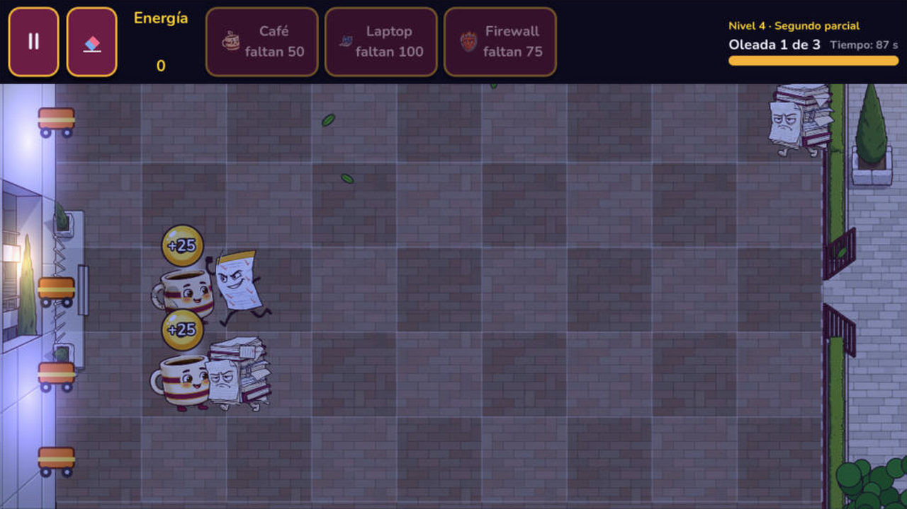
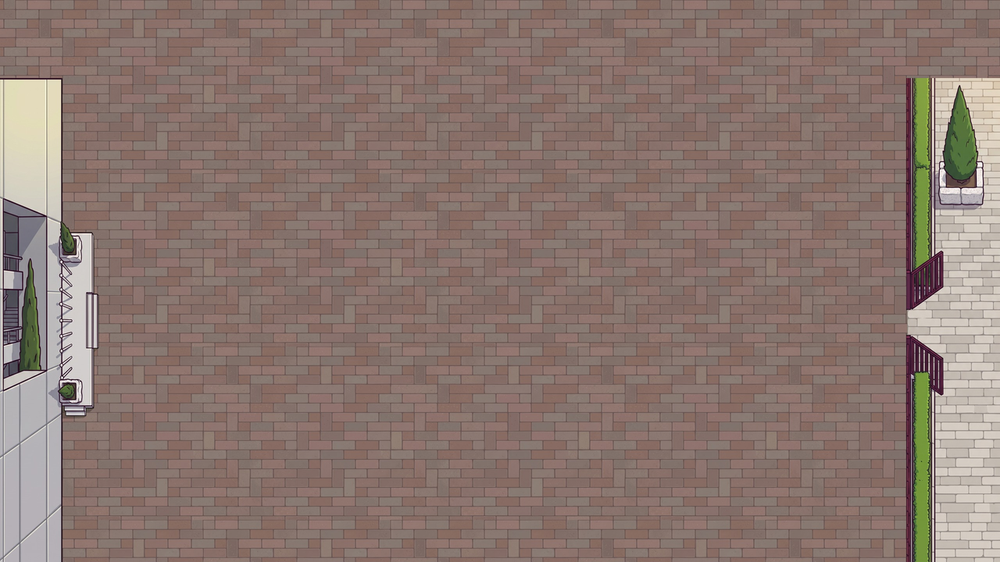
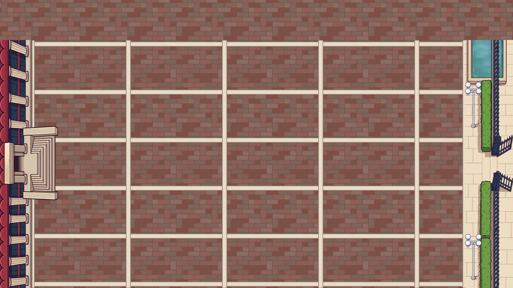

# Technical Note — v1.5 (Block 11: IPN locations and audio)

## Goal

Make each world recognizable at first sight by its place of the IPN, and make the game sound. Cards, enemies, waves and balance are unchanged.

What the player notices:

- **World 1 is the plaza in front of ESCOM** (the school building on the left, where the student is safe; the explanada is the floor of the 5 lanes; the enemies come in through the gate on the right). **World 2 is the plaza of the Biblioteca Central** (playable in Block 12; its scenery, music and map icon are already set).
- **The hour changes with the level:** morning in levels 1–2, afternoon in levels 3–5 and night for the boss (level 6), where the windows and lamps turn on little by little.
- **The scenery is alive:** two pigeons peck and sometimes fly across the screen, the shadow of a cloud slides over the plaza, leaves fall from the trees, homework sheets fly with the wind, and a branch in the foreground moves.
- **Illustrated career map:** a grass field with a curved dirt road that joins the 8 semesters; each semester shows a thumbnail of its place (ESCOM, Biblioteca Central, Estadio Wilfrido Massieu, Planetario, CENLEX, Dirección General, CIC, Auditorio de ESCOM).
- **Music:** menu, World 1, World 2, boss, victory and defeat, with a crossfade between songs. **Effects:** place, collect, shoot, hit, bite, die, Extraordinario, button and the Director's "bip" voice while he writes.
- **Vibration** when a defender is lost, when an Extraordinario runs and when the boss arrives (only on phones and only if it is on in *Ajustes*).
- **One Theme for the whole UI:** the free font **Nunito** and guinda/gold buttons with a visible pressed state.

| | |
|---|---|
|  |  |
|  | |

> **The two game backgrounds are final art**, assembled from separate pieces (see *Backgrounds built from pieces*). The loose decorations (pigeons, leaf, paper, branch), the map grass and the 8 map thumbnails are still **placeholder** shapes drawn by `tools/art_src/make_scenery_placeholders.py`; they are replaced by files with the same name and size, without touching the code.

## Node hierarchy

### Game (`scenes/game/game.tscn`) — new node `Scenery`

```
Game (Node2D)                      game.gd
├── Background (Sprite2D)          the picture of the world (WorldData.background), 2560 x 1440 at scale 0.5
├── Scenery (Node2D)               scenery.gd  ← new
│   ├── Daylight (CanvasModulate)  tint of the hour (it tints the whole game world, not the UI)
│   └── EscomScenery               instanced in code from WorldData.scenery
├── Camera, Board, Defenders, Enemies, Projectiles, Orbs, Extraordinarios, Effects
├── WaveManager, UI (CanvasLayer), DialogueBox, Tutorial
```

### A world's scenery (`scenes/scenery/escom_scenery.tscn`, `biblioteca_scenery.tscn`)

Six decorations (the limit of the plan) and the foreground. The Biblioteca scene has the same nodes; its NightLights are the dark glass of the building (Window1 … Window7) and the four-globe lamps of the walkway (Glow1 … Glow3).

```
EscomScenery (Node2D)
├── CloudShadow (Sprite2D)         drifter.gd   z 5, 16 % opacity, slides right and wraps around
├── PigeonEntry (Sprite2D)         pigeon.gd    group "day_only", on the walkway of the gate
├── PigeonRoof (Sprite2D)          pigeon.gd    group "day_only", on the roof of the building
├── Leaves (CPUParticles2D)        6 leaves falling from the trees
├── Papers (CPUParticles2D)        3 homework sheets flying from the gate to the left
├── NightLights (Node2D)           group "night_only", modulate (1.7, 1.5, 1.1) so they shine through the night tint
│   ├── FacadeLight1, FacadeLight2 blue-violet wash on the facade, as the real ESCOM at night (additive blend)
│   └── PortalLight (Sprite2D)     warm light coming out of the portal (additive blend)
└── Foreground (Sprite2D)          sway.gd      z 20, the branch in the bottom-right corner
```

## Scripts

| Script | What changed |
|---|---|
| `scripts/data/level_data.gd` | `enum TimeOfDay { MORNING, AFTERNOON, NIGHT }` and `time_of_day` (group *Look*). |
| `scripts/data/world_data.gd` | `scenery: PackedScene` (group *Look and sound*). `background`, `music` and `map_icon` are now filled. |
| `scripts/engine/scenery.gd` | **New.** `setup(world, time_of_day)`: sets the `Daylight` color, instances `world.scenery`, hides `day_only` at night and turns on `night_only` with a Tween. |
| `scripts/scenery/pigeon.gd` | **New.** Pecks (rotation Tween), and with `fly_chance` flies to `fly_offset` off-screen, waits and comes back (position Tween + wing flap by squashing `scale.y`). Only Tweens of the node: they freeze with the pause and die with the scene. |
| `scripts/scenery/drifter.gd` | **New.** Moves at `speed` px/s and wraps around the screen. |
| `scripts/scenery/sway.gd` | **New.** Looping rotation Tween of ±`degrees`. |
| `scripts/autoload/audio_manager.gd` | Constants with every song and effect; **two music players** for the crossfade; `play_jingle()` (victory/defeat start at once); `play_sfx(stream, pitch)` with a minimum gap of 0.06 s per effect and 8 players; `play_sfx_varied()` (random pitch); a click on every `BaseButton` that enters the tree (`SceneTree.node_added`, except the energy orbs). |
| `scripts/engine/game.gd` | World music at the start, boss music + 400 ms vibration when the boss enters, victory and defeat jingles, sounds for place / shoot / Extraordinario, sound + vibration when a defender dies, `scenery.setup()`. |
| `scripts/entities/enemy.gd` | Bite sound every `BITE_SOUND_TIME` (0.6 s) while it bites; death sound. |
| `scripts/entities/projectile.gd`, `energy_orb.gd` | Hit sound; collect sound on the tap. |
| `scripts/ui/dialogue_box.gd` | The typewriter is a `tween_method` (`_type_letters`) that says "bip" every 3 letters with a random pitch (0.9–1.1). |
| `scripts/ui/career_map.gd` | Draws the grass tile under the track and a curved road (`Curve2D` with horizontal handles, `tessellate()`, two polylines: border and dirt). |
| `scripts/ui/semester_button.gd` | The icon is `WorldData.map_icon` (faded while locked); a world without one keeps the book icon of its state. |
| `scripts/ui/settings.gd` | Moving the effects slider plays a sample at the new volume. |
| Menu screens (`main_menu`, `career_map`, `level_select`, `settings`, `credits`, `expediente`, `world_complete`) | `AudioManager.play_music(AudioManager.MENU_MUSIC)` in `_ready()` (it keeps playing between them). |
| `scenes/ui/ui_theme.tres` | The single Theme: Nunito Bold, Button (normal, hover, pressed, disabled, focus), Label, PanelContainer, HSlider, ProgressBar and scroll bars in guinda and gold. |

### Music flow

| Moment | Song |
|---|---|
| Any menu screen | `menu.ogg` (not restarted between screens) |
| A level starts | `WorldData.music` (World 1: `world_1.ogg`) with a 0.8 s crossfade |
| The boss enters | `boss.ogg` with crossfade |
| Victory / defeat | `victory.ogg` / `defeat.ogg` at once (they do not loop) |
| *Reiniciar* | back to the music of the world |

## Audio

All the audio is **original, made by the team with code**: `tools/audio_src/make_audio.py` (numpy + ffmpeg) synthesizes chiptune (band-limited pulse and triangle waves) with a soft bass (sine + filtered saw), a quiet pad and simple drums. Each song is a list of bars (chord + melody in `"NOTE:LENGTH"` notation), so a melody can be changed by editing text and running the script again. No downloaded audio, so there is nothing to license; the credits say so.

| File | Use | Tempo / key | Length |
|---|---|---|---|
| `audio/music/menu.ogg` | menus | 96 BPM, C major | 40 s loop |
| `audio/music/world_1.ogg` | World 1 (ESCOM) | 126 BPM, G major | 30 s loop |
| `audio/music/world_2.ogg` | World 2 (Biblioteca) | 108 BPM, D dorian | 36 s loop |
| `audio/music/boss.ogg` | boss | 150 BPM, A minor | 26 s loop |
| `audio/music/victory.ogg`, `defeat.ogg` | jingles | — | 6 s each |
| `audio/sfx/*.wav` | place, collect, shoot, hit, bite, die, extraordinario, button, director_bip | — | 0.05–0.9 s, mono |

Songs are mastered to the same loudness (about −18 LUFS) so the effects are heard on top. `AudioManager.play_music()` sets `loop = true` on the OGG it plays and `play_jingle()` sets `loop = false`, so no import setting has to be changed by hand.

## Font and Theme

`art/fonts/Nunito-Bold.ttf` (latin subset, SIL Open Font License 1.1, license in `art/fonts/OFL.txt`) is the `default_font` of `ui_theme.tres`, which `project.godot` already uses as the custom theme. Symbols that Nunito does not have (← ▸ ∞ ≥) come from the system font (`allow_system_fallback`, on by default). Screens that had their own styles (cards, eraser, *Jugar*, semester buttons, panels) keep them.

## Backgrounds built from pieces

A whole background generated in one picture never matched the board (the building was too wide, the lanes had perspective and the top bar hid the details). So each background is drawn as separate pieces and assembled by code, pixel-exact:

| Piece | ESCOM (`tools/art_src/escom/`) | Biblioteca (`tools/art_src/biblioteca/`) |
|---|---|---|
| Floor, seamless, seen from above, low contrast | `floor.jpg`: mixed reddish-gray pavers | `floor.jpg`: muted terracotta pavers |
| Left strip (9:16, on green #00FF00) | `left_strip.jpg`: the concrete block, the portal with its cypress, the platform with the flagpoles | `left_strip.jpg`: the scalloped red roof, the grooved pillars, the staircase |
| Right strip (9:16, on green) | `right_strip.jpg`: the open guinda gate, hedge, planter | `right_strip.jpg`: the open blue gate, hedges, reflecting pool |
| Loose decoration | — | `lamp.jpg`: the four-globe lamp |

`tools/art_src/compose_backgrounds.py` (numpy + Pillow) removes the green (a green shadow becomes a soft black shadow and the edges lose their green tint), repeats the floor (2 cells per tile; the ESCOM tile is cut on two joint lines so its top continues its bottom), draws the cream stone strips of the Biblioteca on every lane line and every 2 columns, and places the strips so that the facade falls exactly on the left edge of the board (x = 160) and the gate on the right edge (x = 2320). The floor is kept calm on purpose: the orange Firewall must stand out on it.

```bash
python tools/art_src/compose_backgrounds.py   # -> art/backgrounds/escom_bg.jpg, biblioteca_bg.jpg
```

## Replacing the placeholder art

The remaining placeholder pictures are replaced keeping name and size:

| File | Size |
|---|---|
| `art/scenery/pigeon_stand.png`, `pigeon_fly.png` | 96 × 80, looking left |
| `art/scenery/leaf.png`, `paper.png` | 32 × 32, 48 × 48 |
| `art/scenery/foreground_branch.png` | 420 × 300, branch from the bottom-right corner |
| `art/map/map_ground.png` | 1280 × 580, tileable left-right |
| `art/map/place_1.png` … `place_8.png` | 256 × 256 |

## Android

`Input.vibrate_handheld()` needs the **VIBRATE** permission: *Project → Export → Android → Permissions → Vibrate* (the preset is local to each laptop, it is not in the repository).

## Tests

Run in the Godot 4.7.2 editor (Windows, Compatibility renderer):

- The project opens and imports the new audio, font, backgrounds and scenery without errors; the only message in the debugger is the old warning about `GameSession.grade_for()` being static (it existed before this block).
- Inicio, Mapa de la carrera, Selección de nivel, Ajustes and Créditos use the new Theme (Nunito, guinda/gold buttons, pressed state) and the menu song keeps playing between them.
- *Primer día* (morning): the ESCOM background matches the board; pigeons, falling leaves, flying papers, the cloud shadow and the foreground branch move; placing a Café and collecting orbs works.
- *Segundo parcial* switched to night only for the test: the tint is blue, the pigeons hide, the blue-violet facade light and the portal light turn on after the Director talks; an Extraordinario ran, two Cafés were bitten and died, and wave 2 started, with no errors.
- World 2 is not playable yet (Block 12); its background was checked as a picture.

Pending on a phone: hearing the effects and the vibration (VIBRATE permission in the Android preset).
