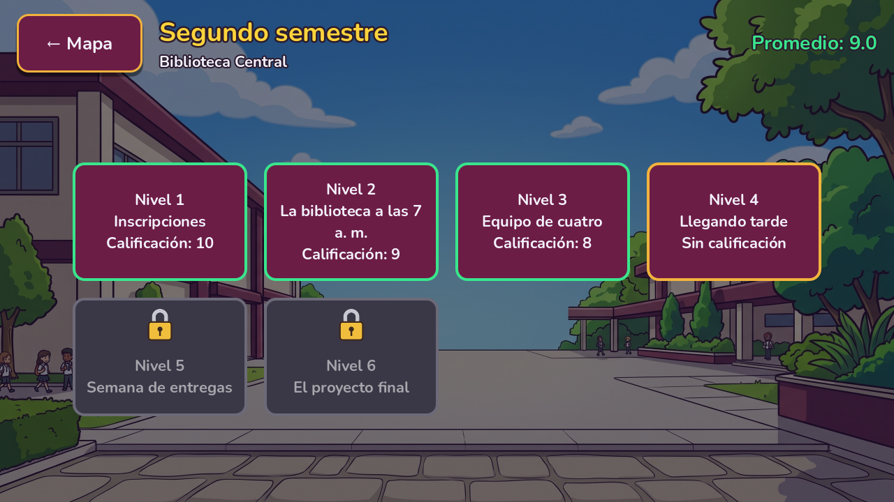
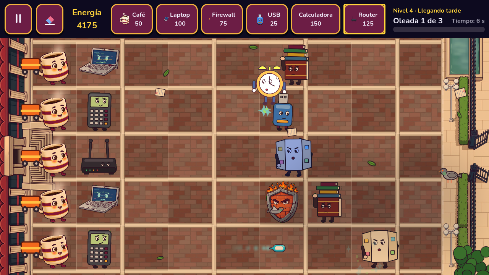
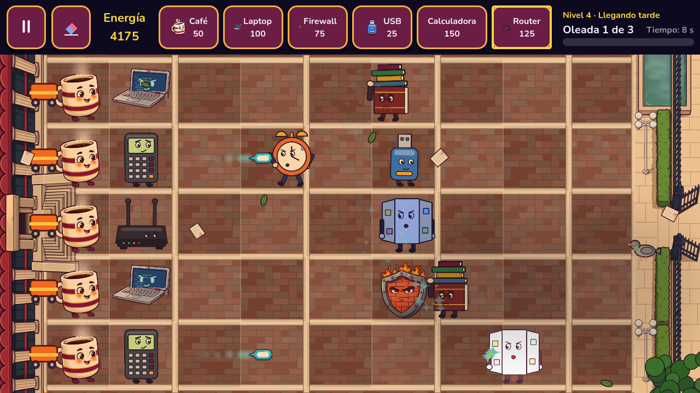
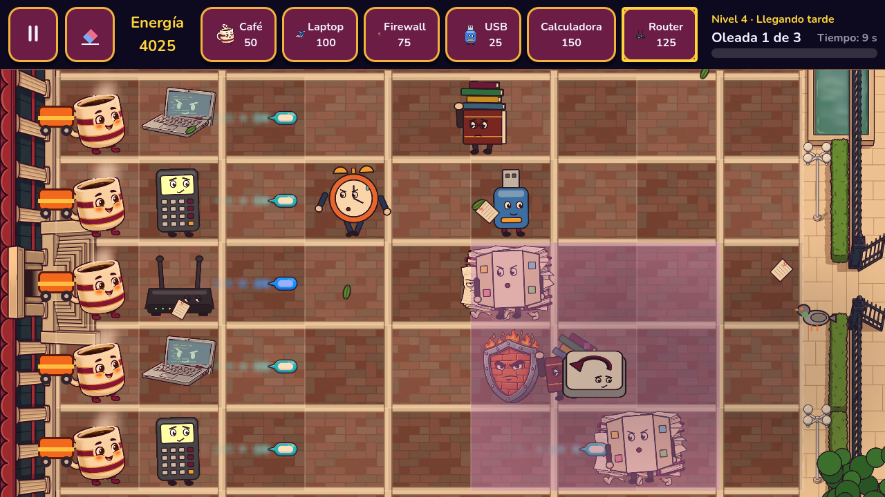
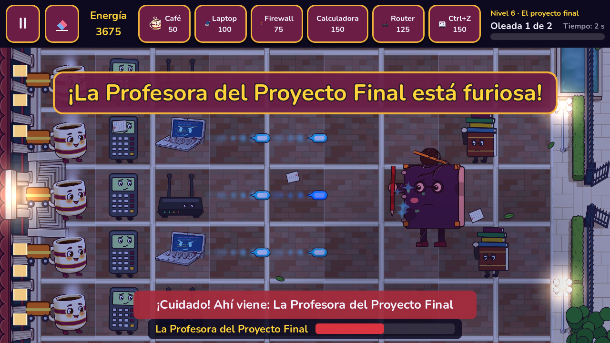
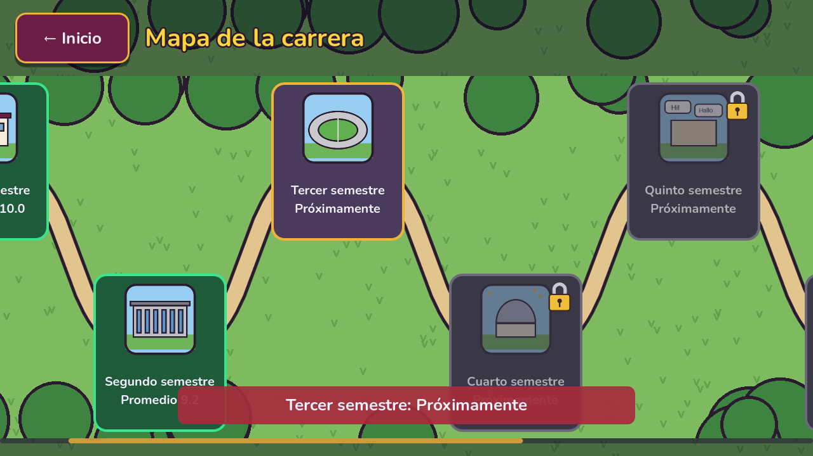
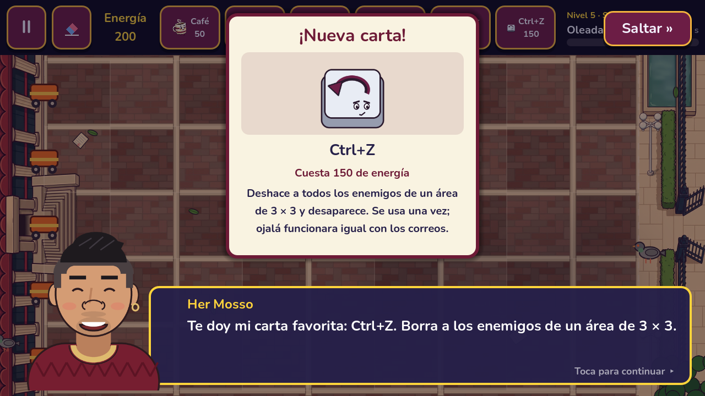
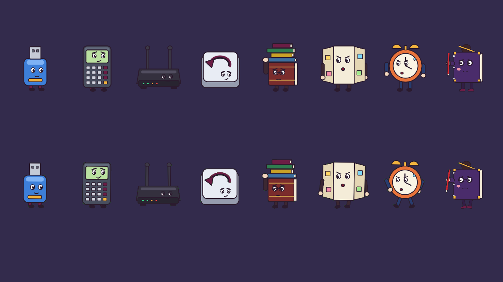
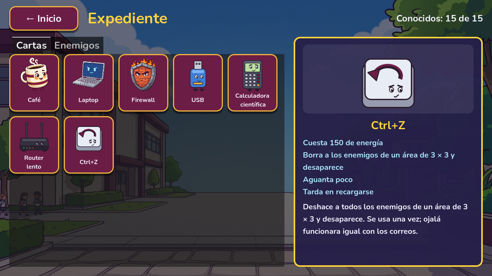
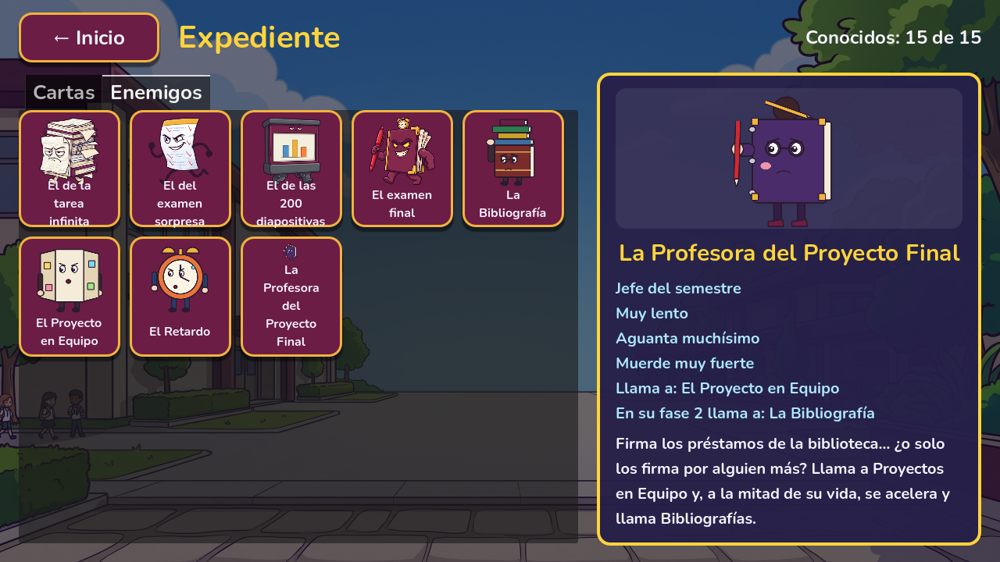

# Technical Note — v1.6 (Block 12: World 1 with 6 levels and World 2)

## Goal

Have **12 playable levels** and prove that the content grows with data: World 2 (*Segundo semestre*, Biblioteca Central) is made of `.tres` files, and the only new script is one new behaviour (`InstantDefender`).

What the player notices:

- **World 2 is playable** after World 1: six levels in the plaza of the Biblioteca Central (morning, afternoon, night for the boss), with the Director's conversations and the clue that leads to the *Sínodo*.
- **Four new cards:** **USB** (cost 25, a cheap wall), **Calculadora científica** (150, shoots every 0.75 s, weaker shots), **Router lento** (125, its shots slow the enemy to half speed for 3 s; slowed enemies are tinted blue) and **Ctrl+Z** (150, after 0.5 s it erases the enemies of a 3 × 3 area with a purple flash and disappears).
- **Three new enemies:** **La Bibliografía** carries a pile of books that takes the damage first and falls when it breaks; **El Proyecto en Equipo** splits into two *Tareas infinitas* when it is defeated ("los que no trabajaron"); **El Retardo** jumps over the first defender it meets.
- **The boss *La Profesora del Proyecto Final*** calls Proyectos en Equipo; at half health she gets furious (red, bigger, banner "¡La Profesora del Proyecto Final está furiosa!"), walks 1.5 times faster and calls Bibliografías.
- **World 3 opens after World 2 and says *Próximamente*:** its button loses the padlock and a tap says "Tercer semestre: Próximamente"; worlds 4–8 stay locked. *Semestre aprobado* of World 2 says the same.
- **Expediente:** 7 cards and 8 enemies, with their descriptions and the new abilities in words ("Trae armadura", "Al caer se divide en 2", "Salta a tu primer defensor", "En su fase 2 llama a: La Bibliografía").

| | |
|---|---|
|  |  |
|  |  |
|  |  |
|  |  |
|  |  |

> **The art of the 8 new characters is placeholder.** `tools/art_src/make_world2_placeholders.py` draws them in the style of the 1.0 art (flat colours, thick dark outline, a face; no text inside the images, so Ctrl+Z is an "undo" arrow) and lays out their pieces as "vista desarmada" sheets in 3 damage stages; `tools/cut_parts.py` cuts them like real sheets. When the real art (tandas 3–4 of plan section 7.3) arrives, it replaces `tools/art_src/<character>/*.png`, `art/defenders|enemies/<character>.png` and the strips, without touching code.

## World 1 with 6 levels (decision)

Plan item 1 (World 1 with *Primer día* as level 1 and the five 1.0 levels as levels 2–6) **was already done in v1.1** (Block 7), together with the save migration, and Block 9 turned *Primer día* into the guided tutorial. v1.6 keeps it as it is:

- Level ids: `w1_l1` *Primer día* … `w1_l6` *El examen final*. Grades are saved by id (`grade_w1_l3`), so nothing moves again.
- 1.0 saves (no `[meta]`): `current_level` and `unlocked_level` + 1 (old level N → new level N + 1); levels won in the 1.0 get grade 6 (v1.2); a finished World 1 is marked completed (it opens World 2).
- **Primer día after a migration:** it is open and playable, but it gets **no grade**, because the player never played it (the brief suggested counting it as passed). This keeps the v1.1/v1.2 behaviour that every 1.1–1.5 player already went through; the world average only counts the levels with a grade, so it is not lowered.
- World 2 needs **no new migration**: the save format stays version 3, and `[world_2]` simply appears when its first level is won. A v1.5 save that finished World 1 opens World 2 at level 1.

## Data (World 2)

```
data/
├── defenders/  usb.tres (now with art), calculadora.tres, router.tres, ctrl_z.tres
├── enemies/    bibliografia.tres, proyecto_equipo.tres, retardo.tres, profesora.tres
├── dialogues/  w2_intro, w2_l1_intro … w2_l6_intro, w2_l6_outro, w2_outro (.tres)
└── worlds/world_2/
    ├── world_2.tres          available = true, 6 levels, intro/outro dialogues
    └── levels/w2_l1.tres … w2_l6.tres
```

### Cards

| Card | Behaviour | Cost | Health | Cooldown | Numbers |
|---|---|---|---|---|---|
| USB | `BlockerDefender` | 25 | 600 | 10 s | — |
| Calculadora científica | `ShooterDefender` | 150 | 300 | 7.5 s | `fire_interval` 0.75, `projectile_damage` 12 (16 per s; Laptop 13.3) |
| Router lento | `ShooterDefender` | 125 | 300 | 7.5 s | `fire_interval` 1.5, `projectile_damage` 15, `slow_factor` 0.5, `slow_time` 3 |
| Ctrl+Z | `InstantDefender` | 150 | 300 | 30 s | `area_radius` 1 (3 × 3), `area_damage` 1800, `trigger_delay` 0.5 |

### Enemies

| Enemy | Health | Speed (cells/s) | Bite (per s) | Ability |
|---|---|---|---|---|
| La Bibliografía | 200 + **150 armor** | 0.20 | 25 | `armor_health` 150 |
| El Proyecto en Equipo | 350 | 0.18 | 30 | `split_into` Tarea infinita, `split_count` 2 |
| El Retardo | 220 | 0.30 | 25 | `jumps_first_defender` |
| La Profesora del Proyecto Final | 3000 | 0.10 → 0.15 | 50 | boss; `summon_type` Proyecto en Equipo every 16 s (lanes above and below); `phase2_speed_multiplier` 1.5, `phase2_summon_type` Bibliografía |

### Levels

| # | Level | Cards | New | Waves (enemies) | Start energy | Hour |
|---|---|---|---|---|---|---|
| 1 | Inscripciones | Café, Laptop, Firewall, USB | La Bibliografía, USB | 2 (5 + 8) | 150 | morning |
| 2 | La biblioteca a las 7 a. m. | + Calculadora | Calculadora científica | 2 (6 + 10) | 150 | morning |
| 3 | Equipo de cuatro | the same 5 | El Proyecto en Equipo | 3 (4 + 6 + 9) | 150 | afternoon |
| 4 | Llegando tarde | + Router lento (6) | El Retardo, Router lento | 3 (5 + 7 + 11) | 150 | afternoon |
| 5 | Semana de entregas | Café, Laptop, Firewall, Calculadora, Router, Ctrl+Z | Ctrl+Z, everything | 3 (6 + 9 + 14) | 200 | afternoon |
| 6 | El proyecto final | the same 6 | the boss | 1 (9) + boss | 250 | night |

Every World 2 level uses Extraordinarios. `reward_card` is empty: each new card is presented by the Director at the start of its level (`show_card`), as the dialogue scripts say.

## Scripts

| Script | What changed |
|---|---|
| `scripts/entities/instant_defender.gd` + `scenes/entities/instant_defender.tscn` | **New.** `InstantDefender extends Defender`. A one-shot `TriggerTimer` (pausable) waits `trigger_delay`; `trigger()` hits every live enemy with `is_in_area()` (lanes ± `area_radius`, columns ± `area_radius` + 0.5) with `area_damage` (armor first, as any hit), adds a fading `Polygon2D` over the area and sparks to `Effects`, emits `used(defender, hits)` and frees itself (its puppet falls apart in `Effects`). |
| `scripts/entities/shooter_defender.gd` | Passes `slow_factor` and `slow_time` of its `DefenderType` to the projectile. |
| `scripts/entities/projectile.gd` | `setup()` takes the slow-down (optional, default 1.0 / 0 s); a slowing projectile is blue and calls `enemy.apply_slow()` before the damage. |
| `scripts/entities/enemy.gd` | `apply_slow(factor, seconds)`: `current_speed()` = speed × `speed_multiplier` (boss phase 2) × `slow_multiplier`; slows do not stack (the slowest factor is kept, the time restarts); blue tint on `Visual`. **Split:** `_split()` before `died`, `split_count` × `summon_requested(split_into, lane, column ± 0.35)` — the same signal and the same `Game.spawn_enemy()` as the boss's summons, so the wave is never empty in between. **Jump:** the first time it touches a defender, `_jump_over()` moves `column` to the defender's column − 1 with a Tween (0.5 s) and an arc of `Visual` (70 px); it does not bite in the air and never jumps again. `jumped` signal. **Phase 2 summon:** `current_summon_type()`. |
| `scripts/engine/game.gd` | Connects `InstantDefender.used` (frees the cell if it is still its own, sound, small camera shake; no vibration because it is not a loss). Phase 2 banner = `EnemyType.phase2_text`, or the old "¡X está furioso!". |
| `scripts/data/defender_type.gd` | `area_damage` (1800) and `trigger_delay` (0.5) in the group *Instant*; `card_name`, a short name for the card of the top bar ("Calculadora", "Router"; empty = `display_name`). |
| `scripts/ui/defender_card.gd` | Shows `card_name`; a compact card clips its text with an ellipsis instead of growing. Since v1.5 (Nunito) a long name made a compact card wider, and with 6 cards the level name and time at the right of the top bar were cut off. |
| `scripts/data/enemy_type.gd` | `phase2_summon_type` and `phase2_text`. The other ability fields (`armor_health`, `split_into`, `split_count`, `jumps_first_defender`, `phase2_speed_multiplier`) were added in v1.1 and are now used. |
| `scripts/autoload/game_session.gd` | `is_world_coming_soon(index)`: not built yet (`available = false` or no levels) and the previous world completed. |
| `scripts/ui/semester_button.gd`, `career_map.gd` | New state `COMING_SOON`: no padlock, its own colours, "Próximamente"; a tap shows the same "Tercer semestre: Próximamente" notice as before (the world still cannot be entered). |
| `scripts/ui/expediente.gd` | Card action for instant cards and for shooters that slow; enemy summary lines for armor, split, jump and the phase 2 summon. |
| `tools/art_src/make_world2_placeholders.py` | **New.** Placeholder art and sheets of the 8 characters (reuses `damage()` of `make_placeholder_sheets.py`). |

### Puppets (`scenes/visuals/`)

Built like the v1.4 ones (one `Sprite2D` per piece on its pivot, `AnimationPlayer` with the fixed names and a `RESET`):

| Scene | Pieces | Animations |
|---|---|---|
| `usb_visual` | Body, Plug, LegL, LegR | idle, hit, die |
| `calculadora_visual` | Body, Screen (flashes when it shoots), LegL, LegR | idle, action, hit, die |
| `router_visual` | Body, AntennaL, AntennaR | idle (slow wobble), action, hit, die |
| `ctrl_z_visual` | Key, Arrow (spins back when it goes off) | idle, action, hit, die |
| `bibliografia_visual` | Body, **Armor** (the pile of books, dropped by `armor_broken`), Arm, LegL, LegR | idle, walk, attack, hit, die |
| `proyecto_equipo_visual` | Body (trifold board), ArmL, ArmR, LegL, LegR | idle, walk, attack, hit, die |
| `retardo_visual` | Body (alarm clock), Bells, ArmL, ArmR, LegL, LegR | idle, walk, attack, **jump**, hit, die |
| `profesora_visual` | Body (binder), Bun, ArmPen, LegL, LegR | idle, walk, attack, hit, die |

## Balance

Method: the test bots of the 1.0 (not part of the repository), rewritten for 6 cards. Both play every level from the start with the real energy, the real waves and the real card cooldowns: the **fast bot** collects each orb 1 s after it appears and does one action every 0.75 s; the **slow bot** waits 2.5 s for orbs and 1.5 s between actions. Their plan is the one a player follows: a Café per lane, a shooter in every lane that has enemies (more in the busy ones), a wall in front, the cheap USB as bait for El Retardo, Ctrl+Z on a crowd or on an enemy that is about to arrive, and the spare energy into more shooters. The grade is the game's: 10 minus one point per Extraordinario.

| Level | Fast bot | Slow bot |
|---|---|---|
| W1-1 Primer día | Win, 10 | Win, 10 |
| W1-2 Inicio de semestre | Win, 10 | Win, 10 |
| W1-3 Primer parcial | Win, 10 | Win, 10 |
| W1-4 Segundo parcial | Win, 10 | Win, 10 |
| W1-5 Tercer parcial | Win, 10 | Win, 10 |
| W1-6 El examen final | Win, 10 | Win, 9 |
| W2-1 Inscripciones | Win, 10 | Win, 8 |
| W2-2 La biblioteca a las 7 a. m. | Win, 9 | Win, 8 |
| W2-3 Equipo de cuatro | Win, 9 | Win, 9 |
| W2-4 Llegando tarde | Win, 8 | Win, 8 |
| W2-5 Semana de entregas | Win, 8 | Win, 9 |
| W2-6 El proyecto final | Win, 9 | Win, 8 |

Both bots win the 12 levels and the slow bot never gets less than 8 (the plan asks for 7 or more). World 2 is harder than World 1 on purpose: the bots need 1–2 Extraordinarios in most of its levels, while World 1 is won almost always with 10.

How the numbers were reached (all changes are in the `.tres` files, no script): the first proposal (Bibliografía with 300 armor, Proyecto with 450 health, Retardo at 0.32, waves of 6–18 enemies, boss with 4000 health calling every 12 s) was too hard: the fast bot lost levels 2, 5 and 6. Then the armor went down to 150, the Proyecto to 350 health and 0.18 cells/s, the Retardo to 220 health and 0.30, and each wave lost about a quarter of its enemies, with more seconds between them. The boss level got 250 start energy, a first wave of 9 and a boss with 3000 health, 50 bite, a summon every 16 s and 1.5× speed in phase 2. *Semana de entregas* was the last level on the edge: its start energy went from 175 to 200 and its waves got a bit more spaced (first wave at 40 s).

## Scalability test

Done as an automated test (QA phase *16x*, outside the repository), with **no script changed**: the test creates a `LevelData` *Nivel de prueba* (2 cards, 1 wave with a Tarea and a Retardo) and a `WorldData` *Tercer semestre (prueba)* with one level, **saves them as `.tres` files** with `ResourceSaver` (the same files the Inspector makes), loads them back, appends the level to `world_2.levels` and puts the world in the place of World 3 in `campaign.tres` (in memory). Result: the level select of World 2 shows 7 levels; level 7 is played and won and its grade is saved as `grade_w2_l7_test`; winning it completes World 2, the career map shows the test World 3 open, its level select shows 1 level, and winning it completes World 3. The test files are not shipped in the campaign. The same steps in the editor are in the README (*Adding a level / Adding a world*).

## Android

Android preset (local to each laptop): version/name `1.6`, version/code `7`. No new permission.

## Tests

QA ran on the branch worktree with Godot 4.7.2 (headless, Windows), on copies of the project with their own user data folder (`override.cfg` with a custom user dir), so no real progress file was touched. The test scripts stay outside the repository, like in the previous blocks.

| Suite | Result |
|---|---|
| Phases of Blocks 1–10 and the v1.3 fixes (1, 2, 3, 5, 6, 7, 8, 9a/b, 10a/b, 11, 11a/b, 12, 12b, 13, 13b) + `qa_v04` | **630 / 630**. 17 checks were adapted because the flow changed on purpose: version 1.6 (3 checks); two music players and a click sound on every button since v1.5; the passed semester shows its map icon since v1.5; a compact card can be up to 130 px with the v1.5 font; World 2 is available (locked as *Bloqueado* until World 1 is passed, then Inicio shows *Segundo semestre · Nivel 1*); 20 dialogue files and 7 cards in the Expediente; the USB now has art and a puppet (the letter placeholder is tested on a copy without them). |
| Phase 16 — Block 12 | **88 / 88**: World 1 with 6 levels and the tutorial first; World 2 data (names, ids, cards, dialogues, presentations, boss at night); save migration (a 1.0 save moves +1 with grade 6 and *Primer día* open without grade; a v1.5 save is kept as it is and opens World 2 at level 1; World 2 grades saved by id); career map and level select of World 2; the top bar of the 6-card levels fits on the screen; Ctrl+Z (waits 0.5 s, erases the 3 × 3 area, armor included, hurts the boss by `area_damage`, frees its cell); shooter numbers read from the resource (0.75 s / 12, 15 + slow, 20); the "lag" (half speed, blue tint, ends after 3 s, does not stack); armor; split (2 Tareas in its column, the wave does not end early); jump (over the first defender only, lands one column beyond, the next defender is bitten); boss phases (Proyectos, then at 50 % faster and Bibliografías, banner); World 3 *Próximamente* after World 2 (button, notice, *Semestre aprobado*); Expediente (7 + 8 entries, descriptions, abilities in words). |
| Phase 16p — scripted playthrough | **49 / 49**: the 12 levels played in a row from Inicio through the real menus and the real waves (with plenty of energy), *Semestre aprobado* of both worlds, World 3 cannot be entered and says *Próximamente*. |
| Phase 16x — scalability | **11 / 11** (see *Scalability test*). |
| Balance bots | fast **12 / 12** wins; slow **12 / 12** wins with grade ≥ 8 (see *Balance*). |

Screenshots were taken in a window (1280 × 720) by the same runner.

Pending on a phone: the 50 fps test of Block 10 with the new puppets on screen.
